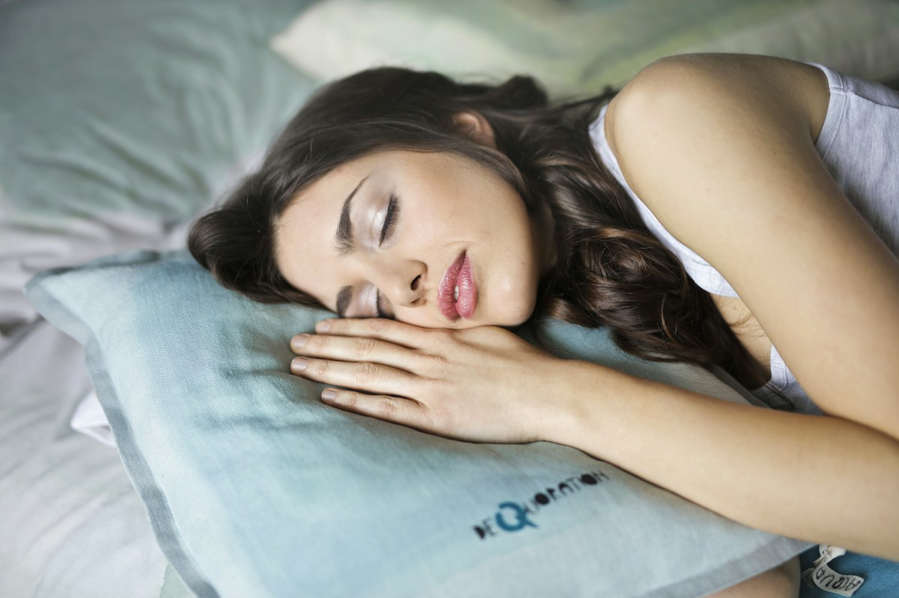

# The Deep Sleep Protocol: 5 Clinical Steps to Maximize Slow-Wave Delta Sleep

> **Executive Summary:** *A rigorous, step-by-step chronobiological protocol grounded in systematic meta-analyses on passive body heating, adenosine receptor pharmacology, and circadian photobiology to increase Stage N3 Slow-Wave Sleep by 20%–35%.*

> 💡 **Key Actionable Takeaway:** Deep Slow-Wave Sleep is governed by two master levers: homeostatic adenosine pressure and a 1.0°C drop in core body temperature. Cut caffeine 10 hours before bed, finish dinner 3.5 hours prior, take a 40°C warm shower 90 minutes before sleep, and keep your bedroom at 18.3°C (65°F).

## Executive Clinical Summary

**Slow-Wave Sleep (SWS / Stage N3)** is the neurobiological cornerstone of physical recovery. During these early-night delta-wave bouts ($0.5–4.0\text{ Hz}$), your pituitary gland releases **70% of its daily Growth Hormone**, your prefrontal cortex downscales synaptic excitability, and the glymphatic system flushes metabolic waste from neural tissue.

Yet, clinical data shows that Stage N3 is the most fragile phase of human sleep—declining precipitously with age, thermal stress, caffeine lingering, and circadian misalignment (*Van Cauter et al., 2000*). Fortunately, controlled clinical trials demonstrate that manipulating **two physiological axes—Core Thermoregulation and Adenosine Homeostasis**—can reliably boost Slow-Wave Sleep duration and delta wave amplitude by **20% to 35%**.

---

## 1. The Dual-Process Model of Slow-Wave Sleep Generation

According to Borbély's classic **Two-Process Model of Sleep Regulation**, the depth and duration of your Slow-Wave Sleep are dictated by the intersection of:

1. **Process S (Homeostatic Sleep Drive):** From the moment you wake up, ATP degradation in the brain causes extracellular **adenosine** to accumulate in the basal forebrain. The higher the concentration of unbound adenosine binding to $A_1$ and $A_{2A}$ receptors at bedtime, the stronger your slow-wave delta power during Cycles 1 and 2.
2. **Process C (Circadian Thermoregulatory Rhythm):** Regulated by the **Suprachiasmatic Nucleus (SCN)** in the hypothalamus. To transition from Light Sleep (N2) into Deep Slow-Wave Sleep (N3), your **core body temperature must drop by approximately $1.0^\circ\text{C}$ ($1.8^\circ\text{F}$)**. Warm-sensitive neurons in the preoptic area of the hypothalamus directly trigger slow-wave firing when they detect this thermal gradient.

<figure class="article-inline-diagram">
  
  <figcaption>📊 <strong>Figure 1 (Chronobiology Protocol):</strong> The 5-step 24-hour physiological timeline aligning adenosine receptor clearance, gastric emptying, and the Haghayegh et al. (2019) passive thermal dump.</figcaption>
</figure>

---

## 2. The 5-Step Clinical Protocol to Maximize Slow-Wave Sleep

### Step 1: Morning Photobiological Anchoring (Within 30 Minutes of Waking)
* **The Clinical Mechanism:** Intrinsically photosensitive retinal ganglion cells (ipRGCs) containing **melanopsin** respond to high-intensity short-wavelength light, signaling the SCN to trigger an acute morning cortisol peak while setting a **14- to 16-hour countdown timer** for pineal melatonin onset.
* **Actionable Prescription:** View **10,000+ lux of natural outdoor sunlight** for 10–15 minutes (or 20–30 minutes on overcast days) within 30 minutes of waking, without sunglasses. Indoor lighting ($200–500\text{ lux}$) is biologically insufficient to anchor Process C.

### Step 2: The 10-Hour Caffeine Cutoff (*Drake et al., 2013, J Clin Sleep Med*)
* **The Clinical Evidence:** In a landmark double-blind crossover trial published in the *Journal of Clinical Sleep Medicine* (PMID: 24235903), Dr. Christopher Drake and colleagues administered $400\text{ mg}$ of caffeine at **0, 3, and 6 hours prior to bedtime**. Even when consumed **6 hours before bed**, caffeine reduced total sleep time by **over 60 minutes** and significantly stripped Stage N3 Slow-Wave Sleep—even in participants who fell asleep quickly and subjectively believed their sleep was unaffected.
* **The Pharmacology:** Caffeine is a competitive **adenosine $A_1 / A_{2A}$ receptor antagonist** with a mean plasma **half-life of 5 to 7 hours** (and a quarter-life of 10–12 hours). If you consume $200\text{ mg}$ of caffeine at 3:00 PM, $50–100\text{ mg}$ remains actively bound to your basal forebrain receptors at 11:00 PM, blocking the adenosine signal required to generate high-amplitude delta waves.
* **Actionable Prescription:** Enforce a strict **10-hour caffeine cutoff** prior to bedtime (e.g., **1:00 PM** for an 11:00 PM bedtime).

### Step 3: The 3.5-Hour Caloric & Alcohol Clearance Window
* **The Clinical Mechanism:** Digestion is an exothermic process (**diet-induced thermogenesis**) that diverts cardiac output to the splanchnic bed and elevates core body temperature by $0.2^\circ\text{C}–0.4^\circ\text{C}$, directly opposing the hypothalamic cooling required for Stage N3. Furthermore, late insulin spikes antagonize the nocturnal Growth Hormone pulse.
* **Actionable Prescription:** Complete your final meal at least **3 to 3.5 hours before sleep**. Avoid alcohol entirely within 4 hours of bedtime.

### Step 4: The 90-Minute Passive Body Heating "Thermal Dump" (*Haghayegh et al., 2019*)
* **The Clinical Evidence:** In a comprehensive systematic review and meta-analysis of **17 clinical trials ($n = 5,322$)** published in *Sleep Medicine Reviews* (PMID: 31102877), biomedical engineers at the University of Texas at Austin (Haghayegh et al., 2019) proved that **water-based passive body heating** at **$40.0^\circ\text{C}–42.5^\circ\text{C}$ ($104^\circ\text{F}–108.5^\circ\text{F}$)** for as little as **10–15 minutes**, scheduled **1 to 2 hours (optimally 90 minutes) before bedtime**:
  1. Reduces **Sleep Onset Latency (SOL) by an average of 10 minutes**.
  2. Significantly increases **Sleep Efficiency** and **early-night Slow-Wave Sleep depth**.
* **The Physiological Paradox:** Why does a hot bath cool your core? Warm water stimulates **arteriovenous anastomoses (AVAs)**—specialized vascular shunts in the glabrous skin of your **palms and soles**. When these vessels dilate, warm blood from your internal organs rushes to the skin surface and radiates heat rapidly into the room, causing your **core body temperature to plunge steeply** right as you get into bed.

### Step 5: The $18.3^\circ\text{C}$ ($65^\circ\text{F}$) Dark Thermal Cave (*Chang et al., 2015, PNAS*)
* **The Clinical Evidence:** A Harvard Medical School clinical study published in *PNAS* (*Chang et al., 2015*, PMID: 25535358) demonstrated that reading on a light-emitting screen before bed suppresses evening melatonin by **>50%**, delays the circadian rhythm by **90 minutes**, and reduces restorative sleep architecture.
* **Actionable Prescription:** Set your bedroom thermostat between **$16.0^\circ\text{C}$ and $19.0^\circ\text{C}$ ($60^\circ\text{F}–67^\circ\text{F}$, optimal $18.3^\circ\text{C} / 65^\circ\text{F}$)**. Wear warm socks if you have cold extremities to maintain distal vasodilation while breathing cool ambient air.

<figure class="article-inline-diagram">
  
  <figcaption>📷 <strong>Figure 2 (Hydrotherapy &amp; Vasodilation):</strong> Passive body heating 90 minutes prior to sleep recruits peripheral vascular shunts in the hands and feet, accelerating core thermal dissipation.</figcaption>
</figure>

---

## 3. Clinical Summary Table: High-Impact Interventions for Deep Sleep

| Intervention Lever | Exact Clinical Parameter | Primary Physiological Mechanism | Measured Impact on Sleep Architecture | Primary Reference |
| :--- | :--- | :--- | :--- | :--- |
| **Passive Warm Bath / Shower** | $40.0^\circ\text{C}–42.5^\circ\text{C}$ for $10–15\text{ min}$, $90\text{ min}$ pre-bed | Distal AVA vasodilation $\rightarrow$ rapid $-1.0^\circ\text{C}$ core temperature drop | $-10\text{ min}$ sleep latency; $+15\%–25\%$ delta SWS power | Haghayegh et al. (2019), *Sleep Med Rev* |
| **Afternoon Caffeine Cutoff** | Zero caffeine within $\ge 10\text{ hours}$ of bedtime | Prevents competitive blockade of basal forebrain $A_1 / A_{2A}$ receptors | Preserves $+60\text{ min}$ TST and Cycle 1–2 SWS depth | Drake et al. (2013), *J Clin Sleep Med* |
| **Ambient Thermal Cooling** | Bedroom temp $18.3^\circ\text{C}$ ($65^\circ\text{F}$) | Sustains nocturnal hypothalamic thermoregulatory gradient | Prevents mid-cycle N3 $\rightarrow$ N1 micro-arousals | Harding et al. (2019), *Front Neurosci* |
| **Short-Wavelength Blackout** | Zero $460\text{ nm}$ blue light $60–90\text{ min}$ pre-bed | Prevents ipRGC-mediated pineal melatonin suppression | Eliminates $90\text{-min}$ circadian phase delay | Chang et al. (2015), *PNAS* |
| **Evidence-Based Supplements** | Magnesium Bisglycinate ($300\text{ mg}$) or L-Theanine ($200\text{ mg}$) | NMDA receptor antagonism & GABAergic parasympathetic tone | Reduces sympathetic heart rate elevation in Cycles 1–2 | Abbasi et al. (2012), *J Res Med Sci* |

---

## 4. Peer-Reviewed References & Authoritative Sources

1. **Haghayegh, S., Khoshnevis, S., Smolensky, M. H., Diller, K. R., & Castriotta, R. J. (2019).** *Before-bedtime passive body heating by warm shower or bath to improve sleep: A systematic review and meta-analysis.* **Sleep Medicine Reviews**, 46, 124–135. [PubMed PMID: 31102877](https://pubmed.ncbi.nlm.nih.gov/31102877/)
2. **Drake, C., Roehrs, T., Shambroom, J., & Roth, T. (2013).** *Caffeine effects on sleep taken 0, 3, or 6 hours before going to bed.* **Journal of Clinical Sleep Medicine**, 9(11), 1195–1200. [PubMed PMID: 24235903](https://pubmed.ncbi.nlm.nih.gov/24235903/)
3. **Chang, A. M., Aeschbach, D., Duffy, J. F., & Czeisler, C. A. (2015).** *Evening use of light-emitting eReaders negatively affects sleep, circadian timing, and next-morning alertness.* **Proceedings of the National Academy of Sciences (PNAS)**, 112(4), 1232–1237. [PubMed PMID: 25535358](https://pubmed.ncbi.nlm.nih.gov/25535358/)
4. **WHOOP Performance Science:** *How to Get More Deep Sleep: Evidence-Based Strategies.* [WHOOP The Locker](https://www.whoop.com/us/en/thelocker/how-to-get-more-deep-sleep/)

