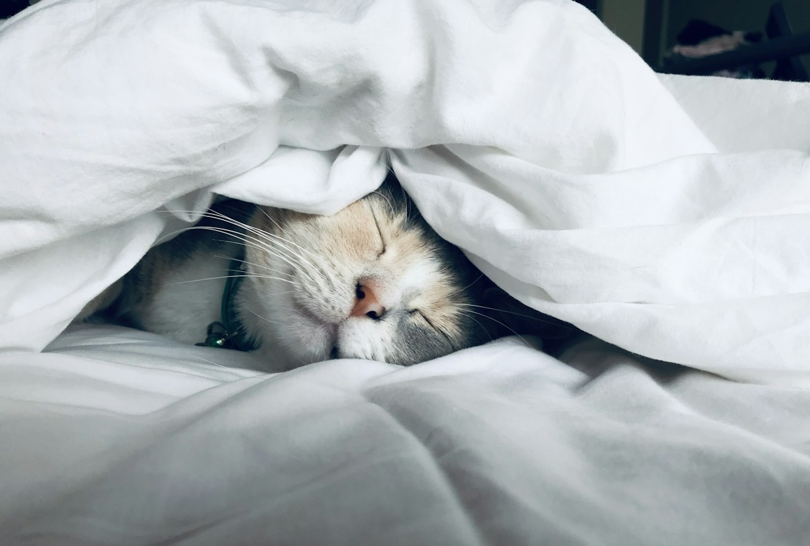

# Decoding Your Sleep Score: How Multi-Parametric Wearable Algorithms Evaluate Rest

> **Executive Summary:** *An evidence-based clinical breakdown of how modern wrist-worn wearables combine optical photoplethysmography (PPG) and 3-axis accelerometry to quantify sleep architecture, autonomic dipping, and nightly restoration on a 0–100 scale.*

> 💡 **Key Actionable Takeaway:** Time in bed does not equal restorative sleep. To consistently score above 85, prioritize a 3-hour pre-bedtime caloric and alcohol cutoff so your overnight heart rate drops at least 10–15% below your daytime resting baseline for >85% of the night.

## Executive Clinical Summary

For decades, evaluating human sleep quality required an overnight stay in a clinical sleep laboratory wired to a **Polysomnography (PSG)** rig—measuring brainwaves via electroencephalography (EEG), eye movements via electrooculography (EOG), and skeletal muscle tone via electromyography (EMG). Today, modern wrist-worn wearables synthesize millions of longitudinal biometric data points into a single daily metric: the **Sleep Score (0–100)**.

Understanding how this algorithm weighs duration against physiological restoration allows you to move beyond simply "spending 8 hours in bed" and actively engineer deeper cellular and autonomic recovery.

---

## 1. The Multi-Parametric Algorithm: How 100 Points Are Calculated

Clinical validation studies conducted by **Fitbit Research** (*Beattie et al., 2017, Physiological Measurement*) and guidelines from the **American Academy of Sleep Medicine (AASM)** establish that sleep quality cannot be captured by duration alone. Instead, consumer wearable algorithms partition the 100-point Sleep Score into three distinct physiological pillars:

### Pillar I: Sleep Duration & Efficiency (50 Points)
* **Total Sleep Time (TST):** Evaluates actual time asleep against your age-adjusted biological requirement (typically **7.0 to 9.0 hours** for healthy adults, per the *AASM & Sleep Research Society Consensus Statement*, Watson et al., 2015).
* **Sleep Efficiency (SE):** Calculated as $\text{SE} = (\text{Total Sleep Time} / \text{Total Time in Bed}) \times 100$. Clinically healthy sleep efficiency exceeds **85%**. Frequent micro-arousals or prolonged **Sleep Onset Latency (SOL > 30 minutes)** penalize this pillar even if you remain in bed for 9 hours.

### Pillar II: Deep (N3) & REM Architecture (25 Points)
* Rather than relying on scalp electrodes, wearables leverage **autonomic nervous system (ANS) signatures** that accompany each brainwave stage.
* **Slow-Wave Sleep (Deep / Stage N3):** Characterized by highly regular respiratory rates, minimal physical movement, and stable parasympathetic vagal dominance. Optimal allocation is **15%–20%** of total sleep time (approx. 70–110 minutes).
* **REM Sleep (Rapid Eye Movement):** Identified by skeletal muscle atonia (zero accelerometer movement) paired with sudden, irregular fluctuations in heart rate and beat-to-beat variability driven by vivid dream activity. Optimal allocation is **20%–25%** of total sleep time (approx. 90–120 minutes).

### Pillar III: Autonomic Restoration & Nocturnal Dipping (25 Points)
* This is the most sensitive differentiator between a "72 Fair" and a "92 Optimal" score. The algorithm continuously compares your **sleeping heart rate** against your **daytime清醒 resting heart rate (RHR)** alongside **WASO (Wake After Sleep Onset)**.
* In a truly restorative night, cardiovascular demand drops precipitously, allowing sleeping heart rate to remain **below daytime resting baseline for 85%–95% of the night**.

<figure class="article-inline-diagram">
  
  <figcaption>📊 <strong>Figure 1 (Clinical Telemetry):</strong> Breakdown of the 100-point wearable Sleep Score algorithm alongside the nocturnal heart rate "Hammock Curve" vs. non-dipping sympathetic elevation (Adapted from Beattie et al., 2017, PMID: 29087960).</figcaption>
</figure>

---

## 2. Sensor Physics: How Optical PPG and 3D Accelerometry Detect Sleep Stages

How does a sensor on your wrist know what your brain is doing? In the landmark validation trial by **Beattie et al. (2017)** involving 60 healthy adults monitored simultaneously with gold-standard home polysomnography and wrist wearables, researchers demonstrated that cardiorespiratory coupling mirrors central nervous system sleep staging:

1. **Tri-Axial Accelerometry (Actigraphy):** Samples micro-movements at 30–50 Hz. While actigraphy alone exhibits high sensitivity for detecting sleep (>90%), it suffers from low specificity for detecting quiet wakefulness (lying still while awake).
2. **Optical Photoplethysmography (PPG):** Green and infrared LEDs emit light into the capillary beds of the wrist, measuring blood volume pulse variations to extract **Inter-Beat Intervals (IBI)**, **Heart Rate Variability (RMSSD)**, and **Respiratory Rate** (via respiratory sinus arrhythmia).
3. **Machine Learning Classification:** By combining movement absence with HF-band HRV shifts, automated classifiers achieve an overall epoch-by-epoch agreement of **69% ($\kappa = 0.52$)** across Wake, Light (N1/N2), Deep (N3), and REM stages without systematic bias in total stage duration estimation (*de Zambotti et al., 2019*).

---

## 3. Clinical Benchmarks & Score Stratification

Use the clinical reference table below to interpret your nightly wearable telemetry and identify which subsystem is limiting your recovery:

| Sleep Score Tier | Numerical Range | Nocturnal HR Dip (% Below RHR) | Sleep Efficiency (TST / TIB) | Deep + REM Combined Ratio | Primary Physiological State |
| :--- | :--- | :--- | :--- | :--- | :--- |
| **Optimal / Peak** | **85 – 100** | $\ge 85\%$ of night ($-8$ to $-15$ bpm) | $\ge 90\%$ | $38\% – 45\%$ of TST | Full glymphatic clearance, peak GH surge, high vagal tone |
| **Good / Baseline** | **70 – 84** | $65\% – 84\%$ of night ($-4$ to $-8$ bpm) | $82\% – 89\%$ | $30\% – 37\%$ of TST | Adequate homeostatic maintenance; minor fragmentation |
| **Fair / Suboptimal** | **55 – 69** | $40\% – 64\%$ of night (Flat curve) | $75\% – 81\%$ | $22\% – 29\%$ of TST | Sympathetic lingering (late meal, stress, or mild debt) |
| **Poor / Deficit** | **< 55** | $< 40\%$ of night (Elevated above RHR) | $< 75\%$ | $< 22\%$ of TST | Acute autonomic strain, alcohol toxicity, or illness onset |

<figure class="article-inline-diagram">
  
  <figcaption>📷 <strong>Figure 2 (Longitudinal Tracking):</strong> Consistent sleep-wake windows anchor the suprachiasmatic nucleus (SCN), improving both Sleep Efficiency and rapid Slow-Wave Sleep onset.</figcaption>
</figure>

---

## 4. The "Hammock Curve": Why Your Score Drops Even After 8 Hours in Bed

The most common question among wearable users is: *"I slept for 8.5 hours—why is my Sleep Score only 66?"*

The answer almost always lies in **Nocturnal Heart Rate Morphology**:
* **The Ideal "Hammock" Curve:** When you go to bed in a fasted, parasympathetically calm state, your heart rate drops rapidly during the first two 90-minute cycles, reaching its lowest point (**nadir**) around 2:00 AM–4:00 AM before gently rising prior to awakening as morning cortisol prepares you for the day.
* **The "Downward Slope" (Late Caloric Load / Evening HIIT):** If you consume a heavy meal within 2 hours of sleep or perform high-intensity anaerobics late at night, splanchnic blood flow and core body temperature remain elevated. Your heart rate starts 10–15 bpm too high and only reaches its nadir right before your alarm goes off—wasting the first 4 hours of restoration.
* **The "Upset V-Shape" (Evening Alcohol):** Alcohol is a potent GABAergic sedative that fragments sleep architecture. As the liver metabolizes ethanol into **acetaldehyde**, it triggers a sympathetic catecholamine surge, suppressing REM sleep and keeping your heart rate elevated by **+8 to +15 bpm** above baseline.

---

## 5. Evidence-Based Protocol to Add +10–15 Points Tonight

1. **Enforce the 3-2-1 Evening Funnel:**
   * **3 Hours Before Bed:** Cease all caloric intake and alcohol. This ensures gastric emptying is complete and splanchnic thermogenesis subsides before sleep onset.
   * **2 Hours Before Bed:** Terminate cognitively demanding work and cortisol-inducing stressors.
   * **1 Hour Before Bed:** Eliminate overhead short-wavelength blue light ($460\text{ nm}$) to prevent pineal melatonin suppression.
2. **Anchor Your Wake Time Within $\pm 30$ Minutes:** Circadian stability drives sleep efficiency. Waking up at the same time 7 days a week trains your homeostatic sleep drive (adenosine accumulation) to initiate deep sleep within 15 minutes of lying down.
3. **Lower Ambient Bedroom Temperature to $18.3^\circ\text{C}$ ($65^\circ\text{F}$):** Core body temperature must drop by $\approx 1.0^\circ\text{C}$ to initiate and sustain Stage N3 Slow-Wave Sleep.

---

## 6. Peer-Reviewed References & Authoritative Sources

1. **Beattie, Z., Oyang, Y., Statan, A., Ghoreyshi, A., Pantelopoulos, A., Russell, A., & Heneghan, C. (2017).** *Estimation of sleep stages in a healthy adult population from optical plethysmography and accelerometer signals.* **Physiological Measurement**, 38(11), 1968–1979. [PubMed PMID: 29087960](https://pubmed.ncbi.nlm.nih.gov/29087960/)
2. **Watson, N. F., Badr, M. S., Belenky, G., et al. (2015).** *Recommended Amount of Sleep for a Healthy Adult: A Joint Consensus Statement of the American Academy of Sleep Medicine and Sleep Research Society.* **SLEEP**, 38(6), 843–844. [PubMed PMID: 26039963](https://pubmed.ncbi.nlm.nih.gov/26039963/)
3. **de Zambotti, M., Cellini, N., Goldstone, A., Colrain, I. M., & Baker, F. C. (2019).** *Wearable Sleep Technology in Clinical and Research Settings.* **Medicine & Science in Sports & Exercise**, 51(7), 1538–1557. [PubMed PMID: 30789439](https://pubmed.ncbi.nlm.nih.gov/30789439/)
4. **Fitbit Health Science Official Documentation:** *How Does Fitbit Track Sleep Score and Restoration?* [Fitbit Science Blog](https://blog.fitbit.com/sleep-score-fitbit/)

