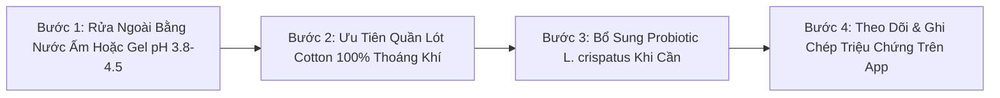

# WH_11 - Hệ Vi Sinh Âm Đạo & Độ pH: Cách Đọc Vị Sức Khỏe Vùng Kín Chuẩn Y Khoa
**Category:** Sexual Wellness — Vaginal Health & Microbiome 
**Screen:** Menstrual Cycle Screen 
**Metric:** Vaginal Health & Symptom Logs (HO-06 / HO-04) 
**Reading Time:** 8 phút đọc / 8 min 
**Hero Image:**  *(Source: [https://images.unsplash.com/photo-1579684385127-1ef15d508118?auto=format&fit=crop&w=1200&q=85](https://images.unsplash.com/photo-1579684385127-1ef15d508118?auto=format&fit=crop&w=1200&q=85))* 
**Inline Figure:**  *(Source: [https://commons.wikimedia.org/wiki/File:Lactobacillus_acidophilus_(259_19).jpg](https://commons.wikimedia.org/wiki/File:Lactobacillus_acidophilus_(259_19).jpg))* 
**Clinical Source:** [PNAS (Ravel et al., 2011) & Am J Obstet Gynecol (Brotman et al., 2014)](https://pubmed.ncbi.nlm.nih.gov/20534435/) 

---

## 🇻🇳 Phiên Bản Tiếng Việt (Vietnamese Edition)

# Hệ Vi Sinh Âm Đạo & Độ pH: Cách Đọc Vị Sức Khỏe Vùng Kín Chuẩn Y Khoa

> **Tóm tắt (Sapo):** Âm đạo là một hệ sinh thái tự làm sạch tinh vi được bảo vệ bởi hàng tỷ vi khuẩn Lactobacillus. Hiểu rõ sự tương tác giữa estrogen, glycogen và độ pH từ 3.8 đến 4.5 giúp bạn dễ dàng phân biệt dịch tiết sinh lý bình thường theo chu kỳ với các dấu hiệu cảnh báo viêm nhiễm cần can thiệp y khoa.

> 💡 **Điểm Cốt Lõi & Hành Động Thực Tế (Key Takeaway):** Khí hư thay đổi từ lỏng trong suốt sang đục dính là hoàn toàn sinh lý theo dao động estrogen. Hãy bảo tồn lớp vi sinh vật tự nhiên bằng cách kiêng tuyệt đối thụt rửa sâu, chọn quần lót cotton thoáng khí và theo dõi triệu chứng mùi hôi hoặc ngứa rát song hành cùng pha chu kỳ trên ứng dụng.

## Hệ Vi Sinh Vùng Kín: Tuyến Phòng Thủ Sinh Học Kỳ Diệu

Vùng kín phụ nữ không phải là một môi trường vô trùng; trái lại, đây là một hệ sinh thái vi sinh vật (**Vaginal Microbiome**) vô cùng sôi động với mật độ lên tới 10⁷ đến 10⁸ tế bào vi khuẩn trên mỗi gam dịch tiết.

Theo công trình nghiên cứu kinh điển của **Giáo sư Jacques Ravel và cộng sự (PNAS 2011)** phân tích hệ gen vi sinh vật ở hàng trăm phụ nữ khỏe mạnh, có 5 trạng thái cộng đồng vi khuẩn đặc trưng (Community State Types - CST), trong đó chiếm ưu thế tuyệt đối là các chủng vi khuẩn sinh axit lactic:
1. **CST I:** Thống trị bởi *Lactobacillus crispatus* (lá chắn bảo vệ kiên cố nhất, tỷ lệ kháng viêm và chống tái phát bệnh cao nhất).
2. **CST II:** Thống trị bởi *Lactobacillus gasseri*.
3. **CST III:** Thống trị bởi *Lactobacillus iners* (chủng vi khuẩn chuyển tiếp, có thể sống sót khi pH dao động).
4. **CST V:** Thống trị bởi *Lactobacillus jensenii*.
5. **CST IV:** Hệ vi sinh đa dạng không có vi khuẩn lactic thống trị, thường đi kèm với độ pH kiềm hơn và nguy cơ bùng phát viêm âm đạo do vi khuẩn (**Bacterial Vaginosis - BV**).

<figure class="article-inline-diagram">
 
 <figcaption>🔬 <strong>Cơ Chế Bảo Vệ Tự Nhiên:</strong> Vi khuẩn Lactobacillus lên men glycogen thành axit lactic D- và L-, giữ cho môi trường vùng kín luôn có tính axit cao (pH 3.8 – 4.5), ức chế nấm và vi khuẩn gây bệnh. <a href="https://commons.wikimedia.org/wiki/File:Lactobacillus_acidophilus_(259_19).jpg" target="_blank" rel="noopener">Nguồn: CDC / Wikimedia Commons ↗</a></figcaption>
</figure>

---

## Mối Liên Hệ Giữa Estrogen & Độ pH Âm Đạo

Nồng độ axit của môi trường âm đạo không phải là bất biến mà biến động chặt chẽ theo nồng độ **Estradiol (E2)** trong chu kỳ kinh nguyệt:
- Khi Estrogen tăng cao ở pha nang trứng, hormone này thúc đẩy các tế bào biểu mô âm đạo tích lũy một lượng lớn phân tử đường dự trữ gọi là **Glycogen**.
- Khi các tế bào này bong ra tự nhiên, *Lactobacillus* sử dụng enzyme α-amylase để phân giải glycogen thành glucose và lên men thành **Axit Lactic (cả D-lactic và L-lactic acid)** cùng chất diệt khuẩn tự nhiên **Hydro peroxide (H₂O₂)**.
- Quá trình này duy trì độ **pH lý tưởng từ 3.8 đến 4.5**—môi trường có tính axit mạnh ngăn chặn hoàn toàn sự sinh sôi của mầm bệnh kỵ khí như *Gardnerella vaginalis* hay trùng roi *Trichomonas*.
- Ngược lại, trong kỳ kinh nguyệt, máu kinh có độ pH kiềm tính (~7.4) tạm thời đẩy pH âm đạo lên cao hơn (>5.0), tạo cơ hội thuận lợi cho nấm men hoặc vi khuẩn phát triển nếu vệ sinh không đúng cách.

---

## Bảng Đối Chiếu: Dịch Tiết Sinh Lý vs. Dấu Hiệu Nhiễm Khuẩn

| Phân Loại Khí Hư | Màu Sắc & Kết Cấu | Mùi Đặc Trưng | Triệu Chứng Kèm Theo | Độ pH Ước Tính | Nguyên Nhân & Hướng Xử Trí |
| :--- | :--- | :--- | :--- | :--- | :--- |
| **Pha Nang Trứng Sớm** | Trắng đục hoặc vàng nhạt, hơi dính hoặc kem nhẹ. | Không mùi hoặc chua thanh rất nhẹ. | Không ngứa, không rát, da vùng kín êm dịu. | 3.8 – 4.2 | **Hoàn toàn bình thường:** Estrogen đang tăng dần, glycogen bắt đầu tích lũy. |
| **Cửa Sổ Rụng Trứng** | Trong suốt như lòng trắng trứng sống, co giãn dai từ 5–10 cm (Spinnbarkeit). | Không mùi hoặc mùi xạ hương tự nhiên nhẹ. | Tăng tiết dịch bôi trơn, tăng ham muốn tình dục. | 4.2 – 4.5 | **Đỉnh sinh sản:** Dịch cổ tử cung loãng để tạo điều kiện cho tinh trùng bơi vào tử cung. |
| **Pha Hoàng Thể Muộn** | Trắng đục, đặc sánh như hồ dán, khô ráo dần. | Hầu như không mùi. | Cảm giác hơi khô ráo trước ngày có kinh. | 4.0 – 4.4 | **Tác động của Progesterone:** Làm đặc dịch nhầy cổ tử cung để chặn vi khuẩn xâm nhập lòng tử cung. |
| **Viêm Do Vi Khuẩn (BV)** | Xám nhạt, trắng đục loãng sủi bọt, dính đều thành âm đạo. | **Mùi tanh cá ươn** rõ rệt (đặc biệt nồng nặc sau quan hệ hoặc khi gặp kiềm). | Châm chích nhẹ, không ngứa dữ dội. | **> 4.5 (Kiềm hóa)** | Mất cân bằng vi sinh, *Gardnerella* chiếm ưu thế. Cần bác sĩ kê kháng sinh Metronidazole hoặc Clindamycin. |
| **Nhiễm Nấm Men (Candida)** | Trắng vón cục như bã đậu hoặc phô mai cottage, đặc. | Thường không có mùi hôi tanh. | **Ngứa dữ dội**, sưng đỏ âm hộ, đau rát khi đi tiểu hoặc quan hệ. | Thường **< 4.5** (Bình thường) | *Candida albicans* bùng phát khi đề kháng giảm hoặc dùng kháng sinh phổ rộng. Cần thuốc kháng nấm Clotrimazole / Fluconazole. |
| **Trùng Roi (Trichomonas)** | Vàng xanh, loãng, nhiều bọt khí li ti. | Mùi hôi thối khó chịu nồng nặc. | Đau rát, tiểu buốt, xuất huyết điểm ở cổ tử cung. | **> 5.0** | Bệnh lây qua đường tình dục (STI). Bắt buộc điều trị đồng thời cho cả bạn tình. |

---

## 4 Sai Lầm Phổ Biến Phá Vỡ Hệ Vi Sinh & Độ pH Tự Nhiên

1. **Thụt Rửa Sâu Bằng Dung Dịch Vệ Sinh:** Âm đạo có cơ chế tự làm sạch tự nhiên nhờ dòng dịch biểu mô chảy ra ngoài liên tục. Việc dùng vòi xịt hoặc xà phòng thơm thụt rửa vào sâu bên trong sẽ quét sạch toàn bộ lợi khuẩn *Lactobacillus*, đẩy pH lên mức kiềm và tăng nguy cơ viêm vùng chậu lên gấp 3 lần.
2. **Mặc Quần Lót Sợi Tổng Hợp Khi Tập Thể Dục:** Vải nilon bí khí giữ lại mồ hôi và nhiệt độ cao, tạo ra một "nhà kính nhiệt đới" kích thích nấm *Candida* sinh sôi nảy nở.
3. **Lạm Dụng Băng Vệ Sinh Hàng Ngày Không Thấm Khí:** Sử dụng băng hàng ngày liên tục cả tháng gây bí bách niêm mạc âm hộ, làm tăng độ ẩm và ma sát cơ học.
4. **Tự Ý Mua Kháng Sinh Uống Khi Thấy Ra Khí Hư:** Uống kháng sinh bừa bãi tiêu diệt vi khuẩn *Lactobacillus*, mở đường cho nấm kháng thuốc bùng phát dữ dội.

---

## Giao Thức 4 Bước Chăm Sóc Vùng Kín Chuẩn Y Khoa

1. **Vệ Sinh Bên Ngoài Đúng Cách:** Chỉ làm sạch nhẹ nhàng vùng môi lớn, môi bé bên ngoài bằng nước ấm hoặc dung dịch vệ sinh có pH cân bằng (3.8–4.5) không chứa hương liệu nhân tạo; lau khô từ trước ra sau để tránh lây nhiễm vi khuẩn *E. coli* từ hậu môn.
2. **Chọn Trang Phục Vận Động Thông Minh:** Thay quần tập ngay sau khi hoàn thành buổi tập gym hoặc chạy bộ; ưu tiên quần lót đáy cotton 100% và ngủ thả lỏng không quần lót khi ở nhà để vùng kín được thông thoáng tự nhiên.
3. **Nuôi Dưỡng Lợi Khuẩn Đường Ruột & Âm Đạo:** Tăng cường thực phẩm lên men tự nhiên (sữa chua Hy Lạp, kefir, kim chi) và cân nhắc bổ sung các chủng men vi sinh đường uống chuyên biệt cho phụ nữ chứa *Lactobacillus crispatus* và *Lactobacillus rhamnosus GR-1*.
4. **Đồng Bộ Dữ Liệu Khí Hư Với Chu Kỳ Kinh Nguyệt:** Sử dụng tính năng ghi log triệu chứng (Symptom Log) trên ứng dụng để theo dõi sự biến đổi của dịch nhầy; nếu phát hiện mùi tanh kèm bọt khí kéo dài trên 48 giờ, hãy đi khám phụ khoa thay vì tự chữa tại nhà.

---

## Nguồn Y Khoa Lâm Sàng & Tài Liệu Tham Khảo

1. **Ravel, J., et al. (2011).** Vaginal microbiome of reproductive-age women. *Proceedings of the National Academy of Sciences (PNAS)*, 108(Supplement 1), 4680-4687. [PMID: 20534435](https://pubmed.ncbi.nlm.nih.gov/20534435/)
2. **Brotman, R. M., et al. (2014).** Association between the vaginal microbiota, menopause status, and signs of vulvovaginal atrophy. *American Journal of Obstetrics and Gynecology*, 210(4), 305-e1. [PMID: 24045187](https://pubmed.ncbi.nlm.nih.gov/24045187/)
3. **ACOG Practice Bulletin No. 215 (2020).** Vaginitis in Nonpregnant Patients. *Obstetrics & Gynecology*, 135(1), e1-e17. [ACOG Guidelines](https://www.acog.org/clinical/clinical-guidance/practice-bulletin/articles/2020/01/vaginitis-in-nonpregnant-patients)
4. **WHOOP Medical Knowledge Base & Apple HealthKit (2025).** Menstrual Flow and Vaginal Symptom Tracking Protocols.

---

## 🇬🇧 English Edition

# The Vaginal Microbiome & pH: Decoding Flora Balance, Odor & Discharge

> **Abstract (Sapo):** The vagina is a dynamic, self-cleaning ecosystem shielded by billions of lactic acid-producing Lactobacillus bacteria. Understanding the relationship between estrogen, epithelial glycogen, and an acidic pH (3.8–4.5) allows you to confidently distinguish cyclic physiological discharge from clinical infections.

> 💡 **Key Takeaway & Clinical Action:** Cyclic changes in discharge consistency from watery-clear to thick-tacky reflect healthy estrogen fluctuations. Protect your natural microbiome by avoiding internal douching, wearing breathable cotton, and cross-referencing atypical odor or pruritus with your wearable cycle tracking logs.

## The Vaginal Microbiome: A Dynamic Biological Fortress

The female reproductive tract is far from sterile. It is populated by an intricate, highly dynamic microbial ecosystem—the **Vaginal Microbiome**—hosting approximately 10⁷ to 10⁸ bacterial cells per gram of vaginal fluid.

In a landmark genomic sequencing study published in **PNAS (Ravel et al., 2011)**, researchers categorized healthy vaginal microbiotas into five distinct Community State Types (CSTs), predominantly governed by protective lactic acid-producing bacteria:
1. **CST I:** Dominated by *Lactobacillus crispatus* (the most resilient defense against dysbiosis and sexually transmitted infections).
2. **CST II:** Dominated by *Lactobacillus gasseri*.
3. **CST III:** Dominated by *Lactobacillus iners* (a transitional species capable of surviving fluctuating microenvironments).
4. **CST V:** Dominated by *Lactobacillus jensenii*.
5. **CST IV:** Lacks dominant *Lactobacillus* species; exhibits polymorphic anaerobic diversity, frequently correlating with elevated pH and clinical **Bacterial Vaginosis (BV)**.

<figure class="article-inline-diagram">
 
 <figcaption>🔬 <strong>Biological Protection:</strong> Lactobacillus species ferment glycogen into protective lactic acid isomers, preserving an acidic barrier against fungal and anaerobic overgrowth. <a href="https://commons.wikimedia.org/wiki/File:Lactobacillus_acidophilus_(259_19).jpg" target="_blank" rel="noopener">Source: CDC / Wikimedia Commons ↗</a></figcaption>
</figure>

---

## How Estrogen Governs Vaginal pH & Glycogen Dynamics

Vaginal acidity is directly regulated by circulating **Estradiol (E2)** concentrations throughout the menstrual cycle:
- As estrogen rises during the follicular phase, it stimulates mature vaginal epithelial cells to deposit substantial intracellular stores of **Glycogen**.
- When these epithelial cells naturally desquamate, resident *Lactobacillus* species utilize cell-surface α-amylases to degrade glycogen into maltose and glucose, subsequently metabolizing them into **L-lactic and D-lactic acids**, along with bactericidal **Hydrogen Peroxide (H₂O₂)**.
- This biological reaction maintains a strict **acidic pH between 3.8 and 4.5**, effectively neutralizing opportunistic pathogens like *Gardnerella vaginalis* and *Trichomonas vaginalis*.
- Conversely, during menstruation, shedding blood possesses an alkaline pH of ~7.4, transiently raising the local environment above 5.0 and creating an opportunistic window for microflora shifts.

---

## Comparative Matrix: Normal Discharge vs. Clinical Infections

| Clinical Presentation | Appearance & Consistency | Characteristic Odor | Associated Physical Sensations | Local pH Range | Underlying Etiology & Next Steps |
| :--- | :--- | :--- | :--- | :--- | :--- |
| **Early Follicular Discharge** | Whitish-translucent, slightly viscous or creamy paste. | Inodorous or faintly acidic scent. | None; vulva is comfortable and supple. | 3.8 – 4.2 | **Normal physiology:** Moderate estrogen levels, active glycogen deposition. |
| **Ovulatory Peak (Fertile)** | Crystal-clear, elastic like raw egg whites (Spinnbarkeit > 8 cm). | Neutral or mild subtle pheromonal musk. | Heightened natural lubrication and arousal. | 4.2 – 4.5 | **Fertility window:** Low-viscosity mucus designed to facilitate sperm motility. |
| **Late Luteal Secretions** | Opaque white, thick paste, rapidly drying. | Odorless. | Transient dryness right before menses onset. | 4.0 – 4.4 | **Progesterone dominance:** Mucus thickens to form a cervical barrier. |
| **Bacterial Vaginosis (BV)** | Homogeneous, thin, off-white or grayish discharge. | **Prominent fishy amine odor** (accentuated after intercourse or alkali exposure). | Mild irritation; minimal erythema or pruritus. | **> 4.5 (Alkaline)** | Overgrowth of anaerobes (*Gardnerella*, *Atopobium*). Requires oral/topical Metronidazole. |
| **Vulvovaginal Candidiasis** | Thick, curd-like, white plaques resembling cottage cheese. | Virtually odorless. | **Intense itching (pruritus)**, vulvar erythema, dysuria, burning. | **< 4.5 (Acidic)** | *Candida albicans* opportunistic proliferation. Managed with antifungal azoles. |
| **Trichomoniasis** | Frothy, greenish-yellow, profuse thin fluid. | Pungent, foul, stale odor. | Severe dyspareunia, strawberry cervix (colpitis macularis). | **> 5.0** | Protozoan STI. Mandates simultaneous partner treatment with oral antiprotozoals. |

---

## 4 Common Habits That Disrupt Your Natural Flora

1. **Intravaginal Douching:** Douching flushes out essential *Lactobacillus* colonies, stripping the epithelial mucosa and increasing the hazard of pelvic inflammatory disease (PID) threefold.
2. **Prolonged Wear of Synthetic Athleisure:** Polyester and spandex trap moisture and heat, creating an anaerobic incubator that triggers fungal blooms.
3. **Constant Use of Scented Daily Liners:** Continuous pantyliner use prevents ambient air circulation, leading to micro-abrasions and contact dermatitis.
4. **Empiric Antibiotic Misuse:** Taking broad-spectrum systemic antibiotics for minor respiratory bugs annihilates intestinal and vaginal lactobacilli indiscriminately.

---

## 4-Step Clinical Hygiene & Flora Protection Protocol

1. **Cleanse External Vulva Only:** Wash external labia using warm water or an unfragranced, pH-balanced (3.8–4.5) feminine wash. Never spray pressurized water into the vaginal canal.
2. **Switch to Breathable Apparel:** Discard damp workout clothes immediately post-exercise. Opt for organic cotton underwear and consider sleeping pantless to encourage natural ventilation.
3. **Fortify Mucosal Immunity:** Incorporate natural probiotic foods (kefir, unsweetened yogurt) and consider oral probiotic supplements verified to colonize the reproductive tract, specifically *Lactobacillus crispatus* and *Lactobacillus rhamnosus GR-1*.
4. **Log Symptoms Alongside Biometrics:** Track unusual discharge, odor, or local itching in your wearable cycle tracker. If a foul amine scent or frothy consistency persists for over 48 hours, seek a clinical swab test immediately.

---

## Clinical Citations & Reference Literature

1. **Ravel, J., et al. (2011).** Vaginal microbiome of reproductive-age women. *Proceedings of the National Academy of Sciences (PNAS)*, 108(Supplement 1), 4680-4687. [PMID: 20534435](https://pubmed.ncbi.nlm.nih.gov/20534435/)
2. **Brotman, R. M., et al. (2014).** Association between the vaginal microbiota, menopause status, and signs of vulvovaginal atrophy. *American Journal of Obstetrics and Gynecology*, 210(4), 305-e1. [PMID: 24045187](https://pubmed.ncbi.nlm.nih.gov/24045187/)
3. **ACOG Practice Bulletin No. 215 (2020).** Vaginitis in Nonpregnant Patients. *Obstetrics & Gynecology*, 135(1), e1-e17. [ACOG Guidelines](https://www.acog.org/clinical/clinical-guidance/practice-bulletin/articles/2020/01/vaginitis-in-nonpregnant-patients)
4. **WHOOP Medical Knowledge Base & Apple HealthKit (2025).** Menstrual Flow and Vaginal Symptom Tracking Protocols.

