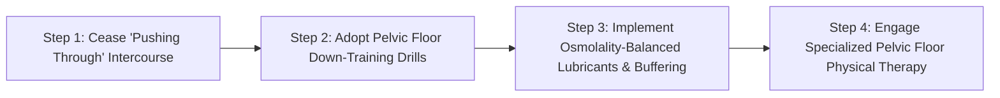

# WH_12 - Đau Rát Khi Quan Hệ (Dyspareunia): Căn Nguyên Cơ Học, Nội Tiết & Giải Pháp Điều Trị
**Category:** Women's Health 
**Screen:** Menstrual Cycle Screen 
**Metric:** Pelvic Pain & Symptom Logs (HO-06 / REC-03) 
**Reading Time:** 9 phút đọc / 9 min 
**Hero Image:**  *(Source: [https://images.unsplash.com/photo-1516549655169-df83a0774514?auto=format&fit=crop&w=1200&q=85](https://images.unsplash.com/photo-1516549655169-df83a0774514?auto=format&fit=crop&w=1200&q=85))* 
**Inline Figure:**  *(Source: [https://commons.wikimedia.org/wiki/File:1116_Muscle_of_the_Female_Perineum.png](https://commons.wikimedia.org/wiki/File:1116_Muscle_of_the_Female_Perineum.png))* 
**Clinical Source:** [The Lancet (Bergeron et al., 2018) & ACOG Committee Opinion No. 673](https://www.thelancet.com/journals/lancet/article/PIIS0140-6736(17)30944-5/fulltext) 

---

## 🇻🇳 Phiên Bản Tiếng Việt (Vietnamese Edition)

# Đau Rát Khi Quan Hệ (Dyspareunia): Căn Nguyên Cơ Học, Nội Tiết & Giải Pháp Điều Trị

> **Tóm tắt (Sapo):** Đau rát khi quan hệ tình dục không bao giờ là điều bạn phải cắn răng chịu đựng hay xem là chuyện 'bình thường'. Từ sự co thắt quá mức của các bó cơ sàn chậu đến tình trạng suy giảm estrogen hay lạc nội mạc tử cung, y học hiện đại có các phác đồ chuẩn xác để chữa lành tận gốc chứng giao hợp đau (Dyspareunia).

> 💡 **Điểm Cốt Lõi & Hành Động Thực Tế (Key Takeaway):** Nếu bạn bị đau rát khi quan hệ, giải pháp đầu tiên không phải là 'cố gắng chịu đựng' hay tập Kegel siết chặt cơ. Hãy phân biệt đau nông tại cửa mình (cần khám nơ-ron tiền đình, phục hồi màng nhầy) hay đau sâu trong ổ bụng (cần tầm soát lạc nội mạc, nang buồng trứng), đồng thời ưu tiên các bài tập hạ trương lực cơ sàn chậu.

## Đau Khi Quan Hệ Tình Dục: Căn Bệnh Thầm Lặng Đang Bị Xem Nhẹ

Cảm giác đau đớn trong hoặc sau khi quan hệ tình dục—trong y khoa gọi là **Chứng Giao Hợp Đau (Dyspareunia)**—là một vấn đề phổ biến đến mức đáng kinh ngạc: theo thống kê của **Đại học Sản Phụ khoa Hoa Kỳ (ACOG)**, gần **75% phụ nữ** từng trải qua cơn đau này ít nhất một lần trong đời, và khoảng 10%–15% phải chịu đựng nó như một cơn ác mộng mãn tính kéo dài nhiều năm.

Tuy nhiên, do sự e ngại và các định kiến xã hội, rất nhiều phụ nữ chọn cách chịu đựng âm thầm hoặc tự trách bản thân rằng mình "chưa đủ thoải mái" hay "bị ức chế tâm lý". 

Khoa học phụ khoa hiện đại (**Bergeron et al., The Lancet 2018**) khẳng định: **Đau khi thâm nhập là một triệu chứng sinh học rõ ràng bắt nguồn từ các rối loạn cơ xương khớp, thần kinh hoặc cấu trúc giải phẫu**, hoàn toàn có thể chẩn đoán và điều trị dứt điểm nếu tiếp cận đúng phương pháp.

<figure class="article-inline-diagram">
 
 <figcaption>⚙️ <strong>Giải Phẫu Cơ Tầng Sinh Môn & Đáy Chậu Nữ:</strong> Các bó cơ hành xốp (bulbospongiosus), cơ ngồi hang (ischiocavernosus) và cơ thắt niệu đạo. Trạng thái co thắt mạn tính không chủ ý tại các bó cơ này là nguyên nhân cốt lõi gây hội chứng giao hợp đau (dyspareunia). <a href="https://commons.wikimedia.org/wiki/File:1116_Muscle_of_the_Female_Perineum.png" target="_blank" rel="noopener">Nguồn: OpenStax Anatomy / Wikimedia Commons ↗</a></figcaption>
</figure>

---

## Phân Loại Y Khoa: Đau Nông (Superficial) vs. Đau Sâu (Deep)

Để tìm ra gốc rễ vấn đề, bác sĩ phụ khoa luôn bắt đầu bằng việc phân định vị trí chính xác của điểm đau:

### 1. Đau Nông (Superficial / Introital Dyspareunia)
Cơn đau xuất hiện ngay tại cửa mình hoặc tiền đình âm đạo ngay từ khoảnh khắc bắt đầu tiếp xúc hoặc thâm nhập:
- **Hội Chứng Đau Tiền Đình Âm Hộ (Provoked Vestibulodynia - PVD):** Các đầu mút dây thần kinh cảm giác tại vùng tiền đình tăng sinh bất thường, khiến não bộ diễn dịch một cái chạm nhẹ hoặc thâm nhập như vết bỏng axit hay dao cứa.
- **Thiếu Hụt Estrogen & Hội Chứng Tiết Niệu - Sinh Dục (GSM):** Gặp phổ biến ở phụ nữ cho con bú (prolactin ức chế estrogen) hoặc giai đoạn tiền mãn kinh. Niêm mạc mỏng manh, mất tính đàn hồi và không tiết đủ chất bôi trơn sinh lý.
- **Nhiễm Trùng Cấp Tính:** Viêm do nấm *Candida* hoặc viêm bàng quang gây trầy xước và đau rát bề mặt.

### 2. Đau Sâu (Deep Dyspareunia)
Cơn đau nhói buốt xuất hiện sâu bên trong vùng chậu hoặc bụng dưới khi có sự va chạm cơ học vào cổ tử cung và cùng đồ sau:
- **Lạc Nội Mạc Tử Cung (Endometriosis):** Các tế bào nội mạc tử cung đi lạc và bám vào dây chằng tử cung - cùng, trực tràng hoặc vách ngăn âm đạo - trực tràng. Mỗi va chạm cơ học sẽ kích hoạt viêm nhiễm và co rút dây chằng dữ dội.
- **Lạc Tuyến Nội Mạc Vào Cơ Tử Cung (Adenomyosis):** Tử cung phì đại, sung huyết và cực kỳ nhạy cảm với lực đẩy.
- **Tử Cung Ngả Sau (Retroverted Uterus) & Dính Vùng Chậu:** Cổ tử cung nằm ở vị trí thấp và trực diện hơn với góc thâm nhập.
- **Nang Buồng Trứng Hoặc Viêm Vùng Chậu (PID):** Áp lực đè nén lên các khối mô đang viêm sưng.

---

## Thủ Phạm Bị Bỏ Quên: Hội Chứng Sàn Chậu Tăng Trương Lực (Hypertonic Pelvic Floor)

Một nghịch lý lớn trong chăm sóc sức khỏe phụ nữ là khi nghe đến sàn chậu, hầu hết mọi người đều nghĩ đến bài tập **Kegel** để "siết chặt". Tuy nhiên, với chứng giao hợp đau, Kegel thường là một thảm họa!

Nhiều phụ nữ—đặc biệt là vận động viên, người tập gym cường độ cao hoặc người thường xuyên căng thẳng—sở hữu **Sàn chậu tăng trương lực (Hypertonic / High-tone Pelvic Floor)**:
- Cơ nâng hậu môn (*Levator Ani*) luôn ở trạng thái co quắp, căng cứng liên tục như một nắm đấm siết chặt không chịu mở ra.
- Khi có vật thể thâm nhập, phản xạ tự vệ vô thức của hệ thần kinh giao cảm khiến các bó cơ này lập tức co giật mạnh hơn (chứng co thắt âm đạo - *Vaginismus*), khóa chặt cửa mình và gây đau đớn cùng cực.
- **Chỉ số thiết bị đeo phản chiếu:** Những phụ nữ bị co thắt sàn chậu mãn tính thường có điểm HRV ban đêm thấp hơn mức trung bình, nhịp tim nghỉ ngơi cao và nồng độ cortisol tăng cao do hệ thần kinh thực vật luôn ở chế độ "chiến đấu hay bỏ chạy".

---

## Bảng So Sánh Các Căn Nguyên & Phác Đồ Lâm Sàng

| Căn Nguyên Gốc Rễ | Vị Trí Cơn Đau | Cơ Chế Sinh Học | Tín Hiệu Nhận Diện | Phác Đồ Can Thiệp Y Khoa Chuẩn |
| :--- | :--- | :--- | :--- | :--- |
| **Co Thắt Cơ Sàn Chậu (Hypertonicity)** | Nông hoặc giữa ống âm đạo. | Cơ nâng hậu môn co thắt không chủ ý, xuất hiện các điểm kích hoạt đau (Trigger Points). | Cảm giác giống như chạm vào "bức tường gạch", không thể nhét tampon hoặc thâm nhập. | **Vật lý trị liệu sàn chậu (Pelvic Floor PT)**: Kỹ thuật nhả cơ, thở hoành thả lỏng, thanh nong âm đạo (Dilators). |
| **Teo Niêm Mạc Do Hụt Estrogen (GSM)** | Cửa mình & thành âm đạo. | Niêm mạc mỏng, giảm độ ẩm tự nhiên, mất nếp gấp đàn hồi. | Khô hạn, rát buốt kéo dài nhiều giờ sau quan hệ, hay bị rách xước da vi thể. | Liệu pháp bổ sung Estrogen bôi tại chỗ (Kem E2 / Vòng đặt âm đạo) + Chất bôi trơn gốc silicone/nước y tế. |
| **Lạc Nội Mạc Tử Cung (Endometriosis)** | Sâu trong đáy chậu, bụng dưới. | Viêm vô khuẩn, tổn thương dây chằng tử cung - cùng, mô xơ dính vùng chậu. | Đau nhói thấu bụng khi thâm nhập sâu, đau bụng kinh dữ dội, đau khi đi đại tiện trong kỳ kinh. | Thăm khám chuyên khoa sâu; liệu pháp ức chế hormone hoặc phẫu thuật nội soi bóc tách tổn thương xơ dính. |
| **Viêm Tiền Đình Âm Hộ (PVD)** | Đúng vòng tròn cửa mình (Tiền đình). | Tăng mật độ thụ thể thần kinh thụ cảm đau (Hyper-innervation). | Chỉ cần chạm nhẹ tăm bông vào viền cửa mình đã thấy đau buốt nhói như châm kim. | Thuốc giảm đau thần kinh tại chỗ (Lidocaine/Gabapentin bôi), liệu pháp giải mẫn cảm thần kinh. |

---

## Giao Thức 4 Bước Phục Hồi & Tìm Lại Sự Thoải Mái

1. **Phá Vỡ Phản Xạ Đau - Co Thắt Của Não Bộ:** Nguyên tắc vàng số một: **Tuyệt đối không tiếp tục quan hệ khi đang bị đau.** Khi bạn cố chịu đựng, não bộ sẽ hình thành cung phản xạ có điều kiện: gán ghép tình dục với sự nguy hiểm, kích hoạt hệ thần kinh giao cảm co thắt cơ dữ dội hơn trong những lần sau.
2. **Thực Hiện Các Bài Tập Hạ Trương Lực Sàn Chậu (Down-training):**
 - Dừng ngay các bài tập Kegel siết cơ.
 - Tập **Thở bụng cơ hoành (Diaphragmatic Breathing)**: Hít sâu phình bụng và cảm nhận cơ sàn chậu mở rộng, đẩy nhẹ xuống dưới như một bông hoa bung nở; thở ra thả lỏng hoàn toàn.
 - Thực hiện tư thế Yoga mở háng nhẹ nhàng: *Em bé hạnh phúc (Happy Baby Pose)*, *Tư thế cánh bướm ngả lưng (Reclined Butterfly)* giữ trong 3–5 phút mỗi tối.
3. **Thay Đổi Cơ Học & Dụng Cụ Hỗ Trợ:**
 - Sử dụng chất bôi trơn cao cấp đẳng trương (Isotonic, osmolality 260–380 mOsm/kg, không chứa glycerin hoặc paraben làm kích ứng niêm mạc).
 - Dùng gối kê dưới mông hoặc vòng giới hạn độ sâu (Ohnut) để giảm bớt lực va chạm trực tiếp vào cổ tử cung.
4. **Tìm Kiếm Sự Hỗ Trợ Từ Chuyên Gia:** Đặt lịch khám với bác sĩ phụ khoa có chuyên môn về đau vùng chậu mãn tính để soi cổ tử cung, siêu âm vùng chậu và kết hợp với chuyên gia Vật lý trị liệu sàn chậu (Pelvic Floor Physical Therapist) để thực hiện kỹ thuật giải phóng điểm đau Trigger Points.

---

## Nguồn Y Khoa Lâm Sàng & Tài Liệu Tham Khảo

1. **Bergeron, S., et al. (2018).** Female sexual pain disorders: a review of the literature. *The Lancet*, 391(10121), 1196-1207. [Tạp chí The Lancet: Tổng Quan Lâm Sàng Đau Khi Quan Hệ Ở Nữ (PMID: 29551357) ↗](https://www.thelancet.com/journals/lancet/article/PIIS0140-6736(17)30944-5/fulltext)
2. **Faubion, S. S., et al. (2015).** Dyspareunia in postmenopausal women: a clinical approach. *Mayo Clinic Proceedings*, 90(3), 399-407. [Báo Cáo Mayo Clinic: Phác Đồ Tiếp Cận Đau Vùng Kín (PMID: 26522336) ↗](https://www.mayoclinicproceedings.org/article/S0025-6196(14)01014-9/fulltext)
3. **ACOG Committee Opinion No. 673 (2020 update).** Persistent Vulvar Pain: Diagnosis and Management. *Obstetrics & Gynecology*, 136(3), e44-e53. [Khuyến Cáo Lâm Sàng ACOG: Đau Âm Hộ Mãn Tính (ACOG Guidelines) ↗](https://www.acog.org/clinical/clinical-guidance/committee-opinion/articles/2016/09/persistent-vulvar-pain)
4. **WHOOP Medical Knowledge Base & Apple HealthKit (2025).** Pelvic Health and Menstrual Symptom Tracking Protocols. [WHOOP The Locker: Menstrual Health & Recovery ↗](https://www.whoop.com/thelocker/menstrual-cycle-coaching/) • [Mayo Clinic: Dyspareunia Care ↗](https://www.mayoclinic.org/diseases-conditions/painful-intercourse/symptoms-causes/syc-20375965)

---

## 🇬🇧 English Edition

# Unpacking Dyspareunia: Musculoskeletal, Hormonal & Structural Triggers

> **Abstract (Sapo):** Pain during sexual intercourse is neither an inevitable reality nor a purely psychological hurdle. From hypertonic pelvic floor spasms and mucosal hypoestrogenism to deep endometriosis, clinical medicine provides targeted diagnostic frameworks and rehabilitative protocols to resolve dyspareunia.

> 💡 **Key Takeaway & Clinical Action:** Experiencing pain during intercourse warrants clinical investigation, not passive endurance or blind Kegel squeezing. Differentiate superficial introital pain (vestibulodynia, mucosal dryness) from deep abdominal pain (endometriosis, retroverted uterus), and prioritize pelvic floor down-training over contraction exercises.

## Dyspareunia: The Overlooked Biological Reality of Sexual Pain

Pain during or after sexual intercourse—clinically termed **Dyspareunia**—is remarkably widespread. According to the **American College of Obstetricians and Gynecologists (ACOG)**, nearly **75% of women** experience sexual pain at some point in their lives, with 10% to 15% enduring it as a chronic, debilitating condition.

Yet, due to cultural taboos and anatomical misunderstandings, countless women suffer in silence, falsely internalizing the belief that the issue is "all in their head" or that they simply need to "relax more."

Modern gynecological neuroscience (**Bergeron et al., The Lancet 2018**) firmly refutes this: **Pain upon penetration is a concrete biophysical signal stemming from neuro-musculoskeletal, hormonal, or structural dysfunctions**, all of which can be systematically diagnosed and effectively treated.

<figure class="article-inline-diagram">
 
 <figcaption>⚙️ <strong>Musculature of the Female Perineum:</strong> The bulbospongiosus and ischiocavernosus complex. Hypertonic involuntary guarding of these muscle groups directly triggers entry dyspareunia and pelvic pain syndromes. <a href="https://commons.wikimedia.org/wiki/File:1116_Muscle_of_the_Female_Perineum.png" target="_blank" rel="noopener">Source: OpenStax Anatomy / Wikimedia Commons ↗</a></figcaption>
</figure>

---

## Clinical Classification: Superficial vs. Deep Dyspareunia

Diagnostic precision begins by isolating the spatial anatomical depth of the discomfort:

### 1. Superficial (Introital) Dyspareunia
Pain localized at the vaginal opening or vulvar vestibule upon the earliest contact or initial penetration:
- **Provoked Vestibulodynia (PVD):** Characterized by hyper-innervation and localized neurogenic inflammation within the mucosal cuff of the vestibule, where light tactile stimuli trigger intense burning sensations.
- **Genitourinary Syndrome of Menopause (GSM) & Hypoestrogenism:** Observed postmenopausally and during lactation (where prolactin down-regulates estradiol). Mucosal thinning, loss of rugae elasticity, and depleted natural secretions lead to severe frictional micro-trauma.
- **Infectious Vulvovaginitis:** Acute yeast flares or urethral inflammation creating severe surface friability.

### 2. Deep Dyspareunia
Dull, throbbing, or sharp pain felt deep within the pelvis, sacrum, or lower abdomen upon deep penetrative thrusting:
- **Endometriosis:** Ectopic endometrial implants embedding on the uterosacral ligaments, pouch of Douglas, or rectovaginal septum undergo cyclical bleeding and scarring, triggering acute lancinating pain on mechanical contact.
- **Adenomyosis:** Endometrial invasion into the myometrial wall causing marked uterine enlargement, vascular engorgement, and mechanical hypersensitivity.
- **Retroverted Uterus & Pelvic Adhesions:** Fixed backward tilting of the cervix placing it in direct, unyielding contact with thrusting angles.
- **Ovarian Cysts & Chronic Pelvic Inflammatory Disease (PID):** Pressure transmission directly into tender, inflamed adnexal structures.

---

## The Hidden Culprit: Hypertonic Pelvic Floor Dysfunction

A prevailing myth in women's health is that all pelvic floor complaints require **Kegel exercises** to "tighten up." For dyspareunia, doing Kegels is often profoundly harmful!

Many women—particularly dedicated runners, CrossFitters, high-stress executives, or individuals with chronic anxiety—possess a **Hypertonic (Overactive) Pelvic Floor**:
- The *Levator Ani* musculature resides in a constant state of spastic contraction, unable to lengthen or achieve resting baseline tone.
- When penetration is attempted, the sympathetic nervous system triggers an involuntary protective spasm (*Vaginismus*), creating a physical blockage.
- **Biometric Wearable Signature:** Individuals suffering from chronic pelvic muscle spasticity frequently exhibit depressed nocturnal HRV baselines and elevated resting heart rates, reflecting chronic autonomic sympathetic dominance.

---

## Diagnostic Matrix & Clinical Protocols

| Underlying Mechanism | Pain Depth & Sensation | Biophysical Pathology | Clinical Red Flags | Gold-Standard Clinical Intervention |
| :--- | :--- | :--- | :--- | :--- |
| **Pelvic Hypertonicity** | Introital or mid-vaginal canal. | Involuntary spasm of levator ani with myofascial trigger points. | Sensation of hitting a "brick wall"; inability to insert tampons without sharp pain. | **Pelvic Floor Physical Therapy**: Myofascial trigger point release, down-training breathing, graduated medical dilators. |
| **Estrogen Deficiency (GSM)** | Introital & vaginal walls. | Severe epithelial atrophy, diminished cellular glycogen, micro-abrasions. | Severe dryness, chronic burning post-intercourse, post-coital spotting. | Topical Estrogen Therapy (estradiol cream/tablet/ring) + physiological isotonic lubricants. |
| **Endometriosis** | Deep pelvic floor, lower abdomen. | Chronic neurogenic inflammation, fibrotic adhesions across uterosacral ligaments. | Piercing deep pain on thrusting, severe dysmenorrhea, cyclic dyschezia (painful bowel movements). | Advanced specialist laparoscopy for excision of fibrotic lesions; GnRH modulators or cyclic progestins. |
| **Provoked Vestibulodynia** | Localized to vestibule ring (3 to 9 o'clock). | Proliferation of nociceptive C-nerve fibers; central sensitization. | Severe lancinating pain upon light cotton-swab palpation of the introital margin. | Compounded topical neuropathic ointments (e.g., Gabapentin/Amitriptyline), specialized desensitization therapy. |

---

## 4-Step Action Protocol for Recovery & Healing

1. **Break the Neural Pain Reflex:** The foundational rule of sexual medicine: **Never force or endure painful intercourse.** Pushing through trauma hardwires the central nervous system to associate intimacy with danger, magnifying autonomic guarding reflexes.
2. **Practice Pelvic Floor Down-Training:**
 - Immediately discontinue all voluntary contraction drills (Kegels).
 - Practice **Diaphragmatic Breathing**: Inhale deeply into your lower ribs and belly, visualizing the pelvic floor relaxing and descending outward like an opening flower; exhale gently without force.
 - Dedicate 5 minutes daily to gentle pelvic hip openers: *Happy Baby Pose* and *Reclined Cobbler's Pose (Supta Baddha Konasana)*.
3. **Optimize Mechanical Support & Lubrication:**
 - Utilize high-purity isotonic lubricants (osmolality between 260–380 mOsm/kg, free of glycerin, parabens, and warming additives).
 - Incorporate positioning wedges or depth-limiting devices (such as the Ohnut) to cushion deep thrusting impact against the cervix.
4. **Partner with Pelvic Health Specialists:** Schedule an evaluation with a certified Pelvic Floor Physical Therapist (PT) skilled in internal myofascial release, biofeedback relaxation, and individualized dilator progression.

---

## Clinical Citations & Reference Literature

1. **Bergeron, S., et al. (2018).** Female sexual pain disorders: a review of the literature. *The Lancet*, 391(10121), 1196-1207. [The Lancet: Female Sexual Pain Disorders (PMID: 29551357) ↗](https://www.thelancet.com/journals/lancet/article/PIIS0140-6736(17)30944-5/fulltext)
2. **Faubion, S. S., et al. (2015).** Dyspareunia in postmenopausal women: a clinical approach. *Mayo Clinic Proceedings*, 90(3), 399-407. [Mayo Clinic Proceedings: Dyspareunia Management (PMID: 26522336) ↗](https://www.mayoclinicproceedings.org/article/S0025-6196(14)01014-9/fulltext)
3. **ACOG Committee Opinion No. 673 (2020 update).** Persistent Vulvar Pain: Diagnosis and Management. *Obstetrics & Gynecology*, 136(3), e44-e53. [ACOG Committee Opinion: Persistent Vulvar Pain ↗](https://www.acog.org/clinical/clinical-guidance/committee-opinion/articles/2016/09/persistent-vulvar-pain)
4. **WHOOP Medical Knowledge Base & Apple HealthKit (2025).** Pelvic Health and Menstrual Symptom Tracking Protocols. [WHOOP The Locker: Menstrual Health & Recovery ↗](https://www.whoop.com/thelocker/menstrual-cycle-coaching/) • [Mayo Clinic: Dyspareunia Overview ↗](https://www.mayoclinic.org/diseases-conditions/painful-intercourse/symptoms-causes/syc-20375965)
