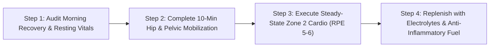

# WH_15 - Tập Gì Khi Đang Có Kinh? Lưu Lượng Máu Tử Cung & Chiến Lược Tập Luyện Phục Hồi
**Category:** Fitness & Recovery — Menstruation & Exercise 
**Screen:** Workout & Menstrual Cycle Screen 
**Metric:** Strain Target & Menstrual Flow (STR-01 / HO-01 / REC-01) 
**Reading Time:** 8 phút đọc / 8 min 
**Hero Image:**  *(Source: [https://images.unsplash.com/photo-1517838277536-f5f99be501cd?auto=format&fit=crop&w=1200&q=85](https://images.unsplash.com/photo-1517838277536-f5f99be501cd?auto=format&fit=crop&w=1200&q=85))* 
**Inline Figure:**  *(Source: [https://commons.wikimedia.org/wiki/File:Female_anatomy_sagittal_pelvis.png](https://commons.wikimedia.org/wiki/File:Female_anatomy_sagittal_pelvis.png))* 
**Clinical Source:** [Br J Sports Med (Bruinvels et al., 2017) & Cochrane Review (Armour et al., 2019)](https://pubmed.ncbi.nlm.nih.gov/27979841/) 

---

## 🇻🇳 Phiên Bản Tiếng Việt (Vietnamese Edition)

# Tập Gì Khi Đang Có Kinh? Lưu Lượng Máu Tử Cung & Chiến Lược Tập Luyện Phục Hồi

> **Tóm tắt (Sapo):** Nhiều phụ nữ phân vân liệu có nên tập luyện khi đang có kinh hay nên nằm yên nghỉ ngơi hoàn toàn. Khoa học thể thao chứng minh vận động cường độ nhẹ đến vừa kích hoạt giải phóng Endorphin giảm đau tự nhiên và tăng cường lưu thông máu vùng chậu. Khám phá cách điều chỉnh tải trọng (Deload) chuẩn xác theo tín hiệu thiết bị đeo.

> 💡 **Điểm Cốt Lõi & Hành Động Thực Tế (Key Takeaway):** Bạn không cần ngừng tập khi có kinh, nhưng hãy hạ cường độ từ ngưỡng bộc phát (RPE 8–10) xuống mức kích thích phục hồi (RPE 5–6) trong 48 giờ đầu. Ưu tiên đi bộ nhanh, yoga giãn mạc hoặc bơi nhẹ để hạ nồng độ prostaglandin gây co thắt tử cung.

## Nghỉ Ngơi Tuyệt Đối Hay Vận Động Tích Cực?

Mỗi khi kỳ kinh nguyệt bắt đầu, câu hỏi quen thuộc lại xuất hiện: *"Liệu tập luyện lúc này có gây hại cho tử cung không, hay mình nên nằm yên trên giường cả ngày?"*

Trong quá khứ, những quan niệm dân gian lỗi thời thường khuyên phụ nữ kiêng khem mọi hoạt động thể chất. Tuy nhiên, các công trình nghiên cứu quy mô lớn trong y học thể thao hiện đại (**Bruinvels et al., British Journal of Sports Medicine 2017** khảo sát trên 1.073 nữ vận động viên) đã chứng minh:
- **78% phụ nữ ghi nhận rằng tập thể dục cường độ vừa phải giúp giảm rõ rệt cơn đau bụng kinh và cảm giác uể oải.**
- Vận động kích thích hệ thần kinh trung ương tiết ra **Beta-Endorphin**—loại morphine nội sinh có khả năng khóa các thụ thể cảm nhận đau tại tủy sống mạnh hơn cả thuốc giảm đau thông thường.
- Hoạt động co bóp nhịp nhàng của các nhóm cơ lớn (cơ đùi, cơ mông, cơ lưng) thúc đẩy bơm tĩnh mạch, giúp giải tỏa tình trạng sung huyết ứ trệ máu tại vùng chậu.

<figure class="article-inline-diagram">
 
 <figcaption>🩸 <strong>Huyết Động Học Tử Cung:</strong> Các cơn co thắt do prostaglandin PGF2a gây thiếu máu cục bộ tạm thời tại cơ tử cung. Vận động nhẹ nhàng kích thích giãn mạch và tưới máu phục hồi oxy. <a href="https://commons.wikimedia.org/wiki/File:Female_anatomy_sagittal_pelvis.png" target="_blank" rel="noopener">Nguồn sơ đồ: OpenStax / Wikimedia Commons ↗</a></figcaption>
</figure>

---

## Sinh Lý Học Cơn Đau Bụng Kinh & Tác Động Của Vận Động

Để tập luyện hiệu quả trong ngày "đèn đỏ", bạn cần hiểu bản chất của cơn đau:
1. **Thủ phạm Prostaglandin (PGF₂α):** Khi lớp nội mạc tử cung bong tróc, các tế bào phóng thích một lượng lớn chất trung gian hóa học gây viêm gọi là Prostaglandin. Chất này kích thích cơ trơn tử cung co thắt dữ dội để tống xuất máu kinh ra ngoài.
2. **Thiếu Máu Cục Bộ Vi Thể (Micro-ischemia):** Lực co thắt mạnh chèn ép các mao mạch tử cung, cắt đứt nguồn oxy tạm thời đến các mô cơ—tương tự như hiện tượng chuột rút cơ tim khi thiếu máu cục bộ.
3. **Cơ Chế Hóa Giải Của Tập Luyện:** 
 - Theo phân tích tổng hợp Cochrane (**Armour et al., 2019**), các bài tập aerobic cường độ 45–60 phút thực hiện 3 lần/tuần giúp **hạ nồng độ prostaglandin trong máu tuần hoàn tới 30%**, đồng thời kích hoạt thụ thể giãn mạch Nitric Oxide (NO), khôi phục dòng máu giàu oxy tới thành tử cung.

---

## Ma Trận Điều Chỉnh Cường Độ (Deload Matrix) Theo Từng Ngày Hành Kinh

| Ngày Trong Kỳ Kinh | Trạng Thái Sinh Lý & Hormone | Tín Hiệu Trên Thiết Bị Đeo (WHOOP / Oura) | Loại Hình Vận Động Tối Ưu | Cần Tránh Hoặc Hạn Chế |
| :--- | :--- | :--- | :--- | :--- |
| **Ngày 1 (Lưu Lượng Nặng Nhất)** | Prostaglandin đạt đỉnh; lưu lượng kinh nhiều; tử cung co thắt mạnh. | **Recovery thường ở vùng Vàng hoặc Đỏ**; nhịp tim nghỉ ngơi RHR có thể hơi cao do viêm nhẹ. | **Nghỉ ngơi chủ động (Active Recovery):** Đi bộ chậm 30 phút, giãn cơ màng mềm (Yin Yoga), bài tập thở cơ hoành. | Squat/Deadlift tải trọng nặng (>75% 1RM); bài tập nhảy HIIT bộc phát; bài tập gập bụng nén áp lực. |
| **Ngày 2 (Chuyển Giao)** | Máu kinh bắt đầu giảm dần nồng độ prostaglandin; cơ tử cung giãn dần. | Điểm Recovery bắt đầu **bật tăng sang vùng Xanh**; HRV tăng phản ánh hệ phó giao cảm hồi phục. | **Vận động nhịp điệu vừa phải:** Đi bộ nhanh trên máy nghiêng (Incline Walk), đạp xe cố định nhẹ nhàng, bơi lội thả lỏng. | Các buổi chạy biến tốc nước rút (Sprints); các bài tập ép cơ bụng quá mức. |
| **Ngày 3–5 (Tái Tạo Sức Mạnh)** | Estrogen bắt đầu nhích tăng từ mức đáy; nội mạc bước vào pha tăng sinh tái tạo. | **HRV duy trì ổn định ở mức cao**; thân nhiệt da chạm đáy thấp nhất tháng. | **Bắt đầu tăng tải kháng lực:** Tập tạ kỹ thuật, tạ khối lượng vừa (RPE 6–7), thể dục nhịp điệu nhóm, chạy bền cự ly ngắn. | Tập luyện đến kiệt sức nếu chưa bù đủ sắt và điện giải. |

---

## 4 Sai Lầm Cần Tránh Tuyệt Đối Khi Tập Trong Kỳ Kinh

1. **Thực Hiện Các Tư Thế Dốc Ngược Toàn Phần Trong Yoga:** Các tư thế như trồng chuối (*Sirsasana*) hoặc đứng trên vai (*Sarvangasana*) có thể gây cản trở dòng chảy trọng lực tự nhiên của tĩnh mạch chậu, làm tăng ứ huyết vùng tử cung.
2. **Tập Cố Với Mức Tạ Tối Đa (Max Out PR):** Dù nồng độ estrogen bắt đầu tăng sau ngày 2, các dây chằng xương chậu và khớp háng trong những ngày đầu vẫn chịu ảnh hưởng của nồng độ relaxin dư thừa, làm tăng nguy cơ chấn thương gân khớp.
3. **Quên Bù Nước & Muối Khoáng:** Phụ nữ mất từ 30 đến 80 ml dịch thể và máu trong mỗi kỳ kinh. Việc mất máu đi kèm mất sắt và natri/kali, khiến bạn dễ bị chóng mặt và tụt huyết áp tư thế khi đứng lên ngồi xuống.
4. **Mặc Đồ Tập Quá Chật Gây Chèn Ép Đáy Chậu:** Quần legging nén cơ quá chặt quanh vùng xương chậu cản trở dòng tuần hoàn bạch huyết và làm gia tăng áp lực lên bàng quang đang nhạy cảm.

---

## Giao Thức 4 Bước Tập Luyện Phục Hồi Chuẩn Khoa Học

1. **Khảo Sát Chỉ Số Sinh Học Sáng Sớm:** Mở ứng dụng thiết bị đeo kiểm tra điểm Phục hồi. Nếu điểm ở vùng Đỏ kèm đau bụng quặn, hãy chuyển lịch tập sang đi bộ thư giãn ngoài trời 20 phút thay vì cố gắng đến phòng gym.
2. **Khởi Động Tập Trung Vào Khớp Háng:** Dành 10 phút thực hiện các chuỗi chuyển động giải phóng áp lực vùng chậu: *Cat-Cow (Mèo - Bò)*, *Child's Pose (Tư thế em bé)* kết hợp hít thở sâu vào đáy bụng để xoa bóp nội tạng.
3. **Thiết Lập Vùng Cường Độ RPE 5–6:** Giữ nhịp tim ở Vùng 2 (Zone 2 Cardio: 60%–70% nhịp tim tối đa). Bạn hoàn toàn có thể vừa đi bộ vừa trò chuyện thoải mái mà không bị hụt hơi.
4. **Bổ Sung Dinh Dưỡng Phục Hồi Kịp Thời:** Uống 500ml nước dừa tươi hoặc nước lọc pha điện giải giàu magiê ngay sau buổi tập; bổ sung bữa ăn nhẹ giàu vitamin C và sắt (sinh tố rau bina kết hợp chuối hoặc ức gà áp chảo) để hỗ trợ quá trình tạo máu.

---

## Nguồn Y Khoa Lâm Sàng & Tài Liệu Tham Khảo

1. **Bruinvels, G., et al. (2017).** Menstrual cycle: the neglected opportunity in sports medicine and athletics. *British Journal of Sports Medicine*, 51(9), 701-704. [PMID: 27979841](https://pubmed.ncbi.nlm.nih.gov/27979841/)
2. **Armour, M., et al. (2019).** Exercise for dysmenorrhoea. *Cochrane Database of Systematic Reviews*, (9). [PMID: 31538350](https://pubmed.ncbi.nlm.nih.gov/31538350/)
3. **Dehnavi, Z. M., et al. (2018).** The effect of 8 weeks of aerobic exercise on severity of physical symptoms of premenstrual syndrome: a clinical trial study. *BMC Women's Health*, 18(1), 80.
4. **WHOOP Medical Knowledge Base (2025).** Menstrual Cycle Coaching & Dynamic Strain Targets.

---

## 🇬🇧 English Edition

# Exercising on Your Period: Biomechanics, Uterine Blood Flow & Deload Strategy

> **Abstract (Sapo):** Debate persists over whether menstruation demands absolute bed rest or active movement. Sports biomechanics confirms that low-to-moderate aerobic activity stimulates endogenous beta-endorphin analgesia and improves pelvic hemodynamics. Discover how to strategically deload your training intensity using wearable biometrics.

> 💡 **Key Takeaway & Clinical Action:** You don't need to cease exercise during menstruation, but dial back from high-strain intervals (RPE 8–10) to active recovery zones (RPE 5–6) during the first 48 hours. Prioritize brisk walking, myofascial mobility, or gentle swimming to clear vasoconstrictive prostaglandins.

## Absolute Rest or Active Movement?

When menses begins, the persistent question surfaces: *"Will working out cause harm, or should I stay immobile in bed all day?"*

Historically, outdated social paradigms counseled complete sedentary withdrawal during menstruation. However, contemporary exercise physiology (**Bruinvels et al., British Journal of Sports Medicine 2017**, evaluating 1,073 competitive female athletes) demonstrates the contrary:
- **78% of women report that moderate aerobic exercise significantly alleviates menstrual cramps and chronic lethargy.**
- Muscular contraction stimulates the central nervous system to release **Beta-Endorphin**—an endogenous opioid peptide that attenuates spinal nociceptive pain signaling far more effectively than routine over-the-counter analgesics.
- Continuous contraction of the large muscle beds (quadriceps, gluteals, spinal erectors) activates venous muscle pump mechanics, clearing pelvic vascular congestion.

<figure class="article-inline-diagram">
 
 <figcaption>🩸 <strong>Uterine Hemodynamics:</strong> Prostaglandin PGF2a triggers intense myometrial vasoconstriction and local tissue ischemia. Gentle rhythmic movement activates nitric oxide release and restores perfusion. <a href="https://commons.wikimedia.org/wiki/File:Female_anatomy_sagittal_pelvis.png" target="_blank" rel="noopener">Source: OpenStax / Wikimedia Commons ↗</a></figcaption>
</figure>

---

## The Physiology of Primary Dysmenorrhea & Exercise

Navigating period workouts requires understanding the underlying biochemical cascades:
1. **The Prostaglandin Culprit (PGF₂α):** As the secretory endometrium sheds, disrupted cells release high concentrations of inflammatory eicosanoids known as Prostaglandins. These induce spastic myometrial contractions to expel menstrual fluid.
2. **Microvascular Ischemia:** These sustained contractions compress intramyometrial arterioles, suffocating oxygen delivery to the uterine muscle—identical to an ischemic myocardial angina episode.
3. **Exercise as a Counter-Regulator:**
 - In a comprehensive Cochrane systematic review (**Armour et al., 2019**), 45 to 60 minutes of low-to-moderate aerobic exercise performed 3 times weekly reduced **circulating prostaglandins by up to 30%**, concurrently driving Nitric Oxide (NO) release to restore microvascular blood flow.

---

## Daily Period Deload Matrix

| Day of Menses | Biological Landscape & Hormones | Wearable Signature (WHOOP / Oura) | Optimal Exercise Selection | Contraindicated Regimens |
| :--- | :--- | :--- | :--- | :--- |
| **Day 1 (Heaviest Flow)** | Peak prostaglandin release; active uterine shedding; highest cramp intensity. | **Recovery frequently Yellow/Red**; resting heart rate slightly elevated due to acute inflammation. | **Active Recovery:** 30-minute leisurely outdoor walk, gentle Yin Yoga, diaphragmatic decompression. | Heavy compound barbells (>75% 1RM); plyometrics; high-impact interval sprints. |
| **Day 2 (Transitional)** | Declining prostaglandin levels; progressive myometrial relaxation. | Recovery transitioning back into **Green**; nocturnal HRV rebound begins. | **Steady-State Aerobic:** Incline treadmill walking (Zone 2), low-resistance stationary cycling, easy swimming. | Extended high-intensity interval training (HIIT); breath-holding Valsalva maneuvers. |
| **Day 3–5 (Rebuilding Power)** | Estradiol begins rising from its nadir; endometrial proliferative repair initiated. | **HRV stable at monthly highs**; lowest peripheral skin temperature of the cycle. | **Progressive Resistance Training:** Moderate-intensity lifting (RPE 6–7), group fitness, structured tempo runs. | Exercising to exhaustion without replenishing electrolytes and iron. |

---

## 4 Crucial Mistakes to Avoid During Your Period

1. **Full Inversion Yoga Asanas:** Poses like headstands (*Sirsasana*) or shoulder stands (*Sarvangasana*) impede gravity-assisted pelvic venous drainage, potentially magnifying vascular heaviness.
2. **Chasing 1-Rep Max PRs:** Although estrogen levels climb after Day 2, ligamentous laxity may persist from preceding relaxin surges, slightly elevating soft tissue sprain risks under maximal loads.
3. **Neglecting Fluid & Electrolyte Depletion:** A typical menstrual period involves losing 30 to 80 mL of blood and serous fluid. This fluid loss carries essential sodium, potassium, and iron, leaving you vulnerable to orthostatic hypotension.
4. **Restricting Pelvic Circulation with Tight Gear:** Wearing overly constrictive compression leggings around the lower abdomen hampers lymphatic drainage and compresses an already tender bladder.

---

## 4-Step Period Movement & Recovery Protocol

1. **Audit Morning Biometrics:** Check your wearable Recovery Score. If flagged in the Red with acute cramping, pivot your training to a 20-minute restorative walk in nature rather than grinding through the gym.
2. **Execute Pelvic Mobilization:** Dedicate 10 minutes to pelvic decompression sequences: *Cat-Cow*, *Child's Pose*, and *Supine Figure Four*, coordinating deep breaths into the lower abdomen to gently massage visceral organs.
3. **Operate at RPE 5–6 (Zone 2):** Keep your heart rate between 60%–70% of maximum. You should maintain full conversational sentences without shortness of breath throughout the session.
4. **Targeted Post-Workout Rehydration:** Drink 500 mL of fresh coconut water or electrolyte-fortified water rich in magnesium; pair it with a light anti-inflammatory meal (spinach-banana smoothie or grilled chicken breast) to support erythropoiesis.

---

## Clinical Citations & Reference Literature

1. **Bruinvels, G., et al. (2017).** Menstrual cycle: the neglected opportunity in sports medicine and athletics. *British Journal of Sports Medicine*, 51(9), 701-704. [PMID: 27979841](https://pubmed.ncbi.nlm.nih.gov/27979841/)
2. **Armour, M., et al. (2019).** Exercise for dysmenorrhoea. *Cochrane Database of Systematic Reviews*, (9). [PMID: 31538350](https://pubmed.ncbi.nlm.nih.gov/31538350/)
3. **Dehnavi, Z. M., et al. (2018).** The effect of 8 weeks of aerobic exercise on severity of physical symptoms of premenstrual syndrome: a clinical trial study. *BMC Women's Health*, 18(1), 80.
4. **WHOOP Medical Knowledge Base (2025).** Menstrual Cycle Coaching & Dynamic Strain Targets.

