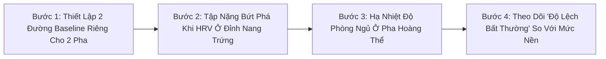
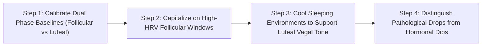

# WH_16 - Biến Thiên Nhịp Tim (HRV) Ở Nữ Giới: Giải Mã Bước Giảm Tự Nhiên Sau Khi Rụng Trứng
**Category:** Fitness & Recovery — Heart Rate Variability (HRV) 
**Screen:** Recovery Screen & Vitals 
**Metric:** Female HRV Baselines & Autonomic Shifts (REC-01 / REC-03 / HO-04) 
**Reading Time:** 9 phút đọc / 9 min 
**Hero Image:**  *(Source: [https://images.unsplash.com/photo-1506126613408-eca07ce68773?auto=format&fit=crop&w=1200&q=85](https://images.unsplash.com/photo-1506126613408-eca07ce68773?auto=format&fit=crop&w=1200&q=85))* 
**Inline Figure:**  *(Source: [https://commons.wikimedia.org/wiki/File:ECG_Intervals.svg](https://commons.wikimedia.org/wiki/File:ECG_Intervals.svg))* 
**Clinical Source:** [Neurosci Biobehav Rev (Schmalenberger et al., 2019) & Eur J Appl Physiol (Tenan et al., 2014)](https://pubmed.ncbi.nlm.nih.gov/31085203/) 

---

## 🇻🇳 Phiên Bản Tiếng Việt (Vietnamese Edition)

# Biến Thiên Nhịp Tim (HRV) Ở Nữ Giới: Giải Mã Bước Giảm Tự Nhiên Sau Khi Rụng Trứng

> **Tóm tắt (Sapo):** Nếu bạn nhận thấy điểm Biến thiên nhịp tim (HRV) của mình đột ngột sụt giảm 10–15% và điểm Phục hồi chuyển sang màu vàng trong hai tuần cuối của tháng, đừng hoảng sợ rằng bạn bị kiệt sức. Đó là một hiện tượng sinh lý học bình thường do progesterone chi phối hệ thần kinh thực vật.

> 💡 **Điểm Cốt Lõi & Hành Động Thực Tế (Key Takeaway):** Đừng so sánh chỉ số HRV pha hoàng thể với pha nang trứng. Hãy xây dựng hai đường cơ sở (Baseline) riêng biệt cho cơ thể: một mức nền cao ở nửa đầu chu kỳ (nhờ estrogen kích hoạt hệ phó giao cảm) và một mức nền thấp hơn ở nửa sau chu kỳ (do progesterone kích hoạt hệ giao cảm và tăng nhiệt độ cơ thể).

## Cơn Ác Mộng Của Người Dùng Thiết Bị Đeo: Điểm HRV Tụt Dốc

Rất nhiều phụ nữ sử dụng các thiết bị theo dõi sức khỏe cao cấp (như WHOOP, Oura Ring hay Apple Watch) từng trải qua trải nghiệm hoang mang này:
- Nửa đầu tháng, điểm Phục hồi (**Recovery Score**) luôn xanh mướt (80%–95%), chỉ số Biến thiên nhịp tim (**HRV RMSSD**) chạm ngưỡng kỷ lục 65–80 ms.
- Thế nhưng, bước sang tuần thứ 3 và thứ 4, dù vẫn đi ngủ đúng giờ, ăn uống lành mạnh và không uống một giọt bia rượu nào, điểm HRV đột ngột tụt xuống 45–55 ms, nhịp tim nghỉ ngơi (**RHR**) tăng vọt thêm 3 đến 6 nhịp/phút, và ứng dụng liên tục báo cảnh báo "Cơ thể chưa hồi phục".

Hàng triệu phụ nữ đã lầm tưởng rằng mình bị "quá tải tập luyện", "suy nhược cơ thể" hoặc "thiếu ngủ trầm trọng". Nhưng sự thật khoa học là gì?

Theo phân tích tổng quan có hệ thống kinh điển của **Schmalenberger et al. (Neuroscience & Biobehavioral Reviews 2019)** tổng hợp hàng chục công trình nghiên cứu: **HRV của phụ nữ có chu kỳ kinh nguyệt tự nhiên PHẢI giảm sau khi rụng trứng. Đây là dấu hiệu của một chu kỳ rụng trứng khỏe mạnh, không phải bệnh lý!**

<figure class="article-inline-diagram">
 
 <figcaption>📈 <strong>Đo Lường Biến Thiên Nhịp Tim:</strong> Chỉ số RMSSD (Root Mean Square of Successive Differences) phản ánh mức độ phanh hãm của hệ phó giao cảm lên nút xoang tim. <a href="https://commons.wikimedia.org/wiki/File:ECG_Intervals.svg" target="_blank" rel="noopener">Nguồn sơ đồ: Wikimedia Commons ↗</a></figcaption>
</figure>

---

## Cơ Chế Sinh Học: Cuộc Chiến Giữa Estrogen & Progesterone Lên Hệ Thần Kinh Thực Vật

Trái tim của chúng ta không đập đều như máy gõ nhịp; khoảng cách giữa các nhịp tim liên tiếp (khoảng R-R) luôn biến đổi linh hoạt dưới sự giằng co liên tục giữa hai nhánh của **Hệ Thần Kinh Thực Vật (Autonomic Nervous System - ANS)**:
1. **Hệ Phó Giao Cảm (Parasympathetic / Vagal Tone):** Nhánh "Nghỉ ngơi và Tiêu hóa", làm chậm nhịp tim, tạo ra sự biến thiên nhịp tim lớn (**HRV cao** → Dấu hiệu cơ thể phục hồi tối ưu).
2. **Hệ Giao Cảm (Sympathetic Tone):** Nhánh "Chiến đấu hay Bỏ chạy", tăng nhịp tim, làm nhịp tim đập đều đặn và cứng nhắc hơn (**HRV thấp** → Dấu hiệu cơ thể đang chịu tải sinh lý).

Sự thăng trầm của các hormone sinh dục nữ tác động trực tiếp lên hai nhánh thần kinh này:

### 1. Pha Nang Trứng (Follicular Phase) — Kỷ Nguyên Của Estrogen
- **Estradiol (E2)** tăng cao kích thích trung tâm phó giao cảm tại thân não, làm tăng trương lực của dây thần kinh phế vị (**Vagus Nerve**).
- Estrogen đồng thời kích thích giãn mạch máu thông qua Nitric Oxide, hạ huyết áp ngoại vi.
- **Kết quả sinh trắc học:** Nhịp tim nghỉ ngơi chạm mức thấp nhất tháng, **HRV RMSSD đạt đỉnh cao nhất**, cơ thể phục hồi cực nhanh sau các buổi tập nặng.

### 2. Pha Hoàng Thể (Luteal Phase) — Kỷ Nguyên Của Progesterone
- Sau khi rụng trứng, hoàng thể tiết ra lượng lớn **Progesterone**.
- Progesterone tác động trực tiếp lên trung tâm điều nhiệt tại vùng hạ đồi, kích hoạt sinh nhiệt và **nâng thân nhiệt cơ bản thêm +0.3°C đến +0.5°C**.
- Để tản nhiệt và thích nghi với thân nhiệt cao hơn, hệ giao cảm phải tăng cường hoạt động; nhịp tim nghỉ ngơi tăng thêm 3–8 bpm.
- **Kết quả sinh trắc học:** Trương lực giao cảm lấn át khiến **HRV tự nhiên sụt giảm từ 10% đến 20%**. Đây là phản ứng bảo vệ sinh tồn hoàn toàn sinh lý!

---

## Bảng Đối Chiếu Chỉ Số Sinh Trắc Học ANS Qua 4 Giai Đoạn

| Giai Đoạn Chu Kỳ | Hormone Thống Trị | Trạng Thái Thần Kinh Thực Vật (ANS) | Biến Thiên Nhịp Tim (HRV RMSSD) | Nhịp Tim Nghỉ Ban Đêm (RHR) | Thân Nhiệt Da Ngoại Vi (BBT) |
| :--- | :--- | :--- | :--- | :--- | :--- |
| **Kỳ Kinh (Ngày 1–5)** | E2 và P4 đều ở mức đáy. | Trương lực giao cảm giảm dần; chuyển giao sang phó giao cảm. | Bắt đầu hồi phục, tăng dần từ Ngày 2. | Hạ dần từ đỉnh cao của kỳ trước về mức nền. | Nhiệt độ hạ về đường cơ sở (36.2°C-36.4°C). |
| **Pha Nang Trứng (Ngày 6–13)** | **Estradiol (E2) tăng vọt.** | **Phó giao cảm (Vagus) thống trị tuyệt đối.** | **Chạm đỉnh cao nhất tháng** (Cao hơn mức trung bình 10–25%). | **Chạm đáy thấp nhất tháng** (Ví dụ: 48–52 bpm). | Thấp và ổn định nhất tháng. |
| **Rụng Trứng (Ngày 14)** | Đỉnh sóng LH; sụt giảm nhẹ estrogen. | Chuyển dịch ngắn hạn; giao cảm nhích nhẹ. | Dao động nhẹ quanh mức đỉnh. | Nhích tăng nhẹ 1–2 bpm. | Điểm võng nhiệt (Nadir) ngay trước khi vọt tăng. |
| **Pha Hoàng Thể (Ngày 15–28)** | **Progesterone (P4) áp đảo.** | **Giao cảm chiếm ưu thế nhẹ** do sinh nhiệt và giữ nước. | **Sụt giảm tự nhiên 10%–20%** (Vùng Vàng trên WHOOP). | **Tăng thêm +3 đến +8 bpm** so với pha nang trứng. | **Tăng vọt +0.3°C đến +0.5°C** liên tục trong 10–14 ngày. |

---

## 4 Sai Lầm Nghiêm Trọng Khi Đọc Dữ Liệu HRV Ở Nữ Giới

1. **So Sánh HRV Của Mình Với Nam Giới Hoặc Người Khác:** HRV là chỉ số mang tính cá nhân hóa 100%. Một người có HRV 40 ms hoàn toàn có thể khỏe mạnh tương đương người có HRV 90 ms do cấu trúc gen và kích thước buồng tim khác nhau.
2. **Cố Ép Mình Đạt "Vùng Xanh" Ở Pha Hoàng Thể:** Uống thêm thuốc bổ hoặc nhịn tập điên cuồng ở tuần thứ 4 để kéo HRV lên vùng Xanh là hành động chống lại quy luật sinh lý tự nhiên của progesterone.
3. **Bỏ Tập Hoàn Toàn Khi Thấy HRV Vàng:** Điểm Vàng ở pha hoàng thể không có nghĩa là bạn phải nằm yên; nó chỉ là tín hiệu nhắc bạn không nên đẩy cơ thể vượt quá ngưỡng chịu đựng (Over-reaching).
4. **Không Ghi Nhận Tác Động Của Thuốc Tránh Thai:** Phụ nữ dùng thuốc tránh thai nội tiết kết hợp (Combined OCPs) không có đỉnh estrogen/progesterone tự nhiên; do đó, HRV của họ thường phẳng hơn và không thể hiện bước giảm chu kỳ đặc trưng.

---

## Giao Thức 4 Bước Ứng Dụng HRV Vào Tập Luyện Thông Minh

1. **Thiết Lập 2 Đường Baseline Cá Nhân Hóa:** Thay vì dùng một con số trung bình chung cho cả tháng, hãy tự tính:
 - *Baseline Pha Nang Trứng:* Trung bình HRV từ Ngày 1 đến Ngày 13.
 - *Baseline Pha Hoàng Thể:* Trung bình HRV từ Ngày 15 đến Ngày 28.
2. **Khai Thác Tối Đa "Cửa Sổ Vàng" Nang Trứng:** Khi HRV đang ở đỉnh cao nhất tháng, hãy mạnh dạn đăng ký các buổi tập tạ nặng, bài tập thể lực cường độ cao hoặc thử thách cá nhân mới; khả năng phục hồi cơ bắp và chống viêm lúc này đang ở mức phi thường.
3. **Chủ Động Hạ Nhiệt Để Bảo Vệ HRV Pha Hoàng Thể:** Vì progesterone làm tăng thân nhiệt khiến tim phải đập nhanh hơn khi ngủ, hãy chủ động hạ điều hòa phòng ngủ xuống 18°C-20°C, tắm nước ấm trước khi ngủ 90 phút và bổ sung 300–400 mg Magnesium Glycinate để hỗ trợ thần kinh phó giao cảm.
4. **Cách Đọc Tín Hiệu Cảnh Báo Thật Sự:** Bạn chỉ cần lo lắng nếu HRV pha hoàng thể **sụt giảm sâu hơn 30%** so với đường cơ sở của chính pha hoàng thể, hoặc nhịp tim nghỉ ngơi tăng vọt trên 10 bpm kèm theo sốt—đó mới là dấu hiệu nhiễm trùng hoặc kiệt sức thật sự.

---

## Nguồn Y Khoa Lâm Sàng & Tài Liệu Tham Khảo

1. **Schmalenberger, K. M., et al. (2019).** Menstrual cycle changes in vagally-mediated heart rate variability: a systematic review and meta-analysis. *Neuroscience & Biobehavioral Reviews*, 105, 292-307. [PMID: 31085203](https://pubmed.ncbi.nlm.nih.gov/31085203/)
2. **Tenan, M. S., et al. (2014).** Changes in resting heart rate variability across the menstrual cycle are dependent on the method of cycle tracking. *European Journal of Applied Physiology*, 114(5), 989-997. [PMID: 24700054](https://pubmed.ncbi.nlm.nih.gov/24700054/)
3. **Grant, C. C., et al. (2020).** The effect of the menstrual cycle and oral contraceptives on heart rate variability: a systematic review. *Heart, Lung and Circulation*, 29(6), 844-853.
4. **WHOOP Research & Clinical Science (2025).** Heart Rate Variability (HRV) and Menstrual Cycle Algorithms (REC-01 & REC-03).

---

## 🇬🇧 English Edition

# Female HRV Biometrics: Why Your Parasympathetic Baseline Shifts Across the Month

> **Abstract (Sapo):** If your Heart Rate Variability (HRV) dips 10–15% and your wearable recovery score turns yellow during the second half of your cycle, do not assume you have lost aerobic fitness. This predictable fluctuation is a healthy neuro-endocrine consequence of progesterone modulating the autonomic nervous system.

> 💡 **Key Takeaway & Clinical Action:** Avoid comparing luteal HRV to follicular baselines. Establish dual autonomic reference baselines: a higher follicular baseline driven by estrogenic parasympathetic vagal stimulation, and a lower luteal baseline induced by progesterone-driven thermogenesis and mild sympathetic dominance.

## The Wearable Dilemma: The Mysterious HRV Plunge

Thousands of female wearable users (tracking with WHOOP, Oura Ring, or Apple Watch) encounter this perplexing pattern monthly:
- Throughout the first two weeks, their **Recovery Scores** glow vivid green (80%–95%), with nocturnal Heart Rate Variability (**HRV RMSSD**) surging to personal highs of 65–80 ms.
- Suddenly, entering weeks 3 and 4, despite flawless sleep hygiene, zero alcohol consumption, and clean nutrition, HRV plummets to 45–55 ms, Resting Heart Rate (**RHR**) spikes by 3 to 6 bpm, and the app sounds warnings of "Incomplete Recovery."

Millions of active women mistakenly conclude that they are "overtraining," "chronically fatigued," or "losing fitness." What is the clinical reality?

According to a seminal systematic review and meta-analysis by **Schmalenberger et al. (Neuroscience & Biobehavioral Reviews 2019)**: **Female HRV is biologically pre-programmed to decline following ovulation. This is the physiological signature of a healthy ovulatory cycle, not a functional deficit!**

<figure class="article-inline-diagram">
 
 <figcaption>📈 <strong>Measuring Autonomic Balance:</strong> The RMSSD (Root Mean Square of Successive Differences) metric reflects parasympathetic vagal modulation acting directly upon the cardiac sinoatrial node. <a href="https://commons.wikimedia.org/wiki/File:ECG_Intervals.svg" target="_blank" rel="noopener">Source: Wikimedia Commons ↗</a></figcaption>
</figure>

---

## Neuro-Endocrine Mechanism: Estrogen vs. Progesterone Autonomic Modulation

The human heart does not beat at a rigid metronomic pace; the duration between consecutive heartbeats (R-R intervals) fluctuates constantly under the dual innervation of the **Autonomic Nervous System (ANS)**:
1. **Parasympathetic Nervous System (Vagal Tone):** The "Rest and Digest" branch. It decelerates sinoatrial firing and amplifies beat-to-beat variability (**High HRV** → Indicator of systemic readiness).
2. **Sympathetic Nervous System:** The "Fight or Flight" branch. It accelerates cardiac frequency, regularizing heartbeat intervals (**Low HRV** → Indicator of systemic physiological load).

Female sex steroid hormones exert powerful, predictable modulation over these autonomic control circuits:

### 1. Follicular Phase — The Estrogenic Parasympathetic Surge
- **Estradiol (E2)** directly stimulates central vagal nuclei within the medulla oblongata, enhancing vagal nerve efferent activity.
- Estrogen promotes peripheral vasodilation via endothelial Nitric Oxide synthase (eNOS), reducing vascular resistance.
- **Biometric Output:** Resting heart rate hits its monthly trough, **HRV RMSSD peaks**, and neuromuscular recovery velocity is maximized.

### 2. Luteal Phase — Progesterone & Thermogenic Strain
- Following ovulation, the corpus luteum produces substantial amounts of **Progesterone**.
- Progesterone crosses the blood-brain barrier to upregulate the hypothalamic preoptic thermoregulatory set-point, driving **basal body temperature up by +0.3°C to +0.5°C**.
- To dissipate thermal energy and sustain cardiac output under elevated core temperatures, the sympathetic nervous system upregulates resting cardiac frequency (+3 to +8 bpm).
- **Biometric Output:** Mild sympathetic dominance suppresses the vagal brake, causing **HRV RMSSD to naturally decline by 10% to 20%**. This is healthy homeostasis in action.

---

## Comparative Autonomic Biomarker Matrix Across 4 Cycle Phases

| Cycle Phase | Dominant Endocrine Profile | Autonomic Balance (ANS) | Heart Rate Variability (HRV RMSSD) | Nocturnal Resting Heart Rate (RHR) | Peripheral Skin Temp (BBT) |
| :--- | :--- | :--- | :--- | :--- | :--- |
| **Menstruation (Days 1–5)** | E2 and P4 at nadir. | Progressive sympathetic withdrawal; vagal reactivation begins. | Gradually rebounding upward from Day 2. | Descending from late luteal elevation toward baseline. | Resets to low baseline (36.2°C-36.4°C). |
| **Follicular Phase (Days 6–13)** | **Estradiol (E2) escalates.** | **Marked Parasympathetic (Vagal) Dominance.** | **Monthly Maximum** (10%–25% above 30-day baseline). | **Monthly Minimum** (e.g., 48–52 bpm). | Low and exceptionally stable. |
| **Ovulatory Window (Day 14)** | LH surge; transient E2 dip. | Brief autonomic transition; mild sympathetic blip. | Minor plateau around peak levels. | Slight 1–2 bpm bump. | Thermal nadir followed by sharp post-ovulatory rise. |
| **Luteal Phase (Days 15–28)** | **Progesterone (P4) dominance.** | **Mild Sympathetic Dominance** driven by thermogenesis. | **Physiological 10%–20% decline** (Typical Yellow Zone). | **Elevated by +3 to +8 bpm** relative to follicular baseline. | **Sustained elevation (+0.3°C to +0.5°C)** for 10–14 days. |

---

## 4 Common Misinterpretations of Female HRV Data

1. **Benchmarking Against Men or Peers:** HRV is an individualized metric influenced by genetic heart volume and vagal nerve diameter. An individual with an average HRV of 45 ms can possess equivalent cardiovascular vitality to someone averaging 90 ms.
2. **Forcing "Green Recoveries" in the Luteal Phase:** Attempting extreme supplementation or complete training paralysis in Week 4 to force a green score contradicts normal human biology.
3. **Treating Yellow Recoveries as Pathology:** A yellow recovery score during the luteal window reflects healthy progesterone thermogenesis, not an emergency requiring total immobilization.
4. **Ignoring Oral Contraceptive Flattening:** Synthetic progestins in combined birth control pills suppress endogenous ovarian cycling; hence, users exhibit flatter, non-cyclical autonomic trajectories.

---

## 4-Step Cycle-Aware HRV Training Protocol

1. **Establish Dual Baseline Norms:** Rather than evaluating your metrics against an undifferentiated monthly mean:
 - *Follicular Baseline:* Mean HRV from Day 1 to Day 13.
 - *Luteal Baseline:* Mean HRV from Day 15 to Day 28.
2. **Unleash Peak Strain During the Follicular Peak:** When your HRV hits its monthly ceiling, schedule high-intensity intervals, max-effort resistance sessions, and athletic competitions; your neuromuscular system can handle higher allostatic loads.
3. **Actively Counter Luteal Thermogenesis:** Because elevated body temperature elevates nocturnal cardiac workload, cool your bedroom ambient temperature to 18°C-20°C (65°F-68°F), take a warm shower 90 minutes before bed to induce peripheral heat dumping, and consider 300–400 mg of Magnesium Glycinate to support vagal activation.
4. **Identify True Autonomic Red Flags:** Only consider clinical overtraining or systemic infection if your luteal HRV drops **more than 30% below your luteal baseline**, or if resting heart rate elevates by >10 bpm alongside systemic malaise.

---

## Clinical Citations & Reference Literature

1. **Schmalenberger, K. M., et al. (2019).** Menstrual cycle changes in vagally-mediated heart rate variability: a systematic review and meta-analysis. *Neuroscience & Biobehavioral Reviews*, 105, 292-307. [PMID: 31085203](https://pubmed.ncbi.nlm.nih.gov/31085203/)
2. **Tenan, M. S., et al. (2014).** Changes in resting heart rate variability across the menstrual cycle are dependent on the method of cycle tracking. *European Journal of Applied Physiology*, 114(5), 989-997. [PMID: 24700054](https://pubmed.ncbi.nlm.nih.gov/24700054/)
3. **Grant, C. C., et al. (2020).** The effect of the menstrual cycle and oral contraceptives on heart rate variability: a systematic review. *Heart, Lung and Circulation*, 29(6), 844-853.
4. **WHOOP Research & Clinical Science (2025).** Heart Rate Variability (HRV) and Menstrual Cycle Algorithms (REC-01 & REC-03).

