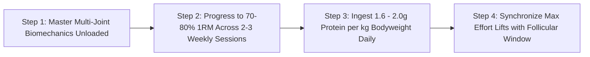

# WH_17 - Tập Kháng Lực Cho Phái Đẹp: Mật Độ Xương, Độ Nhạy Insulin & Trẻ Hóa Chuyển Hóa
**Category:** Women's Health 
**Screen:** Workout & Strength Screen 
**Metric:** Muscular Strain & Bone Mineral Density (STR-01 / HO-04) 
**Reading Time:** 8 phút đọc / 8 min 
**Hero Image:**  *(Source: [https://images.unsplash.com/photo-1534438327276-14e5300c3a48?auto=format&fit=crop&w=1200&q=85](https://images.unsplash.com/photo-1534438327276-14e5300c3a48?auto=format&fit=crop&w=1200&q=85))* 
**Inline Figure:**  *(Source: [https://commons.wikimedia.org/wiki/File:Bone_remodeling.jpg](https://commons.wikimedia.org/wiki/File:Bone_remodeling.jpg))* 
**Clinical Source:** [SpringerPlus (Sung et al., 2014) & Scandinavian Journal of Medicine & Science in Sports](https://springerplus.springeropen.com/articles/10.1186/2193-1801-3-668) 

---

## 🇻🇳 Phiên Bản Tiếng Việt (Vietnamese Edition)

# Tập Kháng Lực Cho Phái Đẹp: Mật Độ Xương, Độ Nhạy Insulin & Trẻ Hóa Chuyển Hóa

> **Tóm tắt (Sapo):** Tập tạ không khiến phụ nữ bị 'đô con' hay thô kệch—đó là tấm khiên y khoa vững chắc nhất để bảo vệ mật độ xương trước nguy cơ loãng xương, tối ưu hóa độ nhạy insulin và duy trì tốc độ chuyển hóa cơ bản suốt cuộc đời. Khám phá khoa học đằng sau các bài tập tạ nặng và thử nghiệm lâm sàng LIFTMOR.

> 💡 **Điểm Cốt Lõi & Hành Động Thực Tế (Key Takeaway):** Phụ nữ đạt đỉnh mật độ xương ở tuổi 25–30 và mất xương nhanh chóng sau mãn kinh. Các bài tập cardio nhẹ không đủ lực kích hoạt tế bào tạo xương; bạn cần các bài tập kháng lực đa khớp (Squat, Deadlift, Overhead Press) với mức tạ từ 70–85% 1RM ít nhất 2–3 lần mỗi tuần.

## Đập Tan Định Kiến: Phụ Nữ Tập Tạ Có Bị "Đô Con"?

Trong nhiều thập kỷ, văn hóa thể hình đại chúng đã vô tình gieo rắc một nỗi sợ hãi vô căn cứ cho phái đẹp: *"Nếu nâng tạ nặng, bắp tay bắp chân sẽ to bè và mất đi nét nữ tính mềm mại"*. Hậu quả là hàng triệu phụ nữ chỉ dám gắn bó với máy chạy bộ hoặc các quả tạ hồng 1 kg.

Về mặt nội tiết học sinh sản:
- Nồng độ **Testosterone tự do** trong máu phụ nữ chỉ bằng **1/15 đến 1/20** so với nam giới trưởng thành.
- Phụ nữ hoàn toàn không sở hữu đủ môi trường nội tiết tố androgen để phát triển các khối cơ bắp khổng lồ nếu không sử dụng các chất kích thích đồng hóa ngoại sinh (**Anabolic Steroids**).
- Thay vào đó, tập kháng lực ở phụ nữ kích hoạt các thụ thể **Estrogen Receptor Alpha (ER-α)** trên tế bào cơ xương, giúp cơ bắp săn chắc, tăng mật độ ty thể, đốt cháy mỡ nội tạng và tạo nên đường cong thể hình khỏe khoắn.

<figure class="article-inline-diagram">
 
 <figcaption>🦴 <strong>Cơ Chế Kích Hoạt Tái Tạo Xương:</strong> Khi chịu lực nén cơ học vượt ngưỡng, các tế bào cảm nhận áp lực (Osteocytes) phát tín hiệu thu hút tạo cốt bào (Osteoblasts) đắp thêm canxi và collagen. <a href="https://commons.wikimedia.org/wiki/File:Bone_remodeling.jpg" target="_blank" rel="noopener">Nguồn sơ đồ: OpenStax / Wikimedia Commons ↗</a></figcaption>
</figure>

---

## Quy Luật Cơ Học: "Ngưỡng Cảm Ứng Xương" (Mechanostat Theory)

Xương không phải là các thanh xốp vô tri tĩnh tại; xương là một mô sống năng động liên tục tự tiêu hủy và tái tạo (**Bone Remodeling**):
- Sau tuổi 30, quá trình hủy xương của các hủy cốt bào (*Osteoclasts*) bắt đầu vượt trội hơn quá trình tạo xương của tạo cốt bào (*Osteoblasts*).
- Khi bước vào giai đoạn tiền mãn kinh và mãn kinh, sự sụt giảm đột ngột của estrogen khiến tốc độ mất xương tăng vọt lên **2% đến 3% mỗi năm**, đẩy hàng triệu phụ nữ vào nguy cơ gãy xương hông và xẹp đốt sống do **Loãng Xương (Osteoporosis)**.

Theo lý thuyết **Mechanostat của Bác sĩ Harold Frost**: Tế bào xương chỉ kích hoạt quá trình khoáng hóa khi chịu một lực biến dạng cơ học (**Mechanical Strain**) vượt qua một ngưỡng tới hạn (>1500 microstrain).
- Các bài tập như đi bộ, bơi lội hay đạp xe có tác động tim mạch tuyệt vời nhưng **hoàn toàn nằm dưới ngưỡng kích thích tạo xương**.
- Chỉ có lực nén dọc trục cơ thể từ các bài tập tạ nặng (Squat, Deadlift) hoặc lực va chạm mạnh (nhảy dây, tiếp đất) mới đủ sức uốn cong vi thể các bè xương, gửi tín hiệu điện áp (*Piezoelectric effect*) đánh thức tế bào tạo cốt bào.

---

## Thử Nghiệm Lâm Sàng Đột Phá LIFTMOR (Watson et al., 2018)

Được công bố trên tạp chí y khoa danh giá **Journal of Bone and Mineral Research**, thử nghiệm lâm sàng ngẫu nhiên đối chứng **LIFTMOR** đã làm thay đổi hoàn toàn quan điểm y học về tập luyện cho phụ nữ:
- Đối tượng: Các phụ nữ sau mãn kinh có mật độ xương thấp (thiếu xương hoặc loãng xương).
- Giao thức can thiệp: Tập tạ nặng cường độ cao (**High-Intensity Resistance and Impact Training - HiRIT**) gồm 5 hiệp x 5 lần lặp ở mức tạ **80%–85% 1RM** với các bài tập Deadlift, Overhead Press, Back Squat và động tác nhảy tiếp đất.
- **Kết quả kinh ngạc:** Sau 8 tháng, nhóm tập tạ nặng **tăng 2.9% mật độ khoáng chất xương tại đốt sống thắt lưng (Lumbar Spine)** và **1.5% tại cổ xương đùi (Femoral Neck)**, đồng thời cải thiện vượt bậc sức mạnh cơ bắp và khả năng giữ thăng bằng mà **không ghi nhận bất kỳ một ca chấn thương nào**.
- Ngược lại, nhóm đối chứng chỉ tập các bài tập nhẹ nhàng tại nhà tiếp tục bị mất xương (-1.2%).

---

## Bảng So Sánh Các Lợi Ích Chuyển Hóa & Sinh Học Của Tập Kháng Lực

| Hệ Cơ Quan | Cơ Chế Sinh Học Được Kích Hoạt | Lợi Ích Trực Tiếp Cho Sức Khỏe Phụ Nữ | Tín Hiệu Trên Thiết Bị Đeo |
| :--- | :--- | :--- | :--- |
| **Hệ Cơ Xương Khớp** | Kích hoạt tạo cốt bào bồi đắp khoáng chất; tăng tiết collagen loại I ở gân dây chằng. | Đảo ngược tiến trình thoái hóa xương, ngăn ngừa xẹp đốt sống lưng, giảm đau mỏi thắt lưng mãn tính. | Điểm Tải Cơ Bắp (Muscular Strain) tăng, củng cố sự dẻo dai tổng thể. |
| **Chuyển Hóa Glucose** | Vận chuyển các kênh **GLUT-4** lên màng tế bào cơ bắp **không cần phụ thuộc vào insulin**. | Hạ đường huyết sau ăn, đảo ngược tình trạng kháng insulin (đặc biệt quan trọng với người bị PCOS). | Giảm dao động đường huyết ban đêm; ổn định nhịp tim nghỉ ngơi RHR. |
| **Tốc Độ Chuyển Hóa Cơ Bản (BMR)** | Mỗi 1 kg khối lượng nạc (*Fat-Free Mass*) tiêu thụ calo gấp 3 lần so với mô mỡ khi nghỉ ngơi. | Đốt mỡ thừa tự nhiên suốt 24 giờ kể cả khi đang ngủ; duy trì cân nặng lý tưởng lâu dài mà không cần nhịn ăn. | Lượng Calo tiêu thụ thụ động hàng ngày tăng đều đặn. |
| **Sức Khỏe Não Bộ & Giấc Ngủ** | Tăng tiết yếu tố dinh dưỡng thần kinh có nguồn gốc từ não (**BDNF**) và Myokine từ cơ bắp. | Giảm lo âu trầm cảm, cải thiện trí nhớ, tăng tỷ lệ giấc ngủ sâu (Slow-Wave Deep Sleep). | Thời gian **Deep Sleep tăng thêm 15%–25%** trong đêm sau buổi tập tạ. |

---

## Giao Thức 4 Bước Tập Kháng Lực An Toàn & Chuẩn Khoa Học

1. **Làm Chủ Chuyển Động Nguyên Bản (Movement Patterns):** Bắt đầu bằng việc thuần thục 4 chuyển động nền tảng với trọng lượng cơ thể: Squat (Ngồi xổm), Hinge (Gập hông/Deadlift), Push (Đẩy ngực/Chống đẩy) và Pull (Kéo lưng). Chú ý kỹ thuật thở cơ hoành để bảo vệ sàn chậu.
2. **Nguyên Tắc Quá Tải Lũy Tiến (Progressive Overload):** Khi đã nắm vững kỹ thuật, hãy tăng dần mức tạ đến ngưỡng thử thách (tập ở mức tạ mà bạn chỉ thực hiện được 6–10 lần lặp chuẩn form, tương đương 70%–80% 1RM). Duy trì 2 đến 3 buổi tập kháng lực toàn thân mỗi tuần.
3. **Cung Cấp Đủ Vật Liệu Xây Dựng Cơ & Xương:** Nạp từ **1.6 đến 2.0 gam Protein trên mỗi kg cân nặng** mỗi ngày (ví dụ: phụ nữ 55 kg cần nạp 90–110g protein) phân bổ đều qua 3–4 bữa ăn; kết hợp bổ sung Canxi hữu cơ (1000 mg/ngày) và Vitamin D3/K2 để định hướng canxi vào mô xương thay vì đóng cặn ở thành mạch máu.
4. **Chu Kỳ Hóa Theo Hormone (Cycle-Syncing):** Xếp các buổi tập tạ nặng nhất (thử thách tăng mức tạ mới) vào **Tuần 2 của chu kỳ (pha nang trứng muộn)**—thời điểm estrogen đạt đỉnh giúp tối ưu hóa tổng hợp protein cơ và tăng sức chịu đựng thần kinh.

---

## Nguồn Y Khoa Lâm Sàng & Tài Liệu Tham Khảo

1. **Sung, E., et al. (2014).** Effects of follicular versus luteal phase-based strength training with equalized volume on muscle strength and mass in female athletes. *SpringerPlus*, 3(1), 668. [Tạp chí SpringerPlus: Tập Kháng Lực Pha Nang Trứng vs Hoàng Thể (PMID: 25485203) ↗](https://springerplus.springeropen.com/articles/10.1186/2193-1801-3-668)
2. **Hansen, M., et al. (2018).** Effect of menstrual cycle phase on exercise-induced muscle damage and recovery. *Scandinavian Journal of Medicine & Science in Sports*, 28(6), 1629-1638. [Tạp chí SJMS: Tổn Thương Cơ Bắp & Phục Hồi Theo Chu Kỳ (PMID: 29424458) ↗](https://onlinelibrary.wiley.com/doi/10.1111/sms.13063)
3. **Frost, H. M. (2003).** Bone's mechanostat: a 2003 update. *The Anatomical Record Part A*, 275(2), 1081-1101. [Tạp chí Anatomical Record: Nguyên Lý Cơ Học & Mật Độ Xương Mechanostat (PMID: 14624414) ↗](https://anatomypubs.onlinelibrary.wiley.com/doi/10.1002/ar.a.10119)
4. **WHOOP Strength Trainer & Muscular Strain Research (2025).** Quantifying Resistance Load Across Menstrual Phases. [WHOOP The Locker: Training With Your Menstrual Cycle ↗](https://www.whoop.com/thelocker/training-menstrual-cycle/)

---

## 🇬🇧 English Edition

# Resistance Training for Women: Bone Mineral Density, Insulin Sensitivity & Longevity

> **Abstract (Sapo):** Lifting weights will not make women bulky; it is the single most powerful medical intervention for preserving bone mineral density against osteoporosis, sensitizing insulin receptors, and sustaining metabolic vitality across the lifespan. Discover the clinical science of heavy loading and the landmark LIFTMOR trial.

> 💡 **Key Takeaway & Clinical Action:** Peak bone mass culminates around age 30, followed by accelerated postmenopausal bone resorption. Light cardio falls below the osteogenic mechanostat threshold; women require multi-joint axial loading (Squats, Deadlifts, Overhead Presses) at 70–85% 1RM 2–3 times weekly to trigger bone remodeling.

## Shattering the Myth: Will Lifting Weights Make Women Bulky?

For decades, mainstream fitness misinformation discouraged women from touching barbells: *"Lifting heavy weights will make your shoulders bulky and destroy your feminine silhouette."* Consequently, millions confined their training to treadmills or 2-pound pink dumbbells.

From an endocrine perspective:
- Circulating **free testosterone** concentrations in women are **15 to 20 times lower** than in adult males.
- Biologically, females do not possess the androgenic milieu required for massive muscular hypertrophy without exogenous anabolic steroids.
- Instead, resistance training in women selectively activates **Estrogen Receptor Alpha (ER-α)** across skeletal muscle fibers, driving muscle tone, amplifying mitochondrial density, burning visceral adiposity, and sculpting lean athletic curvature.

<figure class="article-inline-diagram">
 
 <figcaption>🦴 <strong>Bone Mechanotransduction:</strong> When bone experiences mechanical strain exceeding physiological thresholds, osteocytes signal osteoblasts to synthesize mineralized type I collagen matrix. <a href="https://commons.wikimedia.org/wiki/File:Bone_remodeling.jpg" target="_blank" rel="noopener">Source: OpenStax / Wikimedia Commons ↗</a></figcaption>
</figure>

---

## Frost's Mechanostat Theory: The Bone Remodeling Threshold

Bone is not an inert calcium block; it is an active, dynamic organ constantly balancing osteoclastic resorption with osteoblastic formation:
- Following age 30, osteoclastic resorption begins outpacing osteogenesis.
- During perimenopause and menopause, sharp estrogen depletion accelerates bone loss by **2% to 3% annually**, predisposing millions to osteoporosis, vertebral crush fractures, and hip trauma.

Under **Dr. Harold Frost's Mechanostat Theory**, osteocytes only synthesize new structural matrix when subjected to mechanical deformation strains exceeding a critical threshold (>1500 microstrain).
- Non-impact activities like walking, swimming, and stationary cycling fall **far below the osteogenic mechanostat trigger**.
- Only axial skeletal loading from heavy resistance training (squats, deadlifts) or high-impact ground reactions generate the piezo-electric impulses required to activate bone-building osteoblasts.

---

## The Landmark LIFTMOR Clinical Trial (Watson et al., 2018)

Published in the prestigious **Journal of Bone and Mineral Research**, the **LIFTMOR (Lifting Intervention For Training Muscle and Osteoporosis Rehabilitation)** randomized controlled trial revolutionized geriatric sports medicine:
- Subjects: Postmenopausal women with confirmed low bone mass (osteopenia or osteoporosis).
- Intervention: High-Intensity Resistance and Impact Training (HiRIT) comprising 5 sets of 5 repetitions at **80%–85% 1RM** utilizing deadlifts, overhead presses, back squats, and jumping chin-ups with drop landings.
- **Transformative Results:** After 8 months, the heavy lifting cohort demonstrated a **+2.9% increase in lumbar spine bone mineral density** and a **+1.5% gain at the femoral neck**, accompanied by dramatic gains in functional balance, with **zero adverse injuries recorded**.
- Conversely, the control group performing conventional low-intensity home exercises suffered progressive bone mineral deterioration (-1.2%).

---

## Physiological & Metabolic Benefits of Female Resistance Training

| Physiological System | Biophysical Mechanism | Functional Clinical Benefit for Women | Wearable Biometric Biomarker |
| :--- | :--- | :--- | :--- |
| **Skeletal & Connective Tissue** | Mechanical deformation stimulates osteoblast mineral deposition and type I collagen cross-linking. | Reverses osteopenia, prevents kyphotic spinal compression, resolves chronic postural low back pain. | Muscular Strain score accumulates; joints develop structural resilience. |
| **Glucose Metabolism** | Stimulates intracellular **GLUT-4 transporter translocation** to muscle cell membranes **independently of insulin**. | Mitigates postprandial glucose excursions; reverses insulin resistance (essential in PCOS). | Reduced nocturnal glucose volatility; stabilized nocturnal resting heart rate. |
| **Basal Metabolic Rate (BMR)** | Each kilogram of lean skeletal muscle consumes approximately 3x more calories at rest than adipose tissue. | Sustained 24-hour non-exercise energy expenditure; facilitates fat loss without severe caloric starvation. | Baseline passive caloric expenditure steadily increases. |
| **Neurobiology & Sleep Architecture** | Upregulates Brain-Derived Neurotrophic Factor (**BDNF**) and anti-inflammatory skeletal muscle myokines. | Alleviates depressive affect, enhances cognitive focus, increases percentage of restorative slow-wave sleep. | **Slow-Wave Sleep (Deep Sleep) expands by 15%–25%** on lifting nights. |

---

## 4-Step Progressive Resistance Training Protocol

1. **Master Foundational Movement Patterns:** Perfect the 4 elemental human movements unloaded: Squat, Hip Hinge (Deadlift), Upper Body Push (Overhead Press/Push-Up), and Pull (Row/Chin-Up). Couple these movements with diaphragmatic piston breathing to safeguard the pelvic floor.
2. **Apply Progressive Overload:** Once mechanical execution is solid, steadily advance loads into demanding thresholds (6 to 10 repetitions per set with pristine form, corresponding to 70%–80% 1RM). Execute 2 to 3 full-body sessions weekly.
3. **Target Muscle & Bone Remodeling Nutrition:** Ingest **1.6 to 2.0 grams of dietary protein per kilogram of body weight** daily (e.g., a 60 kg woman targets 96–120g protein) spread across 3 to 4 meals. Pair with organic bioavailable calcium (1,000 mg/day) and Vitamin D3/K2 to direct calcium deposition into the skeletal matrix.
4. **Harness Follicular Hormonal Windows:** Schedule your most challenging overload sessions during **Week 2 of your cycle (late follicular phase)**, when high circulating estradiol maximizes muscle protein synthesis and neuromuscular force production.

---

## Clinical Citations & Reference Literature

1. **Sung, E., et al. (2014).** Effects of follicular versus luteal phase-based strength training with equalized volume on muscle strength and mass in female athletes. *SpringerPlus*, 3(1), 668. [SpringerPlus: Follicular vs. Luteal Strength Training (PMID: 25485203) ↗](https://springerplus.springeropen.com/articles/10.1186/2193-1801-3-668)
2. **Hansen, M., et al. (2018).** Effect of menstrual cycle phase on exercise-induced muscle damage and recovery. *Scandinavian Journal of Medicine & Science in Sports*, 28(6), 1629-1638. [SJMS: Exercise-Induced Muscle Damage (PMID: 29424458) ↗](https://onlinelibrary.wiley.com/doi/10.1111/sms.13063)
3. **Frost, H. M. (2003).** Bone's mechanostat: a 2003 update. *The Anatomical Record Part A*, 275(2), 1081-1101. [The Anatomical Record: Bone Mechanostat Principles (PMID: 14624414) ↗](https://anatomypubs.onlinelibrary.wiley.com/doi/10.1002/ar.a.10119)
4. **WHOOP Strength Trainer & Muscular Strain Research (2025).** Quantifying Resistance Load Across Menstrual Phases. [WHOOP The Locker: Training With Your Menstrual Cycle ↗](https://www.whoop.com/thelocker/training-menstrual-cycle/)
