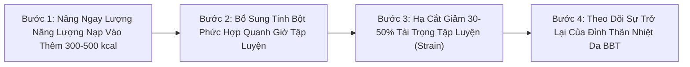
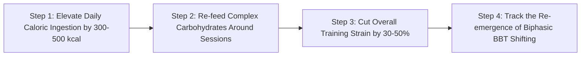

# WH_18 - Hội Chứng RED-S & Thiếu Năng Lượng Sẵn Có: Hiểm Họa Mất Kinh & Quá Tải Tập Luyện
**Category:** Women's Health 
**Screen:** Recovery & Menstrual Cycle Screen 
**Metric:** Energy Availability & Cycle Regularity (HO-02 / REC-01 / STR-01) 
**Reading Time:** 9 phút đọc / 9 min 
**Hero Image:**  *(Source: [https://images.unsplash.com/photo-1541534741688-6078c6bfb5c5?auto=format&fit=crop&w=1200&q=85](https://images.unsplash.com/photo-1541534741688-6078c6bfb5c5?auto=format&fit=crop&w=1200&q=85))* 
**Inline Figure:**  *(Source: [https://commons.wikimedia.org/wiki/File:Hypothalamic%E2%80%93pituitary%E2%80%93gonadal_axis.svg](https://commons.wikimedia.org/wiki/File:Hypothalamic%E2%80%93pituitary%E2%80%93gonadal_axis.svg))* 
**Clinical Source:** [IOC Consensus Statement (BJSM, 2018) & Endocrine Society (Gordon et al., 2017)](https://bjsm.bmj.com/content/52/11/687) 

---

## 🇻🇳 Phiên Bản Tiếng Việt (Vietnamese Edition)

# Hội Chứng RED-S & Thiếu Năng Lượng Sẵn Có: Hiểm Họa Mất Kinh & Quá Tải Tập Luyện

> **Tóm tắt (Sapo):** Mất kinh không phải là 'huy chương danh dự' chứng minh bạn tập luyện chăm chỉ hay giảm mỡ thành công; đó là hồi chuông báo động đỏ của cơ thể khi rơi vào Hội chứng Thiếu Hụt Năng Lượng Tương Đối Trong Thể Thao (RED-S). Tìm hiểu công thức tính năng lượng sẵn có và cách cứu vãn buồng trứng cùng khung xương trước khi quá muộn.

> 💡 **Điểm Cốt Lõi & Hành Động Thực Tế (Key Takeaway):** Nếu chu kỳ kinh nguyệt của bạn bị trễ trên 35 ngày hoặc biến mất hoàn toàn kết hợp với tập luyện nặng và ăn kiêng gắt gao, bạn đang bị thiếu năng lượng sẵn có (< 30 kcal/kg FFM/ngày). Hãy ngừng ngay việc cắt giảm tinh bột, giảm bớt tải trọng tập luyện (Strain) và theo dõi sự phục hồi của thân nhiệt cùng HRV trên ứng dụng.

## Bi Kịch Bị Bình Thường Hóa: "Mất Kinh Là Chuyện Thường Ở Dân Thể Thao"?

Trong các phòng tập gym, đường chạy marathon hay các lớp CrossFit, một quan niệm lệch lạc chết người vẫn đang lưu truyền: *"Chừng nào chưa mất kinh thì tập chưa đủ nặng"*, hoặc *"Mất kinh đỡ phiền toái, chứng tỏ cơ thể ít mỡ chuẩn vận động viên"*.

Y học thể thao quốc tế (**Ủy ban Olympic Quốc tế - IOC Consensus Statement, Mountjoy et al., 2018 và 2023**) khẳng định dứt khoát: **Mất kinh nguyệt do tập luyện là một bệnh lý suy kiệt sinh học nghiêm trọng gọi là Vô Kinh Do Vùng Hạ Đồi (Functional Hypothalamic Amenorrhea - FHA), một mắt xích cốt lõi trong Hội chứng RED-S (Relative Energy Deficiency in Sport).**

Khi bạn tập luyện quá mức nhưng nạp không đủ năng lượng, cơ thể bạn sẽ diễn dịch tình trạng này như một đợt "nạn đói khắc nghiệt". Để bảo toàn sự sống cho tim, não và phổi, não bộ sẽ lập tức cắt nguồn năng lượng nuôi dưỡng hai hệ thống bị xem là "xa xỉ phẩm" trong sinh tồn: **Hệ Sinh Sản (Tắt kinh nguyệt)** và **Hệ Tái Tạo Xương (Ngừng đắp canxi vào xương)**.

<figure class="article-inline-diagram">
 
 <figcaption>📊 <strong>Trục nội tiết Hạ đồi - Tuyến yên - Buồng trứng (HPG Axis).</strong> <a href="https://commons.wikimedia.org/wiki/File:Hypothalamic%E2%80%93pituitary%E2%80%93gonadal_axis.svg" target="_blank" rel="noopener">Link sơ đồ y khoa gốc (Wikimedia Commons) ↗</a></figcaption>
</figure>

---

## Công Thức Đo Lường: "Năng Lượng Sẵn Có" (Energy Availability - EA)

Nhiều phụ nữ lầm tưởng chỉ cần đếm calo nạp vào bằng calo tiêu thụ là đủ. Tuy nhiên, trong sinh lý học thể thao, chỉ số quyết định sự sống còn của hormone là **Năng Lượng Sẵn Có (Energy Availability - EA)**:

> 📐 **Công Thức Đo Lường:**
> 
> **EA = [Tổng Năng Lượng Nạp Vào (kcal) − Năng Lượng Tiêu Hao Khi Tập Luyện (kcal)] / Khối Lượng Cơ Thể Không Mỡ (FFM tính bằng kg)**
> *(Đơn vị tính: kcal / kg FFM / ngày)*

### Các Ngưỡng Lâm Sàng Chuẩn Y Khoa:
1. **EA Tối Ưu (> 45 kcal/kg FFM/ngày):** Mọi chức năng buồng trứng, tuyến giáp, tim mạch và miễn dịch hoạt động hoàn hảo; chu kỳ kinh nguyệt đều đặn.
2. **EA Dưới Chuẩn (30 - 45 kcal/kg FFM/ngày):** Pha hoàng thể bị rút ngắn (< 10 ngày), nồng độ progesterone suy giảm nhẹ, rụng trứng không đều.
3. **Vùng Nguy Hiểm Đỏ (< 30 kcal/kg FFM/ngày):** **Ngưỡng sụp đổ sinh học.** Vùng hạ đồi kích hoạt chế độ ngủ đông; trục nội tiết buồng trứng ngừng hoạt động hoàn toàn.

> **Ví dụ thực tế:** Một nữ vận động viên nặng 55 kg với 20% mỡ cơ thể → Khối lượng nạc FFM = 44 kg. Cô ấy ăn 1800 kcal và tập luyện tiêu hao 800 kcal.
> > **EA = (1.800 − 800) / 44 = 1.000 / 44 = 22.7 kcal/kg FFM/ngày**
> Con số 22.7 nằm sâu trong **Vùng Nguy Hiểm**, chắc chắn sẽ dẫn đến mất kinh và thoái hóa xương dù bề ngoài cô ấy trông rất thon gọn!

---

## Bảng Hệ Lụy Đa Cơ Quan Của Hội Chứng RED-S

| Cơ Quan Bị Ảnh Hưởng | Cơ Chế Bệnh Sinh Do Thiếu Năng Lượng | Biểu Hiện Lâm Sàng Thực Tế | Tín Hiệu Cảnh Báo Trên Thiết Bị Đeo |
| :--- | :--- | :--- | :--- |
| **Buồng Trứng & Sinh Sản** | Nơ-ron Kisspeptin ngừng phát xung GnRH → Mất đỉnh sóng LH → Không rụng trứng. | Trễ kinh > 35 ngày hoặc mất kinh trên 3–6 tháng; khô hạn âm đạo, mất hoàn toàn ham muốn. | Biểu đồ chu kỳ kinh nguyệt không còn pha hai nhiệt độ (Nhiệt độ da BBT nằm phẳng lì cả tháng). |
| **Khung Xương (Bone Health)** | Hụt estrogen kết hợp cortisol tăng cao làm tăng vọt hoạt tính hủy cốt bào; xương mất canxi nhanh chóng. | Chấn thương rạn nứt xương do mệt mỏi (**Stress Fractures** ở cẳng chân, bàn chân); đau mỏi khớp kéo dài. | Điểm Recovery sụt giảm kéo dài sau các buổi tập chạy hoặc nhảy tác động mạnh. |
| **Tuyến Giáp & Chuyển Hóa** | Chuyển đổi hormone T₄ thành T₃ hoạt tính bị chặn đứng (Hội chứng T₃ thấp - Low T₃ Syndrome). | Tốc độ chuyển hóa cơ bản giảm 20%–30%; luôn cảm thấy lạnh cóng tay chân dù trời nóng; rụng tóc, táo bón. | Thân nhiệt ban đêm luôn thấp hơn mức bình thường từ **0.4°C đến 0.8°C**. |
| **Hệ Thần Kinh Thực Vật** | Tuyến thượng thận tăng tiết Cortisol mãn tính; cạn kiệt glycogen dự trữ tại gan và cơ bắp. | Mất ngủ chập chờn, tỉnh giấc giữa đêm, lo âu quá mức, hiệu suất thể thao sa sút không phanh. | **HRV ban đêm sụt giảm sâu liên tục**; nhịp tim nghỉ ngơi RHR có xu hướng tăng cao bất thường. |

---

## 4 Dấu Hiệu Nhận Diện "Báo Động Đỏ" Trước Khi Mất Kinh Hoàn Toàn

1. **Chu Kỳ Kinh Nguyệt Bắt Đầu Dãn Dài (Oligomenorrhea):** Chu kỳ trước đây 28 ngày bắt đầu kéo dài thành 35, 42 rồi 50 ngày mới có một lần.
2. **Xuất Hiện Chấn Thương Nứt Xương (Stress Fracture):** Bị đau nhức cẳng chân khi chạy bộ và chụp MRI phát hiện rạn nứt xương chày hoặc xương bàn chân mà không hề bị va đập trực tiếp.
3. **Cảm Giác Luôn Bị Lạnh Cóng:** Tay chân lạnh buốt ngay cả khi đang ở trong phòng ấm là dấu hiệu rõ ràng của việc tuyến giáp hạ chuyển hóa để tiết kiệm nhiệt năng.
4. **Hiệu Suất Thể Thao Đột Ngột Đi Xuống Dù Vẫn Tập Đều:** Tạ nâng nhẹ hơn, chạy chậm hơn và thời gian phục hồi cơ bắp kéo dài gấp đôi bình thường.

---

## Giao Thức 4 Bước Phục Hồi Năng Lượng & Đánh Thức Buồng Trứng

1. **Nâng Năng Lượng Sẵn Có Ngay Lập Tức:** Tăng khẩu phần ăn thêm 300 đến 500 kcal mỗi ngày, đặc biệt tập trung vào các chất béo lành mạnh (quả bơ, các loại hạt hạnh nhân/óc chó, dầu ô liu) để cung cấp cholesterol làm nguyên liệu tổng hợp hormone sinh dục.
2. **Cứu Vớt Tuyến Giáp Bằng Tinh Bột (Carbohydrate Re-feeding):** Não bộ và vùng hạ đồi cần glucose để cảm nhận sự an toàn năng lượng. Tuyệt đối chấm dứt chế độ ăn kiêng Low-carb hay Ketogenic; hãy nạp tinh bột phức hợp (khoai lang, yến mạch, cơm gạo lứt) ngay trước và sau buổi tập.
3. **Cắt Giảm Tải Trọng Thể Lực (Deload Strain):** Giảm thời lượng tập luyện xuống 30%–50%; tạm ngưng hoàn toàn các bài tập cardio biến tốc cường độ cao (HIIT); thay thế bằng yoga phục hồi hoặc đi bộ nhẹ nhàng.
4. **Theo Dõi Tín Hiệu Thân Nhiệt Tái Sinh:** Sử dụng thiết bị đeo theo dõi nhiệt độ da ban đêm. Khi năng lượng phục hồi, bạn sẽ thấy nhiệt độ cơ bản tăng trở lại, biểu đồ xuất hiện bước nhảy nhiệt độ sau rụng trứng (+0.3°C), báo hiệu trục HPO đã bắt đầu thức tỉnh và chu kỳ kinh nguyệt sắp quay trở lại!

---

## Nguồn Y Khoa Lâm Sàng & Tài Liệu Tham Khảo

1. **De Souza, M. J., et al. (2014).** 2014 Female Athlete Triad Coalition Consensus Statement on treatment and return to play of the female athlete triad. *British Journal of Sports Medicine*, 48(4), 289-289. [Tạp chí BJSM: Đồng Thuận Quốc Tế Về Hội Chứng Tam Giác Vận Động Viên Nữ (PMID: 24463911) ↗](https://bjsm.bmj.com/content/48/4/289)
2. **Mountjoy, M., et al. (2018).** International Olympic Committee (IOC) consensus statement on relative energy deficiency in sport (RED-S): 2018 update. *British Journal of Sports Medicine*, 52(11), 687-697. [Tạp chí BJSM: Tuyên Bố Đồng Thuận Ủy Ban Olympic Quốc Tế Về Thiếu Năng Lượng RED-S (PMID: 29773536) ↗](https://bjsm.bmj.com/content/52/11/687)
3. **Gordon, C. M., et al. (2017).** Functional hypothalamic amenorrhea: an Endocrine Society clinical practice guideline. *The Journal of Clinical Endocrinology & Metabolism*, 102(5), 1413-1439. [Hướng Dẫn Hiệp Hội Nội Tiết Endocrine Society: Vô Kinh Vùng Dưới Đồi (PMID: 28368449) ↗](https://academic.oup.com/jcem/article/102/5/1413/3077281)
4. **WHOOP Strain & Recovery Algorithms (2025).** Monitoring Low Energy Availability & Autonomic Suppression. [WHOOP The Locker: What is RED-S & How Wearables Detect Low Energy Availability ↗](https://www.whoop.com/thelocker/relative-energy-deficiency-in-sport-red-s/)

---

## 🇬🇧 English Edition

# RED-S & Low Energy Availability: Recognizing Overtraining & Hypothalamic Amenorrhea

> **Abstract (Sapo):** Losing your period is not a badge of honor signifying elite athletic dedication; it is a clinical emergency known as Relative Energy Deficiency in Sport (RED-S). Discover the clinical formula for Energy Availability (EA) and learn how to rescue ovarian function, thyroid metabolism, and bone density.

> 💡 **Key Takeaway & Clinical Action:** If your cycle exceeds 35 days or vanishes completely amidst intense training and caloric restriction, you are exhibiting clinical Low Energy Availability (< 30 kcal/kg FFM/day). Cease carbohydrate restriction, down-regulate wearable strain targets, and monitor the restoration of biphasic temperature patterns.

## Normalizing a Biological Tragedy: "Period Loss Means Hard Work"?

Across gyms, marathon circuits, and CrossFit boxes, a hazardous misconception persists: *"If you haven't lost your cycle, you aren't training hard enough,"* or *"Amenorrhea is convenient; it proves your body fat is exceptionally lean."*

The international sports medicine community (**International Olympic Committee - IOC Consensus Statements, Mountjoy et al., 2018 and 2023**) firmly condemns this: **Exercise-induced amenorrhea is a severe biological pathology termed Functional Hypothalamic Amenorrhea (FHA), a core clinical manifestation of Relative Energy Deficiency in Sport (RED-S).**

When extreme caloric expenditure outpaces nutritional intake, the central nervous system interprets this deficit as severe famine. To preserve vital cardiac, cerebral, and respiratory functions, the brain shuts down energy allocation to biological systems deemed expendable for acute survival: **Reproduction (arresting ovulation and menstruation)** and **Skeletal Remodeling (ceasing bone mineralization)**.

<figure class="article-inline-diagram">
 
 <figcaption>📊 <strong>Hypothalamic-Pituitary-Gonadal endocrine signaling axis.</strong> <a href="https://commons.wikimedia.org/wiki/File:Hypothalamic%E2%80%93pituitary%E2%80%93gonadal_axis.svg" target="_blank" rel="noopener">Original Image Source: Wikimedia Commons ↗</a></figcaption>
</figure>

---

## The Clinical Formula: "Energy Availability" (EA)

Merely tracking "calories in versus calories out" is biologically misleading. In sports endocrinology, the metric governing reproductive viability is **Energy Availability (EA)**:

> 📐 **Formula Definition:**
> 
> **EA = [Energy Intake (kcal) − Exercise Energy Expenditure (kcal)] / Fat-Free Mass (FFM in kg)**
> *(Unit: kcal / kg FFM / day)*

### Established Clinical Thresholds:
1. **Optimal Energy Availability (> 45 kcal/kg FFM/day):** Normal neuro-endocrine kinetics; regular biphasic ovulatory cycles; optimal bone turnover.
2. **Subclinical Low EA (30 - 45 kcal/kg FFM/day):** Luteal phase deficiency (< 10 days), subclinical progesterone deficits, sporadic anovulation.
3. **Severe Clinical Low EA (< 30 kcal/kg FFM/day):** **The biological crash zone.** Hypothalamic Kisspeptin silencing; complete shutdown of ovarian folliculogenesis and bone resorption runaway.

> **Clinical Calculation:** An endurance runner weighing 55 kg with 20% body fat has a fat-free mass of FFM = 44 kg. She ingests 1,800 kcal and burns 800 kcal during intense training.
> > **EA = (1,800 − 800) / 44 = 1,000 / 44 = 22.7 kcal/kg FFM/day**
> An EA of 22.7 falls deep within the **Severe Crash Zone**, accelerating bone mineral loss and hypothalamic shutdown despite an outwardly "fit" physique.

---

## Multi-System Sequelae of RED-S

| Physiological System | Biophysical Etiology | Clinical Symptoms | Wearable Biometric Signature |
| :--- | :--- | :--- | :--- |
| **Reproductive (HPG Axis)** | Kisspeptin inhibition suppresses GnRH pulsatility → LH surge extinguished → Anovulation. | Cycle intervals > 35 days (oligomenorrhea) or complete amenorrhea > 90 days; vaginal atrophy, zero libido. | Monophasic baseline skin temperature across the entire month (absence of post-ovulatory +0.3°C shift). |
| **Skeletal Infrastructure** | Concomitant estrogen depletion and hypercortisolemia trigger uncoupled osteoclastic bone resorption. | **Bone Stress Fractures** (tibia, metatarsals, femoral neck); persistent chronic joint inflammation. | Prolonged red recovery scores following running or plyometric impact sessions. |
| **Thyroid & Metabolism** | Peripheral deiodinase conversion of T₄ into active T₃ is suppressed (**Low T₃ Syndrome**). | Resting metabolic rate drops by 20%–30%; persistent cold intolerance, dry skin, severe hair shedding. | Nocturnal skin temperature depressed by **0.4°C to 0.8°C** below historical normal ranges. |
| **Autonomic Nervous System** | Adrenocortical hyperactivation drives chronic baseline cortisol elevation; glycogen depletion. | Non-restorative sleep, early morning awakenings, unprovoked anxiety, chronic athletic performance plateau. | **Suppressed nocturnal HRV RMSSD**; chronically elevated resting heart rate despite reduced physical fitness. |

---

## 4 Early Warning Flags Preceding Total Amenorrhea

1. **Cycle Lengthening (Oligomenorrhea):** A reliable 28-day cycle begins stretching to 35, 45, and then 60 days.
2. **Unexplained Bone Stress Fractures:** Developing localized tibial or metatarsal pain during standard training runs, confirmed on MRI as micro-trabecular stress fractures without direct trauma.
3. **Chronic Cold Intolerance:** Experiencing freezing extremities in warm ambient temperatures, reflecting thyroid down-regulation to conserve thermogenic energy.
4. **Performance Collapse Despite Diligent Training:** Lifting numbers drop, running splits worsen, and post-session muscle soreness persists twice as long as normal.

---

## 4-Step RED-S Recovery & Hypothalamic Resuscitation Protocol

1. **Immediate Energy Surplus Intervention:** Increase daily caloric intake by 300 to 500 kcal immediately, targeting nutrient-dense healthy fats (avocados, raw nuts, olive oil) to provide cholesterol substrates for steroidogenesis.
2. **Carbohydrate Re-Feeding for Hypothalamic Signalling:** The hypothalamus requires continuous glucose availability to perceive metabolic safety. Terminate ketogenic or aggressive low-carb regimens; ingest complex carbohydrates (sweet potatoes, oats, whole grains) around training windows.
3. **Deload Physical Strain:** Slash overall training volume by 30%–50%; eliminate all high-intensity interval training (HIIT); substitute with restorative yoga and relaxed walking.
4. **Monitor Temperature Resuscitation:** Track nocturnal skin temperature on your wearable. As systemic energy availability normalizes, baseline temperatures will rise and re-establish a clear post-ovulatory biphasic temperature shift (+0.3°C), indicating that the HPG axis has reactivated and menses is imminent.

---

## Clinical Citations & Reference Literature

1. **De Souza, M. J., et al. (2014).** 2014 Female Athlete Triad Coalition Consensus Statement on treatment and return to play of the female athlete triad. *British Journal of Sports Medicine*, 48(4), 289-289. [BJSM: Female Athlete Triad Consensus (PMID: 24463911) ↗](https://bjsm.bmj.com/content/48/4/289)
2. **Mountjoy, M., et al. (2018).** International Olympic Committee (IOC) consensus statement on relative energy deficiency in sport (RED-S): 2018 update. *British Journal of Sports Medicine*, 52(11), 687-697. [BJSM: IOC Consensus on RED-S (PMID: 29773536) ↗](https://bjsm.bmj.com/content/52/11/687)
3. **Gordon, C. M., et al. (2017).** Functional hypothalamic amenorrhea: an Endocrine Society clinical practice guideline. *The Journal of Clinical Endocrinology & Metabolism*, 102(5), 1413-1439. [Endocrine Society Clinical Guideline: Hypothalamic Amenorrhea (PMID: 28368449) ↗](https://academic.oup.com/jcem/article/102/5/1413/3077281)
4. **WHOOP Strain & Recovery Algorithms (2025).** Monitoring Low Energy Availability & Autonomic Suppression. [WHOOP The Locker: What is RED-S & Wearable Detection ↗](https://www.whoop.com/thelocker/relative-energy-deficiency-in-sport-red-s/)
