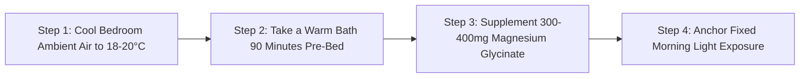

# WH_19 - Hội Chứng Khó Ngủ Tiền Kinh Nguyệt: Vì Sao Thân Nhiệt Tăng Làm Gián Đoạn Giấc Ngủ REM?
**Category:** Women's Health 
**Screen:** Sleep Screen & Vitals 
**Metric:** Sleep Disturbances & Thermoregulation (SL-01 / SL-11 / HO-04) 
**Reading Time:** 8 phút đọc / 8 min 
**Hero Image:**  *(Source: [https://images.unsplash.com/photo-1541781774459-bb2af2f05b55?auto=format&fit=crop&w=1200&q=85](https://images.unsplash.com/photo-1541781774459-bb2af2f05b55?auto=format&fit=crop&w=1200&q=85))* 
**Inline Figure:**  *(Source: [https://commons.wikimedia.org/wiki/File:Circadian_temperature_cycle.svg](https://commons.wikimedia.org/wiki/File:Circadian_temperature_cycle.svg))* 
**Clinical Source:** [Sleep Medicine (Baker & Driver, 2007) & Sleep Medicine Clinics (Shechter et al., 2012)](https://www.sciencedirect.com/science/article/pii/S1389945707000720) 

---

## 🇻🇳 Phiên Bản Tiếng Việt (Vietnamese Edition)

# Hội Chứng Khó Ngủ Tiền Kinh Nguyệt: Vì Sao Thân Nhiệt Tăng Làm Gián Đoạn Giấc Ngủ REM?

> **Tóm tắt (Sapo):** Nếu bạn thường xuyên trằn trọc, đổ mồ hôi đêm hoặc tỉnh giấc giữa chừng vào tuần lễ trước kỳ kinh, đó không phải là sự trùng hợp ngẫu nhiên. Sự gia tăng nồng độ progesterone đẩy thân nhiệt cơ bản lên cao, làm xáo trộn cơ chế làm mát tự nhiên của não bộ và cắt vụn các chu kỳ ngủ sâu.

> 💡 **Điểm Cốt Lõi & Hành Động Thực Tế (Key Takeaway):** Để đi vào giấc ngủ sâu, nhiệt độ cơ thể cần hạ xuống khoảng 1°C. Ở pha hoàng thể, progesterone ngăn chặn bước hạ nhiệt này. Hãy chủ động làm mát cơ thể: hạ điều hòa phòng ngủ xuống 18°C–19°C, tắm nước ấm trước khi ngủ 90 phút để kích thích giãn mạch ngoại vi, và hạn chế ăn khuya.

## Cơn Mất Ngủ Định Kỳ: Nỗi Trăn Trở Của Hàng Triệu Phụ Nữ

Bạn có nhận thấy một quy luật lặp đi lặp lại hàng tháng:
- Trong hai tuần đầu tiên sau khi sạch kinh, bạn đặt lưng xuống là ngủ say như một đứa trẻ, điểm Hiệu Quả Giấc Ngủ (**Sleep Performance**) trên thiết bị đeo luôn đạt 90%–98%.
- Nhưng đúng vào 5 đến 7 ngày trước kỳ kinh, bạn bỗng trằn trọc mất cả tiếng đồng hồ mới vào giấc, cơ thể hâm hấp nóng, hay giật mình thức giấc lúc 2–3 giờ sáng và cảm thấy mệt mỏi rã rời khi thức dậy.

Rất nhiều người đổ lỗi cho "áp lực công việc" hoặc "uống quá nhiều cà phê". Tuy nhiên, theo các công trình nghiên cứu giấc ngủ kinh điển của **Tiến sĩ Fiona Baker (Sleep Medicine Reviews 2007)**: **Giấc ngủ của phụ nữ chịu sự chi phối sinh học khắc nghiệt của hormone sinh dục, đặc biệt là sự tương tác phức tạp giữa Progesterone và Trung tâm Điều hòa Thân nhiệt.**

<figure class="article-inline-diagram">
 
 <figcaption>🌡️ <strong>Cơ Chế Làm Mát Ban Đêm:</strong> Để cơ thể chìm vào giấc ngủ sâu, não bộ phải ra lệnh giãn mạch máu ở tay chân để tản nhiệt, hạ nhiệt độ lõi cơ thể xuống khoảng 1°C. <a href="https://commons.wikimedia.org/wiki/File:Circadian_temperature_cycle.svg" target="_blank" rel="noopener">Nguồn sơ đồ: Wikimedia Commons ↗</a></figcaption>
</figure>

---

## Sinh Lý Học Nhiệt: Progesterone & Cú Sốc Tăng Nhiệt Vùng Hạ Đồi

Để hiểu tại sao giấc ngủ bị phá vỡ, chúng ta cần phân tích cơ chế sinh học phân tử của giấc ngủ:
1. **Quy Luật Hạ Nhiệt Độ Lõi:** Theo nhịp sinh học ngày đêm (*Circadian Rhythm*), khoảng 2 giờ trước khi ngủ, hormone Melatonin tăng tiết làm giãn các mao mạch ngoại vi ở bàn tay và bàn chân, đẩy nhiệt lượng ra ngoài không khí để **hạ nhiệt độ trung tâm cơ thể xuống từ 0.8°C đến 1.2°C**. Sự sụt giảm nhiệt độ này là công tắc sinh học kích hoạt các sóng não chậm của giấc ngủ sâu (Slow-Wave Sleep).
2. **Cú Sốc Sinh Nhiệt Của Progesterone:** 
 - Sau khi rụng trứng, hoàng thể bơm vào máu một lượng lớn **Progesterone**.
 - Progesterone tác động lên các thụ thể tại **Vùng Tiền Thị Của Hạ Đồi (Preoptic Anterior Hypothalamus)**—nơi đóng vai trò như chiếc máy điều hòa trung tâm của cơ thể—và thiết lập lại ngưỡng nhiệt độ chuẩn cao hơn bình thường.
 - Kết quả: **Nhiệt độ cơ thể phụ nữ bị đẩy lên cao hơn từ +0.3°C đến +0.5°C suốt 24 giờ mỗi ngày.**
3. **Hiện Tượng Phân Mảnh Giấc Ngủ (Sleep Fragmentation):** Cơ thể liên tục phải gồng mình tản nhiệt qua hơi thở và tuyến mồ hôi. Nhịp tim nghỉ ngơi ban đêm tăng thêm 4–8 bpm, khiến giấc ngủ bị gián đoạn bởi hàng chục đợt vi thức giấc (**Micro-arousals**) mà bạn thậm chí không nhớ nổi vào sáng hôm sau.

---

## Bảng So Sánh Kiến Trúc Giấc Ngủ Giữa 2 Pha Chu Kỳ

| Chỉ Số Giấc Ngủ (Sleep Architecture) | Pha Nang Trứng (Estrogen Cao) | Pha Hoàng Thể (Progesterone Cao) | Tác Động Lâm Sàng Lên Cơ Thể |
| :--- | :--- | :--- | :--- |
| **Độ Trễ Giấc Ngủ (Sleep Latency)** | Nhanh (10 - 20 phút). | Kéo dài (30 - 60 phút trằn trọc). | Dễ rơi vào trạng thái bồn chồn, ức chế tâm lý trước khi ngủ. |
| **Tỷ Lệ Giấc Ngủ REM (Ngủ Mơ)** | Đạt tỷ lệ tối ưu (20% - 25%). | **Bị cắt ngắn (Giảm 10%–20%)**. | Giảm khả năng củng cố trí nhớ, dễ cáu gắt và nhạy cảm cảm xúc. |
| **Giấc Ngủ Sâu (Deep / SWS)** | Sóng não chậm ổn định, phục hồi thể chất tốt. | Bị đứt đoạn bởi các đợt tăng thân nhiệt. | Cơ bắp lâu hồi phục, cảm giác uể oải dù ngủ đủ 8 tiếng. |
| **Số Lần Thức Giấc Đêm (Wake Events)** | Rất ít (0 - 2 lần). | **Tăng vọt (3 - 6 lần)**, kèm đổ mồ hôi đêm. | Điểm Phục hồi trên thiết bị đeo tụt sâu sang vùng Vàng/Đỏ. |
| **Nhiệt Độ Da Ban Đêm** | Thấp và phẳng (36.2°C-36.4°C). | **Tăng cao (+0.3°C - +0.5°C)** liên tục. | Cơ thể có cảm giác khô nóng, khát nước giữa đêm. |

---

## 4 Yếu Tố "Đổ Dầu Vào Lửa" Khiến Mất Ngủ Trầm Trọng Hơn

1. **Ăn Tối Muộn Giàu Gia Vị Cay Nóng Hoặc Đường Đơn:** Quá trình tiêu hóa bữa ăn muộn làm tăng hiệu ứng sinh nhiệt thực phẩm (**Diet-Induced Thermogenesis**), khiến nhiệt độ lõi cơ thể vọt tăng đúng lúc bạn cần hạ nhiệt để ngủ.
2. **Tập Thể Dục Cường Độ Nặng Sau 19 Giờ:** Các bài tập HIIT hoặc nâng tạ nặng vào buổi tối kích hoạt tuyến thượng thận phóng thích adrenaline và cortisol, đẩy nhịp tim và thân nhiệt lên cao suốt nhiều giờ sau đó.
3. **Phòng Ngủ Quá Kín Và Ấm:** Để nhiệt độ phòng trên 24°C kết hợp đắp chăn dày khiến nhiệt lượng từ da không thể khuếch tán ra môi trường ngoài.
4. **Hội Chứng Cai Allopregnanolone:** Vào những ngày cuối của pha hoàng thể, sự sụt giảm đột ngột của allopregnanolone làm thụ thể an thần **GABA-A** bị mất kích hoạt, tạo ra cơn lo âu vô cớ và giật mình thức giấc giữa đêm.

---

## Giao Thức 4 Bước Làm Mát Cơ Thể & Tối Ưu Giấc Ngủ Hoàng Thể

1. **Thiết Lập Môi Trường Nhiệt Độ "Hang Động Lạnh":** Hạ điều hòa phòng ngủ xuống **18°C đến 20°C (65°F-68°F)**; sử dụng chăn ga bằng chất liệu sợi tre (bamboo) hoặc cotton dệt thưa có khả năng thoát nhiệt và hút ẩm nhanh.
2. **Kỹ Thuật "Nghịch Lý Tắm Nước Ấm" (Warm Bath Effect):** Ngâm mình trong bồn nước ấm hoặc tắm vòi sen nước ấm (40°C) trong 10 phút trước khi đi ngủ khoảng 90 phút. Nước ấm làm giãn toàn bộ mạch máu dưới da; khi bước ra khỏi phòng tắm, nhiệt lượng từ cơ thể sẽ tỏa ra ngoài không khí cực nhanh, giúp nhiệt độ lõi tụt dốc thần tốc và đưa não bộ vào cơn buồn ngủ tự nhiên.
3. **Bổ Sung Dưỡng Chất Kích Hoạt Thần Kinh Thư Giãn:** Uống **300–400 mg Magnesium Glycinate** hoặc L-Threonate cùng 200 mg L-Theanine 60 phút trước khi ngủ. Magiê giúp giãn cơ trơn, hạ nhịp tim và hỗ trợ thụ thể GABA chống lại cơn kích động tiền kinh nguyệt.
4. **Cố Định Nhịp Sinh Học Thức Dậy:** Dù đêm hôm trước ngủ chập chờn, hãy cố gắng thức dậy đúng một khung giờ cố định và bước ra ngoài trời đón ánh nắng tự nhiên 15 phút. Ánh sáng mặt trời sẽ neo giữ nhịp sinh học và thúc đẩy tiết melatonin đúng giờ vào đêm tiếp theo.

---

## Nguồn Y Khoa Lâm Sàng & Tài Liệu Tham Khảo

1. **Baker, F. C., & Driver, H. S. (2007).** Circadian rhythms, sleep, and the menstrual cycle. *Sleep Medicine*, 8(6), 613-622. [Tạp chí Sleep Medicine: Nhịp Sinh Học & Giấc Ngủ Trong Chu Kỳ (PMID: 17383933) ↗](https://www.sciencedirect.com/science/article/pii/S1389945707000720)
2. **Driver, H. S., & Baker, F. C. (1998).** Menstrual factors in sleep. *Sleep Medicine Reviews*, 2(4), 213-229. [Tạp chí Sleep Medicine Reviews: Thân Nhiệt Lõi & Kiến Trúc Giấc Ngủ (PMID: 15310497) ↗](https://www.sciencedirect.com/science/article/pii/S1087079298900406)
3. **Shechter, A., et al. (2012).** Impact of the menstrual cycle on sleep and circadian rhythmicity. *Sleep Medicine Clinics*, 7(3), 499-509. [Tạp chí Sleep Medicine Clinics: Dao Động Progesterone & Giấc Ngủ REM (PMID: 23066373) ↗](https://www.sleep.theclinics.com/article/S1556-407X(12)00064-2/abstract)
4. **WHOOP Sleep Coach & Autonomic Algorithms (2025).** Sleep Disturbances and Luteal Phase Progesterone Tracking. [WHOOP The Locker: How Your Menstrual Cycle Impacts Sleep & Core Temperature ↗](https://www.whoop.com/thelocker/sleep-menstrual-cycle/)

---

## 🇬🇧 English Edition

# The Luteal Insomnia Effect: How Progesterone & Thermoregulation Fragment Sleep

> **Abstract (Sapo):** Tossing and turning, night sweats, and frequent micro-awakenings in the week preceding your period are not coincidences. Progesterone thermogenesis elevates core body temperature, impairing the brain's natural nocturnal cooling cascade and fragmenting restorative REM and deep sleep architecture.

> 💡 **Key Takeaway & Clinical Action:** Initiating deep restorative sleep mandates a core body temperature drop of approximately 1°C. In the luteal phase, progesterone elevates thermal set-points. Actively facilitate peripheral cooling: drop bedroom temperature to 18°C–19°C (65°F–67°F), take a warm bath 90 minutes pre-bed, and cease late-night eating.

## The Monthly Insomnia Paradox: A Biological Mystery Solved

Active women often observe this maddening monthly cycle:
- During the first two weeks following menses, sleep comes effortlessly. Your wearable **Sleep Performance** consistently scores 90%–98%, with deep, unbroken slumber.
- Yet, precisely 5 to 7 days before your period, you suddenly spend hours tossing and turning, experience nocturnal hot flushes, wake up at 3:00 AM with racing thoughts, and awake exhausted.

Many dismiss this as "work-related stress" or "too much coffee." However, comprehensive sleep lab polysomnography led by **Dr. Fiona Baker (Sleep Medicine Reviews 2007)** reveals the biological truth: **Female sleep architecture is rigorously modulated by ovarian steroid oscillations, driven primarily by the interaction between Progesterone and Hypothalamic Thermoregulation.**

<figure class="article-inline-diagram">
 
 <figcaption>🌡️ <strong>Nocturnal Thermal Cascade:</strong> Falling asleep requires distal vasodilation in hands and feet, dumping heat to reduce core body temperature by ~1°C. <a href="https://commons.wikimedia.org/wiki/File:Circadian_temperature_cycle.svg" target="_blank" rel="noopener">Source: Wikimedia Commons ↗</a></figcaption>
</figure>

---

## Thermal Physiology: How Progesterone Elevates Your Biological Thermostat

To understand luteal insomnia, we must explore the biophysics of sleep initiation:
1. **The Core Body Cooling Imperative:** In sync with circadian rhythms, rising evening melatonin levels induce peripheral vasodilation across the distal vascular beds (hands and feet), radiating internal heat to **depress core body temperature by 0.8°C to 1.2°C**. This thermal decline serves as an obligatory gatekeeper for slow-wave sleep (Deep Sleep).
2. **Progesterone-Induced Thermogenesis:**
 - Post-ovulation, the corpus luteum floods circulation with **Progesterone**.
 - Progesterone directly alters firing thresholds within the **Preoptic Anterior Hypothalamus**—the brain's master thermostat—shifting the homeostatic baseline upward.
 - Result: **Basal body temperature remains elevated by +0.3°C to +0.5°C across the entire 24-hour cycle.**
3. **Severe Sleep Fragmentation:** The body works harder to dump excess thermal energy nocturnally. Nocturnal resting heart rate climbs 4–8 bpm, precipitating dozens of micro-arousals that fragment restorative Rapid Eye Movement (REM) cycles.

---

## Comparative Sleep Architecture: Follicular vs. Luteal Phase

| Sleep Metric | Follicular Phase (Estrogen Dominant) | Luteal Phase (Progesterone Dominant) | Clinical Impact |
| :--- | :--- | :--- | :--- |
| **Sleep Latency** | Rapid (10 - 20 minutes). | Prolonged (30 - 60 minutes of restless tossing). | Heightened pre-sleep agitation and mental frustration. |
| **REM Sleep Percentage** | Optimal range (20% - 25%). | **Suppressed (10%–20% decline)**. | Impaired emotional regulation, heightened mood sensitivity. |
| **Slow-Wave Sleep (Deep Sleep)** | Stable delta-wave production. | Interrupted by micro-arousals and night sweats. | Sluggish cellular tissue repair; waking unrefreshed despite 8 hours in bed. |
| **Nocturnal Wake Events** | Minimal (0 - 2 brief disturbances). | **Elevated (3 - 6 awakenings)**, accompanied by thermal flushing. | Depressed wearable recovery scores (persisting in the Yellow/Red zones). |
| **Nocturnal Skin Temperature** | Low and uniform (36.2°C-36.4°C). | **Sustained elevation (+0.3°C - +0.5°C)**. | Sensations of suffocating heat, dry mouth, and tossing blankets. |

---

## 4 Common Habits That Magnify Luteal Sleep Disturbances

1. **Late-Night Meals Heavy in Spices or Simple Sugars:** Late digestion induces Diet-Induced Thermogenesis, spiking core body heat at the exact moment your brain requires thermal dumping.
2. **Vigorous High-Strain Workouts After 7:00 PM:** Late HIIT or heavy lifting spikes catecholamines and cortisol, keeping heart rate and internal body temperature elevated for hours.
3. **Overheated, Unventilated Bedrooms:** Keeping ambient room temperature above 22°C (72°F) under heavy comforters prevents peripheral cutaneous heat radiation.
4. **The Allopregnanolone Withdrawal Shock:** In the final days of the luteal phase, the steep plummet of progesterone metabolite allopregnanolone strips calming **GABA-A** receptor tone, driving 3:00 AM adrenergic arousal.

---

## 4-Step Clinical Protocol for Cooling Luteal Sleep

1. **Engineer a Cold Sleep Sanctuary:** Lower your bedroom thermostat to **18°C to 20°C (65°F-68°F)**. Switch to breathable bamboo or linen bedding with high thermal conductivity.
2. **Execute the "Warm Bath Paradox":** Soak in a warm bath (40°C) or hot shower for 10 minutes, exactly 90 minutes before bedtime. The warm water forcefully dilates peripheral cutaneous capillaries; when you exit into cool air, your core dumps heat rapidly, mimicking the natural biological drop required for deep sleep.
3. **Support Autonomic Calming:** Take **300–400 mg of Magnesium Glycinate** paired with 200 mg of L-Theanine 60 minutes before lights out. Magnesium relaxes vascular smooth muscle, dampens resting pulse, and supports GABAergic tone.
4. **Anchor Circadian Timing:** Regardless of how fragmented your luteal sleep was, rise at a consistent wake-up time and expose your eyes to 15 minutes of direct morning sunlight. This photic stimulus anchors your circadian clock and times evening melatonin release precisely.

---

## Clinical Citations & Reference Literature

1. **Baker, F. C., & Driver, H. S. (2007).** Circadian rhythms, sleep, and the menstrual cycle. *Sleep Medicine*, 8(6), 613-622. [Sleep Medicine: Circadian Rhythms & Sleep Across Menses (PMID: 17383933) ↗](https://www.sciencedirect.com/science/article/pii/S1389945707000720)
2. **Driver, H. S., & Baker, F. C. (1998).** Menstrual factors in sleep. *Sleep Medicine Reviews*, 2(4), 213-229. [Sleep Medicine Reviews: Core Temperature & Architecture (PMID: 15310497) ↗](https://www.sciencedirect.com/science/article/pii/S1087079298900406)
3. **Shechter, A., et al. (2012).** Impact of the menstrual cycle on sleep and circadian rhythmicity. *Sleep Medicine Clinics*, 7(3), 499-509. [Sleep Medicine Clinics: Progesterone & REM Alterations (PMID: 23066373) ↗](https://www.sleep.theclinics.com/article/S1556-407X(12)00064-2/abstract)
4. **WHOOP Sleep Coach & Autonomic Algorithms (2025).** Sleep Disturbances and Luteal Phase Progesterone Tracking. [WHOOP The Locker: How Your Menstrual Cycle Impacts Sleep ↗](https://www.whoop.com/thelocker/sleep-menstrual-cycle/)
