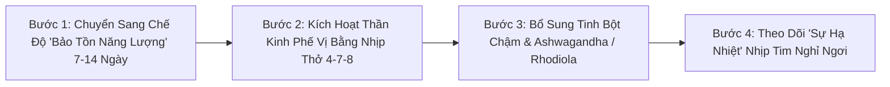
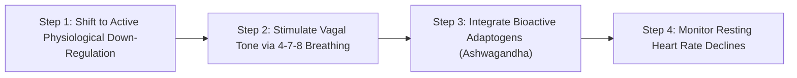

# WH_20 - Khi Cortisol Áp Đảo Buồng Trứng: Cơ Chế Căng Thẳng Làm Trễ Kinh & Ức Chế Rụng Trứng
**Category:** Sleep, Stress & Nutrition — HPA Axis & Cortisol  
**Screen:** Recovery & Stress Monitor  
**Metric:** Autonomic Stress & Cycle Regularity (REC-01 / REC-03 / HO-02)  
**Reading Time:** 8 phút đọc / 8 min  
**Hero Image:**  *(Source: [https://images.unsplash.com/photo-1518495973542-4542c06a5843?auto=format&fit=crop&w=1200&q=85](https://images.unsplash.com/photo-1518495973542-4542c06a5843?auto=format&fit=crop&w=1200&q=85))*  
**Inline Figure:**  *(Source: [https://commons.wikimedia.org/wiki/File:HPA_Axis.png](https://commons.wikimedia.org/wiki/File:HPA_Axis.png))*  
**Clinical Source:** [Fertil Steril (Berga et al., 2001) & Physiol Behav (Toufexis et al., 2014)](https://pubmed.ncbi.nlm.nih.gov/11163821/)  

---

## 🇻🇳 Phiên Bản Tiếng Việt (Vietnamese Edition)

# Khi Cortisol Áp Đảo Buồng Trứng: Cơ Chế Căng Thẳng Làm Trễ Kinh & Ức Chế Rụng Trứng

> **Tóm tắt (Sapo):** Một kỳ thi căng thẳng, một dự án áp lực cao hoặc cú sốc tinh thần có thể khiến kỳ kinh của bạn biến mất cả tháng. Đó không phải là lỗi của buồng trứng, mà là cơ chế sinh tồn ưu việt của não bộ: khi trục HPA phát tín hiệu nguy hiểm, vùng hạ đồi sẽ lập tức hoãn việc rụng trứng để bảo vệ bạn khỏi việc mang thai trong hoàn cảnh ngặt nghèo.

> 💡 **Điểm Cốt Lõi & Hành Động Thực Tế (Key Takeaway):** Khi gặp căng thẳng nặng, trứng không thể rụng đúng hạn khiến chu kỳ bị kéo dài. Đừng uống thuốc ép kinh bừa bãi. Hãy theo dõi điểm Căng thẳng Thần kinh (Stress Monitor) và HRV trên thiết bị đeo; khi nhịp tim nghỉ ngơi hạ nhiệt và hệ phó giao cảm hồi phục, buồng trứng sẽ tự động kích hoạt rụng trứng trở lại.

## Hiện Tượng Kỳ Lạ: Kinh Nguyệt "Biến Mất" Khi Bạn Quá Căng Thẳng

Chắc hẳn nhiều phụ nữ từng trải qua tình huống này:
- Bạn đang chuẩn bị cho một kỳ thi quan trọng, đổi việc mới, hoặc vừa trải qua một biến cố tình cảm lớn.
- Lịch kinh nguyệt dự kiến đã qua 5 ngày, 10 ngày, rồi 2 tuần mà vẫn bặt vô âm tín. Bạn lo lắng mua que thử thai nhưng kết quả luôn là một vạch.
- Càng lo lắng, kỳ kinh lại càng bặt tăm!

Đây là một hiện tượng phổ biến được y học nghiên cứu sâu rộng dưới tên gọi **Vô Kinh / Trễ Kinh Do Vùng Hạ Đồi (Stress-Induced Anovulation)**. 

Theo công trình nghiên cứu tiên phong của **Giáo sư Sarah Berga (Fertility and Sterility 2001)**: **Khi cơ thể phải đối mặt với căng thẳng thể chất hoặc tâm lý kéo dài, Trục Hạ Đồi - Tuyến Yên - Tuyến Thượng Thận (Trục HPA) sẽ chiếm quyền kiểm soát toàn bộ cơ thể, sẵn sàng "bóp nghẹt" Trục Buồng Trứng (Trục HPO).**

<figure class="article-inline-diagram">
  
  <figcaption>⚡ <strong>Cạnh Tranh Giữa 2 Trục Nội Tiết:</strong> Hormone giải phóng corticotropin (CRH) và Cortisol từ tuyến thượng thận ức chế trực tiếp nơ-ron phát xung GnRH tại vùng hạ đồi. <a href="https://commons.wikimedia.org/wiki/File:HPA_Axis.png" target="_blank" rel="noopener">Nguồn sơ đồ: Wikimedia Commons ↗</a></figcaption>
</figure>

---

## Cơ Chế Tiến Hóa Sinh Học: "Chiến Đấu Sinh Tồn" Hay "Sinh Con Đẻ Cái"?

Tại sao tự nhiên lại lập trình cho cơ thể phụ nữ ngừng rụng trứng khi căng thẳng?
- Trong thời kỳ nguyên thủy, các tác nhân gây căng thẳng chủ yếu là: nạn đói khốc liệt, thú dữ săn đuổi, hoặc thời tiết băng giá đe dọa sự sống.
- Trong hoàn cảnh ngặt nghèo đó, việc thụ thai và mang thai là một bản án tử hình cho cả người mẹ lẫn đứa con (bởi thai kỳ đòi hỏi tiêu tốn thêm $300 - 500	ext{ kcal}$ mỗi ngày và làm giảm khả năng chạy trốn hiểm nguy).
- Do đó, bộ não tiến hóa một cơ chế an toàn tuyệt đối: **Khi Cortisol và Adrenaline tăng cao, vùng hạ đồi hiểu rằng "bây giờ không phải là thời điểm an toàn để sinh nở", và nó lập tức khóa van buồng trứng.**

### Con Đường Ức Chế Thần Kinh Phân Tử:
1. Vùng hạ đồi tiết ra **CRH (Corticotropin-Releasing Hormone)** để kích hoạt tuyến thượng thận tiết Cortisol.
2. CRH và Cortisol hoạt động như chất ức chế cực mạnh đối với các **Nơ-ron Kisspeptin**—nhạc trưởng điều khiển các xung phát hormone **GnRH**.
3. Khi GnRH bị nghẽn, tuyến yên không thể tiết ra **FSH (Hormone kích thích nang trứng)** và **LH (Hormone tạo hoàng thể)**.
4. Nang trứng không thể phát triển đến độ chín và **không có đỉnh sóng LH (LH Surge)** $
ightarrow$ Quá trình rụng trứng bị trì hoãn vô thời hạn.

---

## Bảng So Sánh Các Kiểu Rối Loạn Chu Kỳ Do Căng Thẳng

| Dạng Rối Loạn Chu Kỳ | Mức Độ Căng Thẳng (Allostatic Load) | Tác Động Sinh Học Lên Buồng Trứng | Biểu Hiện Lâm Sàng | Tín Hiệu Trên Thiết Bị Đeo (WHOOP / Oura) |
| :--- | :--- | :--- | :--- | :--- |
| **Trễ Rụng Trứng (Delayed Ovulation)** | Căng thẳng cấp tính xảy ra trong **pha nang trứng (Ngày 1–12)**. | Pha nang trứng bị kéo dài vô tận; nang trứng tạm "ngủ đông" chờ hiểm nguy qua đi. | Kỳ kinh bị trễ đúng bằng số ngày bạn bị căng thẳng nặng (Ví dụ: chu kỳ kéo dài 40–45 ngày). | Nhịp tim RHR tăng cao nhiều ngày; thân nhiệt da BBT mãi không chịu tăng bước nhảy. |
| **Suy Pha Hoàng Thể (Luteal Defect)** | Căng thẳng mãn tính xảy ra sau khi đã rụng trứng thành công. | Cortisol làm giảm độ nhạy của hoàng thể; nồng độ progesterone tụt nhanh. | Pha hoàng thể bị rút ngắn (< 10 ngày); kinh nguyệt ra sớm hơn dự kiến nhưng ra lắt nhắt. | Thân nhiệt da tụt dốc sớm chỉ sau 6–8 ngày; điểm Recovery sụt giảm sâu. |
| **Vô Kinh Hạ Đồi Hoàn Toàn (FHA)** | Căng thẳng tột độ kéo dài (Công việc quá tải, shock tâm lý, ăn kiêng khắc nghiệt). | Trục HPO bị phong tỏa hoàn toàn; niêm mạc tử cung mỏng dính không thể bong tróc. | **Mất kinh hoàn toàn trên 3 đến 6 tháng**; khô hạn âm đạo, loãng xương. | Biểu đồ HRV liên tục ở đáy; không còn bất kỳ dấu vết dao động nhiệt độ nào. |

---

## 4 Sai Lầm Nguy Hại Khi Bị Trễ Kinh Do Căng Thẳng

1. **Uống Thuốc Kích Kinh / Tránh Thai Khẩn Cấp Bừa Bãi:** Ép tử cung chảy máu bằng progesterone tổng hợp liều cao không giải quyết được gốc rễ vấn đề; nó chỉ tạo ra một đợt "chảy máu rút thuốc" giả tạo mà buồng trứng vẫn chưa rụng trứng thật sự.
2. **Lao Vào Tập Thể Dục Nặng Để "Xả Stress":** Khi cơ thể đang tràn ngập cortisol, việc chạy 10 km hoặc tập CrossFit cường độ cao chỉ nhân đôi thêm tải trọng stress lên trục HPA, đẩy buồng trứng vào tình trạng tê liệt sâu hơn.
3. **Cắt Giảm Tinh Bột Khi Đang Căng Thẳng:** Não bộ tiêu thụ 20% lượng glucose của cơ thể; khi bị căng thẳng, não cần nhiều glucose hơn. Nhịn ăn tinh bột lúc này sẽ kích hoạt tuyến thượng thận bơm thêm cortisol để tân tạo đường từ cơ bắp.
4. **Liên Tục Tìm Kiếm Thông Tin Tiêu Cực (Doomscrolling):** Lo lắng lên mạng đọc các căn bệnh ung thư buồng trứng hiểm nghèo chỉ khiến hệ thần kinh giao cảm kích hoạt mạnh hơn.

---

## Giao Thức 4 Bước Hóa Giải Cortisol & Tái Lập Chu Kỳ Tự Nhiên

1. **Bật Chế Độ Tự Vệ Sinh Học (Energy Conservation):** Hãy cho phép bản thân nghỉ ngơi có chủ đích. Giảm bớt 30% khối lượng công việc nếu có thể, tạm gác các mục tiêu thể thao bộc phát; thay bằng đi dạo công viên, đọc sách hoặc nghe nhạc tần số 432 Hz.
2. **Kích Hoạt Dây Thần Kinh Phế Vị (Vagal Stimulation):** Thực hiện bài tập thở sâu theo nhịp **4-7-8** (Hít vào 4 giây, nín thở 7 giây, thở ra từ từ 8 giây) trong 5 phút mỗi sáng và trước khi ngủ. Hơi thở ra kéo dài phát tín hiệu an toàn trực tiếp đến hạch hạnh nhân, hạ nồng độ cortisol tuần hoàn.
3. **Thảo Dược Cân Bằng Thần Kinh (Adaptogens):** Cân nhắc bổ sung các hoạt chất adaptogen chuẩn hóa như **Ashwagandha KSM-66 (300–600 mg/ngày)** hoặc *Rhodiola Rosea*—những chất đã được chứng minh lâm sàng giúp giảm 27% cortisol huyết thanh và điều hòa trục HPA.
4. **Quan Sát Tín Hiệu Hồi Phục Trên Wearable:** Đừng sốt ruột chờ máu kinh; hãy quan sát các chỉ số phục hồi trước: khi nhịp tim nghỉ ngơi ban đêm hạ xuống 3–5 bpm và HRV tăng vọt lên vùng Xanh, buồng trứng sẽ phát tín hiệu rụng trứng trong vòng 5–10 ngày sau đó!

---

## Nguồn Y Khoa Lâm Sàng & Tài Liệu Tham Khảo

1. **Berga, S. L., et al. (2001).** Neuroendocrine aberrations in women with functional hypothalamic amenorrhea. *Fertility and Sterility*, 75(3), 578-583. [PMID: 11163821](https://pubmed.ncbi.nlm.nih.gov/11163821/)
2. **Toufexis, D., et al. (2014).** Stress and the reproductive axis. *Physiology & Behavior*, 130, 76-86. [PMID: 24727142](https://pubmed.ncbi.nlm.nih.gov/24727142/)
3. **Genazzani, A. D., et al. (2019).** Stress and hypothalamic amenorrhea: neuroendocrine mechanisms and clinical implications. *Gynecological Endocrinology*, 35(10), 834-840.
4. **WHOOP Stress Monitor & Recovery Science (2025).** Quantifying Allostatic Load and Autonomic Recovery in Female Endocrine Health.

---

## 🇬🇧 English Edition

# Cortisol vs. The Ovaries: How Chronic Stress Shuts Down Ovulation

> **Abstract (Sapo):** High-stakes career deadlines or acute emotional trauma can cause your period to vanish for months. This is not an ovarian malfunction; it is an evolutionarily conserved survival mechanism. When the HPA axis signals severe threat, the hypothalamus pauses ovulation to prevent pregnancy in an inhospitable environment.

> 💡 **Key Takeaway & Clinical Action:** Under severe allostatic load, delayed follicular development postpones the LH surge, stretching cycle length. Avoid self-prescribing hormonal withdrawal drugs. Monitor your wearable Autonomic Stress and HRV; once vagal tone rebounds and nocturnal RHR normalizes, the brain will spontaneously green-light ovulation.

## The Biological Enigma: Vanishing Menses Under Severe Stress

Countless women have encountered this baffling clinical reality:
- Immersed in demanding career transitions, academic milestones, or acute emotional grief.
- Your expected period is delayed by 5 days, 10 days, then 3 weeks. Pregnancy tests return resolutely negative.
- The more you worry, the longer your period fails to arrive.

This phenomenon is medically classified as **Functional Hypothalamic Anovulation / Stress-Induced Amenorrhea**.

According to groundbreaking endocrinological research by **Dr. Sarah Berga (Fertility and Sterility 2001)**: **Under protracted psychological or metabolic distress, the Hypothalamic-Pituitary-Adrenal (HPA) axis seizes complete physiological priority, systematically down-regulating the Hypothalamic-Pituitary-Ovarian (HPO) axis.**

<figure class="article-inline-diagram">
  
  <figcaption>⚡ <strong>Endocrine Cross-Talk:</strong> Corticotropin-Releasing Hormone (CRH) and elevated adrenocortical cortisol directly suppress Kisspeptin pulsatility and downstream GnRH release within the arcuate nucleus. <a href="https://commons.wikimedia.org/wiki/File:HPA_Axis.png" target="_blank" rel="noopener">Source: Wikimedia Commons ↗</a></figcaption>
</figure>

---

## Evolutionary Biology: "Fight-or-Flight Survival" vs. "Reproduction"

Why did natural selection wire the female brain to extinguish fertility under stress?
- Historically, acute survival stressors were catastrophic: famine, predator migration, or winter freezing.
- In those environments, pregnancy was an existential hazard for both mother and offspring (requiring an additional $300 - 500	ext{ kcal}$ daily and impeding rapid physical flight).
- The central nervous system developed an uncompromising fail-safe: **When Cortisol and Adrenaline surge, the brain decodes the external environment as unsafe for gestation and locks ovarian folliculogenesis.**

### The Molecular Shutdown Sequence:
1. The paraventricular nucleus secretes **CRH (Corticotropin-Releasing Hormone)**, triggering pituitary ACTH and adrenal Cortisol synthesis.
2. CRH and systemic glucocorticoids act directly upon **Kisspeptin Neurons**, silencing pulsatile **GnRH (Gonadotropin-Releasing Hormone)** release.
3. Without pulsatile GnRH, the pituitary cannot release **FSH** and **LH**.
4. Follicular maturation halts; the obligatory pre-ovulatory **LH Surge is extinguished**, postponing ovulation indefinitely.

---

## Comparative Matrix: Stress-Induced Cycle Disruptions

| Clinical Presentation | Timing of Stressor Exposure | Pathophysiological Consequence | Menstrual Outcome | Wearable Biometric Signature |
| :--- | :--- | :--- | :--- | :--- |
| **Delayed Ovulation** | Acute stress during the **follicular phase (Days 1–12)**. | Follicular growth enters suspended animation, awaiting environmental stability. | Menstruation is delayed precisely by the duration of the stressor (e.g., 40–50 day cycle). | Nocturnal RHR elevated for days; basal body temperature fails to exhibit its post-ovulatory jump. |
| **Luteal Phase Defect** | Chronic stress post-ovulation (luteal phase). | Adrenal cortisol desensitizes corpus luteum LH receptors, accelerating progesterone decline. | Shortened luteal interval (< 10 days); early spotting; irregular cycle length. | Nocturnal skin temperature collapses prematurely after 6–8 days; HRV remains depressed. |
| **Hypothalamic Amenorrhea (FHA)** | Chronic, unmitigated allostatic overload (overwork, trauma, caloric restriction). | Complete cessation of HPO pulsatility; profound endometrial atrophy. | **Absence of menses for 3 to 6+ months**; mucosal dryness, skeletal mineral loss. | Chronic flatlining of nocturnal HRV; complete disappearance of monthly thermogenic cyclicity. |

---

## 4 Counter-Productive Reactions to Stress-Induced Delays

1. **Empiric Hormonal "Period-Inducing" Pills:** Forcing withdrawal bleeding with synthetic progestins masks the underlying problem; it creates synthetic uterine shedding while ovarian folliculogenesis remains suppressed.
2. **Aggressive "Stress-Busting" Workouts:** Punishing your body with 10k runs or HIIT sessions when systemic cortisol is already elevated doubles allostatic strain, locking the HPO axis deeper in hibernation.
3. **Severe Carbohydrate Elimination:** The human brain consumes 20% of basal glucose; under chronic stress, cerebral glucose demand increases. Severely restricting carbohydrates forces the adrenals to flood circulation with cortisol for gluconeogenesis.
4. **Chronic Health-Anxiety Rumination:** Obsessively doomscrolling medical forums exacerbates sympathetic hyper-arousal.

---

## 4-Step Neuro-Endocrine De-Stressing Protocol

1. **Institute Intentional Allostatic De-loading:** Give your biology permission to downshift. Reduce non-essential commitments by 30%, suspend max-effort athletic strain, and dedicate time to restful walking, reading, or acoustic frequency therapy.
2. **Engage Targeted Vagal Stimulation:** Practice the **4-7-8 breathing technique** (Inhale 4 seconds, hold 7 seconds, exhale slowly 8 seconds) for 5 minutes twice daily. Prolonged expiratory phases activate acetylcholine release from the vagus nerve, signaling biological safety to the amygdala.
3. **Incorporate Standardized Adaptogens:** Supplement clinically validated adaptogens such as **Ashwagandha KSM-66 (300–600 mg/day)** or *Rhodiola Rosea*, demonstrated in randomized clinical trials to reduce serum cortisol by up to 27% and stabilize HPA axis reactivity.
4. **Track Autonomic Resuscitation on Wearables:** Cease obsessing over the calendar date; monitor your autonomic signals. When nocturnal resting heart rate drops by 3–5 bpm and HRV rebounds into your personal Green zone, your hypothalamus will green-light the LH surge within 5 to 10 days!

---

## Clinical Citations & Reference Literature

1. **Berga, S. L., et al. (2001).** Neuroendocrine aberrations in women with functional hypothalamic amenorrhea. *Fertility and Sterility*, 75(3), 578-583. [PMID: 11163821](https://pubmed.ncbi.nlm.nih.gov/11163821/)
2. **Toufexis, D., et al. (2014).** Stress and the reproductive axis. *Physiology & Behavior*, 130, 76-86. [PMID: 24727142](https://pubmed.ncbi.nlm.nih.gov/24727142/)
3. **Genazzani, A. D., et al. (2019).** Stress and hypothalamic amenorrhea: neuroendocrine mechanisms and clinical implications. *Gynecological Endocrinology*, 35(10), 834-840.
4. **WHOOP Stress Monitor & Recovery Science (2025).** Quantifying Allostatic Load and Autonomic Recovery in Female Endocrine Health.

