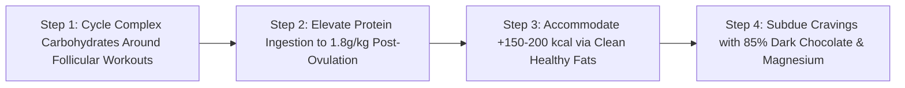

# WH_21 - Dinh Dưỡng Đồng Bộ Nội Tiết: Chiến Lược Bổ Sung Tinh Bột, Protein & Chất Béo Thông Minh
**Category:** Women's Health 
**Screen:** Workout & Nutrition Integration 
**Metric:** Macronutrient Timing & Phase-Based Metabolism (STR-01 / HO-04) 
**Reading Time:** 8 phút đọc / 8 min 
**Hero Image:**  *(Source: [https://images.unsplash.com/photo-1489444444961-d0fda97f0986?auto=format&fit=crop&w=1200&q=85](https://images.unsplash.com/photo-1489444444961-d0fda97f0986?auto=format&fit=crop&w=1200&q=85))* 
**Inline Figure:**  *(Source: [https://commons.wikimedia.org/wiki/File:Cellular_Respiration_in_Aerobic_Respiration.png](https://commons.wikimedia.org/wiki/File:Cellular_Respiration_in_Aerobic_Respiration.png))* 
**Clinical Source:** [Sports Medicine (Oosthuyse et al., 2010) & International Society of Sports Nutrition (ISSN)](https://link.springer.com/article/10.2165/11317090-000000000-00000) 

---

## 🇻🇳 Phiên Bản Tiếng Việt (Vietnamese Edition)

# Dinh Dưỡng Đồng Bộ Nội Tiết: Chiến Lược Bổ Sung Tinh Bột, Protein & Chất Béo Thông Minh

> **Tóm tắt (Sapo):** Cơ thể phụ nữ không phải là một cỗ máy chuyển hóa bất biến như nam giới; khả năng đốt mỡ, dung nạp tinh bột và phân hủy protein thay đổi rõ rệt qua từng tuần theo nồng độ hormone. Áp dụng dinh dưỡng đồng bộ chu kỳ (Cycle-Synced Nutrition) giúp bạn đập tan cơn thèm đồ ngọt tiền kinh nguyệt và tối ưu hiệu suất thể thao.

> 💡 **Điểm Cốt Lõi & Hành Động Thực Tế (Key Takeaway):** Tận dụng độ nhạy insulin cao ở nửa đầu chu kỳ (Pha Nang trứng) để nạp tinh bột phức hợp phục vụ các bài tập nặng. Ở nửa sau chu kỳ (Pha Hoàng thể), khi tốc độ chuyển hóa cơ bản tăng 100–250 kcal/ngày nhưng cơ thể dễ bị dị hóa cơ bắp, hãy tăng lượng protein lên 1.8–2.0g/kg và bổ sung chất béo lành mạnh.

## Nghịch Lý Ăn Kiêng Của Phái Đẹp: Tại Sao Một Thực Đơn Không Thể Dùng Cho Cả Tháng?

Nhiều phụ nữ từng rơi vào cái bẫy này:
- Bạn áp dụng một thực đơn ăn kiêng nghiêm ngặt, cắt giảm tinh bột và tính toán từng calo.
- Trong hai tuần đầu tháng, bạn cảm thấy tràn trề năng lượng, mỡ bụng giảm rõ rệt, kiểm soát cơn đói cực kỳ dễ dàng.
- Thế nhưng bước sang tuần thứ 4, bạn bỗng nhiên bị những cơn thèm đồ ngọt, bánh mì và sô-cô-la tấn công dữ dội. Ý chí sụp đổ, bạn ăn bù vô tội vạ và tự trách mình "kém cỏi, thiếu kỷ luật".

Sự thật là: **Ý chí của bạn không hề yếu đuối; bạn chỉ đang chiến đấu trong vô vọng chống lại các mệnh lệnh chuyển hóa sinh học của hormone.**

Theo công trình nghiên cứu hệ thống của **Tiến sĩ Tanja Oosthuyse (Sports Medicine 2010)**: **Tốc độ chuyển hóa cơ bản (BMR), độ nhạy của thụ thể insulin và tỷ lệ đốt cháy các cơ chất (Substrate Oxidation) ở phụ nữ biến đổi hoàn toàn giữa Pha Nang Trứng và Pha Hoàng Thể.**

<figure class="article-inline-diagram">
 
 <figcaption>📊 <strong>Con đường hô hấp tế bào: Đường phân, chu trình Krebs và chuỗi chuyền electron.</strong> <a href="https://commons.wikimedia.org/wiki/File:Cellular_Respiration_in_Aerobic_Respiration.png" target="_blank" rel="noopener">Link sơ đồ y khoa gốc (Wikimedia Commons) ↗</a></figcaption>
</figure>

---

## Khoa Học Chuyển Hóa: Estrogen vs. Progesterone Định Hình Dòng Năng Lượng

### 1. Pha Nang Trứng (Tuần 1–2) — Kỷ Nguyên "Dung Nạp Tinh Bột"
- **Estradiol (E2)** tăng cao đóng vai trò như một chất kích thích độ nhạy insulin tự nhiên. Các tế bào cơ xương mở rộng các kênh **GLUT-4**, giúp vận chuyển glucose từ máu vào cơ bắp để tổng hợp Glycogen với hiệu suất tối đa.
- Cơ thể sử dụng tinh bột làm nguồn nhiên liệu bộc phát chính; nồng độ mỡ tích tụ mới ở mức tối thiểu.
- Bạn có thể ăn nhiều tinh bột hơn mà đường huyết vẫn ổn định, ít bị tích mỡ và sức bền thể lực ở mức tuyệt vời.

### 2. Pha Hoàng Thể (Tuần 3–4) — Kỷ Nguyên "Đốt Mỡ & Dị Hóa Protein"
- Sau khi rụng trứng, **Progesterone** tăng vọt và làm **giảm độ nhạy insulin sinh lý**, khiến cơ thể phản ứng kém nhạy bén hơn với lượng đường trong máu.
- **Tăng Tốc Độ Chuyển Hóa Cơ Bản (BMR):** Do progesterone kích thích sinh nhiệt (+0.3°C đến +0.5°C), cơ thể phụ nữ phải tiêu tốn thêm **từ 100 đến 250 kcal mỗi ngày** chỉ để duy trì thân nhiệt khi nghỉ ngơi! Cảm giác đói cồn cào trước kỳ kinh là tín hiệu sinh học hoàn toàn có thật.
- **Tăng Dị Hóa Cơ Bắp (Protein Breakdown):** Tỷ lệ oxy hóa các axit amin chuỗi nhánh (BCAA - đặc biệt là Leucine) tăng vọt. Nếu không nạp đủ protein từ thức ăn, cơ thể sẽ phân giải chính các sợi cơ bắp của bạn để lấy năng lượng.
- **Cơn Thèm Serotonin:** Nồng độ estrogen tụt giảm kéo theo sự sụt giảm serotonin tại não bộ; não sẽ phát tín hiệu thèm đồ ngọt/carb nhanh để kích thích tuyến tụy tiết insulin, đưa tryptophan vào não tổng hợp serotonin bù đắp.

---

## Bảng Ma Trận Dinh Dưỡng Đồng Bộ Theo Từng Giai Đoạn

| Giai Đoạn Chu Kỳ | Nhu Cầu Calo Cơ Bản | Tinh Bột (Carbohydrates) | Đạm (Protein) | Chất Béo Lành Mạnh (Fats) | Vi Chất & Nước Thiết Yếu |
| :--- | :--- | :--- | :--- | :--- | :--- |
| **Kỳ Kinh (Ngày 1–5)** | Mức cơ sở bình thường. | Tinh bột ấm nóng, dễ tiêu hóa (cháo yến mạch, súp bí đỏ). | 1.4 - 1.6 g/kg thể trọng. | Axit béo Omega-3 chống viêm (cá hồi, hạt chia). | **Sắt hữu cơ, Vitamin C** (bù máu), Magie (giảm co thắt cơ trơn tử cung). |
| **Pha Nang Trứng (Ngày 6–13)** | Bình thường; cơ thể sử dụng năng lượng hiệu quả. | **Tỷ lệ cao nhất tháng** (Khoai lang, cơm gạo lứt, quinoa). | 1.6 g/kg thể trọng (Xây dựng và phục hồi cơ bắp). | Mức vừa phải; ưu tiên dầu ô liu, quả bơ. | Kẽm (hỗ trợ phát triển nang trứng), Probiotics nuôi vi sinh. |
| **Cửa Sổ Rụng Trứng (Ngày 14)** | Nhích nhẹ; nhiệt độ bắt đầu tăng. | Tinh bột giàu chất xơ để hỗ trợ gan đào thải estrogen dư thừa. | 1.6 - 1.8 g/kg thể trọng. | Các loại hạt hạnh nhân, hạt bí. | B-Complex, Vitamin E (chống oxy hóa bảo vệ trứng). |
| **Pha Hoàng Thể (Ngày 15–28)** | **Tăng thêm +100 đến +250 kcal/ngày**. | **Chuyển sang tinh bột chỉ số GI thấp**, chia nhỏ bữa, tránh đường tinh luyện. | **Tăng vọt lên 1.8 - 2.0 g/kg** để chống dị hóa cơ. | **Tăng tỷ lệ chất béo** (Bơ đậu phộng, dầu dừa) để giữ no lâu. | **Magnesium Glycinate (400mg)**, Canxi, Trà hoa cúc, Kali chống tích nước. |

---

## 4 Sai Lầm Dinh Dưỡng Phổ Biến Nhất Của Phái Đẹp

1. **Nhịn Ăn Gián Đoạn Khắc Nghiệt (16/8 Hoặc 20/4) Trong Pha Hoàng Thể:** Việc nhịn ăn kéo dài ở tuần lễ trước kỳ kinh làm đường huyết tụt dốc, kích thích tuyến thượng thận xả cortisol ồ ạt, làm trầm trọng thêm hội chứng PMS và mất ngủ.
2. **Cắt Sạch Tinh Bột Ở Tuần Tiền Kinh Nguyệt:** Cắt tinh bột khiến não bộ bị bỏ đói serotonin, dẫn đến những cơn cuồng ăn vô độ (Binge Eating) vào ban đêm.
3. **Uống Quá Nhiều Cà Phê Khi Thấy Mệt Mỏi:** Caffeine làm tăng bài tiết canxi và magie qua nước tiểu, đồng thời làm co thắt mạch máu tử cung, khiến cơn đau bụng kinh dữ dội hơn.
4. **Không Nạp Đủ Protein Vào Bữa Sáng:** Một bữa sáng chỉ toàn đồ ngọt hoặc bánh mì trắng khiến đường huyết tăng vọt rồi rơi tự do, kích hoạt cảm giác thèm ăn suốt cả ngày.

---

## Giao Thức 4 Bước Làm Chủ Dinh Dưỡng Đồng Bộ Chu Kỳ

1. **Chiến Lược Tinh Bột Thông Minh (Carb Cycling):** Hãy nạp phần lớn lượng tinh bột trong ngày vào bữa ăn ngay trước và sau buổi tập gym ở pha nang trứng để bơm đầy các kho dự trữ glycogen cơ bắp.
2. **Khóa Chặt Dị Hóa Cơ Bắp Bằng Protein:** Khi bước vào pha hoàng thể (sau rụng trứng), hãy đảm bảo mỗi bữa ăn chính đều có ít nhất 25–30g protein chất lượng cao (thịt nạc, cá, trứng, đậu hũ) để cung cấp đủ leucine bảo vệ khối nạc.
3. **Đáp Ứng Cơn Đói Tự Nhiên Bằng Calo Sạch:** Thay vì chống lại cơn đói trước kỳ kinh, hãy chủ động ăn thêm một bữa phụ khoảng 150–200 kcal gồm sữa chua Hy Lạp không đường kèm một nắm hạt óc chó hoặc một quả táo quết bơ đậu phộng.
4. **Hóa Giải Cơn Thèm Đồ Ngọt:** Khi thèm sô-cô-la, hãy chọn sô-cô-la đen nguyên chất (>80% cacao). Cacao nguyên chất chứa hàm lượng magie và flavonoid cực cao, giúp xoa dịu thần kinh và kích thích endorphin mà không làm đường huyết bị xáo trộn.

---

## Nguồn Y Khoa Lâm Sàng & Tài Liệu Tham Khảo

1. **Oosthuyse, T., et al. (2010).** The effect of the menstrual cycle on exercise metabolism: implications for exercise performance in eumenorrhoeic women. *Sports Medicine*, 40(3), 207-227. [Tạp chí Sports Medicine: Trao Đổi Chất & Hiệu Suất Theo Chu Kỳ (PMID: 20849187) ↗](https://link.springer.com/article/10.2165/11317090-000000000-00000)
2. **Benton, M. J., et al. (2020).** Changes in resting metabolic rate and body composition across the menstrual cycle. *American Journal of Clinical Nutrition*, 112(6), 1483-1492. [Tạp chí AJCN: Tỷ Lệ Trao Đổi Chất Nghỉ Ngơi RMR & Pha Hoàng Thể (PMID: 32692820) ↗](https://academic.oup.com/ajcn/article/112/6/1483/5874288)
3. **Campbell, B. I., et al. (2018).** International Society of Sports Nutrition position stand: protein and exercise. *Journal of the International Society of Sports Nutrition*, 14(1), 20. [Tuyên Bố Vị Thế Hiệp Hội ISSN: Nhu Cầu Protein & Vận Động (PMID: 28642676) ↗](https://jissn.biomedcentral.com/articles/10.1186/s12970-017-0177-8)
4. **WHOOP Metabolic & Strain Algorithms (2025).** Caloric Expenditure & Cycle-Synced Basal Metabolic Rate Tracking. [WHOOP The Locker: Nutrition & Caloric Expenditure Across Menstrual Phases ↗](https://www.whoop.com/thelocker/nutrition-menstrual-cycle/)

---

## 🇬🇧 English Edition

# Fueling the Female Metabolism: Macronutrient Timing Across Follicular & Luteal Phases

> **Abstract (Sapo):** Female metabolism is not a static 24-hour cycle like a man's; carbohydrate tolerance, lipid oxidation, and protein catabolism shift dramatically across monthly hormonal waves. Implementing cycle-synced macronutrient timing eliminates premenstrual binge cravings and optimizes body recomposition.

> 💡 **Key Takeaway & Clinical Action:** Capitalize on high insulin sensitivity in the first half of your cycle (Follicular) with complex carbohydrates to fuel intense training. In the second half (Luteal), where resting metabolic rate climbs by 100–250 kcal/day but protein catabolism accelerates, elevate protein to 1.8–2.0g/kg and emphasize anti-inflammatory fats.

## The Female Diet Dilemma: Why Static Meal Plans Fail

Thousands of health-conscious women cycle through this frustrating scenario:
- You adopt a strict, calorie-controlled regimen, curbing carbohydrates and weighing every portion.
- Throughout weeks 1 and 2, you feel unstoppable: body fat drops rapidly, mental clarity is elevated, and hunger feels effortless to manage.
- Suddenly, entering week 4, unyielding cravings for baked goods, pasta, and sweets overwhelm you. Willpower fractures, late-night binge episodes follow, and shame takes over.

The reality: **Your discipline did not fail; you were fighting a losing biological war against predictable ovarian hormonal shifts.**

According to exhaustive metabolic trials led by **Dr. Tanja Oosthuyse (Sports Medicine 2010)**: **Resting Metabolic Rate (BMR), insulin receptor sensitivity, and substrate oxidation ratios (fat vs. carbohydrate utilization) undergo profound biological transitions between the Follicular and Luteal phases.**

<figure class="article-inline-diagram">
 
 <figcaption>📊 <strong>Cellular aerobic respiration and energetic substrate metabolism.</strong> <a href="https://commons.wikimedia.org/wiki/File:Cellular_Respiration_in_Aerobic_Respiration.png" target="_blank" rel="noopener">Original Image Source: Wikimedia Commons ↗</a></figcaption>
</figure>

---

## Metabolic Science: Estrogen vs. Progesterone Substrate Partitioning

### 1. Follicular Phase (Weeks 1–2) — The Insulin-Sensitized Carb Burning Window
- **Estradiol (E2)** functions as an endogenous insulin sensitizer. Skeletal muscle cells upregulate **GLUT-4 transporter translocation**, shuttling circulating glucose into intramuscular Glycogen stores with superior efficiency.
- Carbohydrates are rapidly utilized as immediate explosive energy substrates; de novo lipogenesis (fat storage) is minimal.
- You can consume higher carbohydrate volumes with minimal glycemic volatility, enjoying superior athletic stamina.

### 2. Luteal Phase (Weeks 3–4) — Fat Oxidation & Accelerated Protein Breakdown
- Following ovulation, elevated **Progesterone induces transient physiological insulin resistance**, reducing peripheral glucose clearance rates.
- **Elevated Basal Metabolic Rate (BMR):** Progesterone-induced thermogenesis (+0.3°C to +0.5°C) burns an additional **100 to 250 kcal daily** merely maintaining homeostatic core temperature at rest! Premenstrual hunger is a verified caloric reality.
- **Heightened Muscular Protein Catabolism:** Whole-body leucine oxidation and amino acid breakdown rates accelerate. In the absence of adequate dietary protein, the body catabolizes skeletal muscle tissue to sustain gluconeogenesis.
- **The Serotonin Hunger Circuit:** Plummeting estrogen triggers a sharp decline in central serotonin; the brain instinctively drives cravings for high-glycemic carbohydrates to stimulate insulin, facilitating tryptophan passage across the blood-brain barrier.

---

## Cycle-Synced Macronutrient Optimization Matrix

| Menstrual Phase | Basal Caloric Expenditure | Carbohydrate Targets | Protein Requirements | Healthy Dietary Fats | Micronutrients & Hydration |
| :--- | :--- | :--- | :--- | :--- | :--- |
| **Menstruation (Days 1–5)** | Baseline resting rate. | Warm, easily digested carbs (oatmeal, pumpkin stew). | 1.4 - 1.6 g/kg body weight. | Anti-inflammatory Omega-3s (wild salmon, chia seeds). | **Bioavailable Iron & Vitamin C** (erythropoiesis); Magnesium. |
| **Follicular Phase (Days 6–13)** | Steady; highly efficient energy utilization. | **Highest monthly allocation** (Sweet potatoes, brown rice, quinoa). | 1.6 g/kg body weight (Muscle repair & anabolism). | Moderate intake; extra virgin olive oil, avocados. | Zinc (follicular health), diverse prebiotic fibers. |
| **Ovulation Window (Day 14)** | Elevated slightly; thermal nadir prior to post-ovulatory jump. | High-fiber complex carbs to aid hepatic estrogen clearance. | 1.6 - 1.8 g/kg body weight. | Raw pumpkin & sunflower seeds. | B-Complex vitamins, Vitamin E (cellular protection). |
| **Luteal Phase (Days 15–28)** | **Elevated by +100 to +250 kcal/day**. | **Low-glycemic complex carbohydrates**; frequent smaller meals. | **Increase to 1.8 - 2.0 g/kg** to suppress catabolism. | **Elevate healthy fats** (Almond butter, coconut oil) for satiety. | **Magnesium Glycinate (400mg)**, Calcium, Chamomile, Potassium. |

---

## 4 Frequent Female Nutrition Pitfalls

1. **Rigid Intermittent Fasting (16/8 or 20/4) in the Luteal Window:** Prolonged fasting when progesterone is high triggers acute hypoglycemia and sympathetic cortisol surges, magnifying PMS irritability and insomnia.
2. **Aggressive Carbohydrate Restriction Premenstrually:** Cutting carbs strips the brain of serotonin precursors, triggering severe uncontrollable nocturnal binge episodes.
3. **Relying on Caffeine to Mask Luteal Fatigue:** High caffeine intake stimulates renal excretion of magnesium and calcium, while inducing peripheral vasoconstriction that worsens uterine cramping.
4. **Skipping Morning Protein:** A breakfast lacking adequate protein drives rapid glucose spikes and subsequent reactive crashes, locking in relentless sugar cravings for the rest of the day.

---

## 4-Step Action Protocol for Hormonally Aligned Nutrition

1. **Implement Strategic Carbohydrate Cycling:** Concentrate the bulk of your daily carbohydrates in pre- and post-workout windows during the follicular phase to completely saturate muscle glycogen stores.
2. **Safeguard Lean Mass with Target Protein Ingestion:** Upon entering the luteal phase (post-ovulation), ensure every primary meal provides at least 25–30 grams of high-leucine protein (lean poultry, eggs, wild fish, tofu) to halt protein catabolism.
3. **Honor Increased Caloric Demands Intelligently:** Rather than fighting premenstrual hunger, deliberately add a nutrient-dense 150–200 kcal snack (unsweetened Greek yogurt with walnuts, or sliced apples with organic peanut butter).
4. **Quench Cravings with Dark Cacao:** When chocolate cravings strike, opt for high-grade dark chocolate (>80% cacao). Raw cacao provides rich stores of elemental magnesium and polyphenols that stimulate endorphins without spiking glycemic curves.

---

## Clinical Citations & Reference Literature

1. **Oosthuyse, T., et al. (2010).** The effect of the menstrual cycle on exercise metabolism: implications for exercise performance in eumenorrhoeic women. *Sports Medicine*, 40(3), 207-227. [Sports Medicine: Cycle Substrate Utilization (PMID: 20849187) ↗](https://link.springer.com/article/10.2165/11317090-000000000-00000)
2. **Benton, M. J., et al. (2020).** Changes in resting metabolic rate and body composition across the menstrual cycle. *American Journal of Clinical Nutrition*, 112(6), 1483-1492. [AJCN: Resting Metabolic Rate in Luteal Phase (PMID: 32692820) ↗](https://academic.oup.com/ajcn/article/112/6/1483/5874288)
3. **Campbell, B. I., et al. (2018).** International Society of Sports Nutrition position stand: protein and exercise. *Journal of the International Society of Sports Nutrition*, 14(1), 20. [ISSN Position Stand: Protein & Exercise (PMID: 28642676) ↗](https://jissn.biomedcentral.com/articles/10.1186/s12970-017-0177-8)
4. **WHOOP Metabolic & Strain Algorithms (2025).** Caloric Expenditure & Cycle-Synced Basal Metabolic Rate Tracking. [WHOOP The Locker: Nutrition & Caloric Expenditure Across Menstrual Phases ↗](https://www.whoop.com/thelocker/nutrition-menstrual-cycle/)
