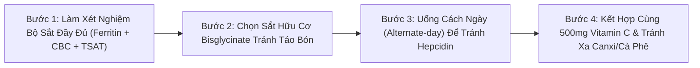
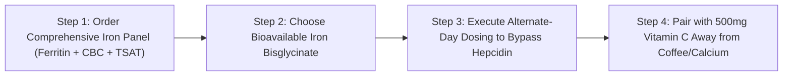

# WH_22 - Kinh Nguyệt Ra Nhiều & Thiếu Máu: Dấu Hiệu Tụt Ferritin & Phác Đồ Bù Sắt Khoa Học
**Category:** Women's Health 
**Screen:** Menstrual Cycle Screen & Vitals 
**Metric:** Heavy Menstrual Flow & Ferritin Levels (HO-01 / REC-01 / STR-01) 
**Reading Time:** 8 phút đọc / 8 min 
**Hero Image:**  *(Source: [https://images.unsplash.com/photo-1584362917165-526a968579e8?auto=format&fit=crop&w=1200&q=85](https://images.unsplash.com/photo-1584362917165-526a968579e8?auto=format&fit=crop&w=1200&q=85))* 
**Inline Figure:**  *(Source: [https://commons.wikimedia.org/wiki/File:Iron-metabolism.svg](https://commons.wikimedia.org/wiki/File:Iron-metabolism.svg))* 
**Clinical Source:** [FIGO PALM-COEIN Classification (Fraser et al., 2011) & Blood Journal (Moretti et al., 2015)](https://www.fertstert.org/article/S0015-0282(11)00345-0/fulltext) 

---

## 🇻🇳 Phiên Bản Tiếng Việt (Vietnamese Edition)

# Kinh Nguyệt Ra Nhiều & Thiếu Máu: Dấu Hiệu Tụt Ferritin & Phác Đồ Bù Sắt Khoa Học

> **Tóm tắt (Sapo):** Bạn cảm thấy tim đập thình thịch khi leo cầu thang, hụt hơi khi chạy bộ dù kết quả xét nghiệm máu cho thấy nồng độ Hemoglobin 'bình thường'? Rất có thể bạn đang bị thiếu sắt tiềm ẩn (Tụt Ferritin) do kinh nguyệt ra nhiều (Menorrhagia). Khám phá cách chẩn đoán và phác đồ bù sắt chuẩn y học thể thao.

> 💡 **Điểm Cốt Lõi & Hành Động Thực Tế (Key Takeaway):** Đừng chỉ kiểm tra nồng độ Hemoglobin; hãy yêu cầu bác sĩ xét nghiệm Ferritin huyết thanh (mục tiêu tối ưu cho phụ nữ vận động là > 50 ng/mL). Nếu bạn phải thay băng vệ sinh sau mỗi 1–2 giờ hoặc có cục máu đông lớn hơn đồng xu, hãy bổ sung sắt hữu cơ dạng Sắt Bisglycinate uống cách ngày kết hợp cùng Vitamin C.

## Hiện Tượng Thiếu Máu Ẩn Giấu: "Hemoglobin Bình Thường Nhưng Người Vẫn Kiệt Sức"

Hàng triệu phụ nữ năng động đang phải trải qua cảm giác bế tắc này:
- Bạn cảm thấy cơ thể nặng như chì, leo vài bậc cầu thang đã thở dốc, tập luyện thể thao nhanh xuống sức và đầu óc lơ mơ thiếu tập trung.
- Bạn đi khám tổng quát và làm xét nghiệm công thức máu (**CBC**), bác sĩ nhìn vào chỉ số **Hemoglobin (Hb)** và kết luận: *"Chỉ số 12.2 g/dL hoàn toàn bình thường, bạn không bị thiếu máu đâu, chỉ là do mệt mỏi thông thường thôi"*.
- Bạn trở về nhà nhưng cơ thể vẫn tiếp tục kiệt quệ từng ngày.

Tại sao lại có nghịch lý này?

Câu trả lời nằm ở sự nhầm lẫn giữa **Hemoglobin (Sắt lưu hành trong hồng cầu)** và **Ferritin (Kho dự trữ sắt sâu trong tế bào gan và tủy xương)**. 

Theo hướng dẫn lâm sàng của **Hội Sản Phụ khoa Quốc tế (FIGO, Fraser et al., 2011)** và các nghiên cứu y học thể thao của **Giáo sư Peter Peeling (2014)**: **Một người phụ nữ có thể hoàn toàn bình thường về Hemoglobin nhưng đã cạn kiệt Ferritin dự trữ—tình trạng này được gọi là Thiếu Sắt Không Thiếu Máu (Non-Anemic Iron Deficiency - NAID).**

<figure class="article-inline-diagram">
 
 <figcaption>🩸 <strong>Cơ Chế Điều Hòa & Chuyển Hóa Sắt Cơ Thể:</strong> Sắt hấp thu qua tá tràng được vận chuyển bởi Transferrin và dự trữ nội bào dưới dạng Ferritin. Rong kinh kéo dài làm cạn kiệt kho dự trữ Ferritin trước khi chỉ số hồng cầu và hemoglobin giảm rõ rệt. <a href="https://commons.wikimedia.org/wiki/File:Iron-metabolism.svg" target="_blank" rel="noopener">Nguồn: Wikimedia Commons ↗</a></figcaption>
</figure>

---

## Kinh Nguyệt Ra Nhiều (Menorrhagia): Kẻ Trộm Sắt Vô Hình Hàng Tháng

Mỗi kỳ kinh nguyệt bình thường, cơ thể phụ nữ mất trung bình từ **30 đến 40 ml máu** (tương đương khoảng 15 - 20 mg sắt nguyên tố). Đây là lượng sắt mà chế độ ăn uống thông thường hoàn toàn có thể bù đắp lại trong vòng 1 tháng.

Tuy nhiên, có tới **25%–30% phụ nữ** mắc chứng **Kinh Nguyệt Ra Nhiều (Menorrhagia / Heavy Menstrual Bleeding)**:
- Lượng máu mất vượt quá **80 ml mỗi chu kỳ** (tương đương mất đi 40 - 60 mg sắt mỗi tháng).
- Các nguyên nhân thực thể hàng đầu: U xơ tử cung (**Uterine Fibroids**), Lạc tuyến nội mạc tử cung (**Adenomyosis**), Polyp lòng tử cung hoặc rối loạn đông máu vi thể.
- Khi lượng sắt mất đi qua máu kinh lớn hơn lượng sắt cơ thể hấp thu được từ thức ăn, cơ thể sẽ buộc phải rút cạn dần kho dự trữ **Ferritin**.
- Khi Ferritin cạn kiệt, các enzyme chứa sắt trong ty thể cơ bắp (Cytochrome C, Aconitase) không thể tổng hợp năng lượng ATP, khiến chỉ số tiêu thụ oxy tối đa (**VO2 Max**) sụt giảm nghiêm trọng và tim phải đập nhanh hơn để bù đắp.

---

## Bảng Đối Chiếu Các Cột Mốc Xét Nghiệm Sắt Chuẩn Lâm Sàng

| Chỉ Số Xét Nghiệm | Ngưỡng Y Tế Tiêu Chuẩn (Standard Range) | Ngưỡng Tối Ưu Cho Phụ Nữ Vận Động (Optimal Athletic Target) | Ý Nghĩa Sinh Học Khi Bị Thấp |
| :--- | :--- | :--- | :--- |
| **Ferritin Huyết Thanh (Serum Ferritin)** | 15 - 150 ng/mL | **> 50 ng/mL** (Lý tưởng: 70 - 100 ng/mL) | **Kho dự trữ sắt tế bào cạn kiệt.** Dưới 30 ng/mL gây rụng tóc, mệt mỏi mãn tính; dưới 15 ng/mL là kiệt quệ hoàn toàn. |
| **Hemoglobin (Hb)** | 12.0 - 15.5 g/dL | **> 13.0 g/dL** | Khi chỉ số này tụt xuống dưới 12.0 g/dL, bạn đã rơi vào giai đoạn cuối: Thiếu máu nhược sắc vi hồng cầu. |
| **Độ Bão Hòa Transferrin (TSAT)** | 20% - 50% | **> 25% - 35%** | Dưới 16% phản ánh lượng sắt sẵn có để tủy xương tạo hồng cầu mới đang bị thiếu hụt trầm trọng. |
| **Sắt Huyết Thanh (Serum Iron)** | 60 - 170 mcg/dL | Dao động tự nhiên trong ngày | Biến động mạnh sau bữa ăn; không phản ánh chính xác lượng sắt dự trữ lâu dài. |

---

## 4 Dấu Hiệu Nhận Diện Kinh Nguyệt Của Bạn Đang "Quá Nặng"

1. **Phải Thay Băng Vệ Sinh Sau Mỗi 1–2 Giờ:** Băng vệ sinh loại dày hoặc tampon thấm đẫm máu chỉ sau 1 đến 2 tiếng sử dụng liên tục trong ngày.
2. **Kỳ Kinh Kéo Dài Quá 7 Ngày:** Chảy máu liên tục từ ngày thứ 8 trở đi.
3. **Xuất Hiện Các Cục Máu Đông Lớn:** Thường xuyên tống xuất các cục máu đông có kích thước lớn hơn **đồng xu 25 cent (đường kính > 2.5 cm)**.
4. **Hội Chứng Tràn Băng Ban Đêm:** Phải thức giấc giữa đêm để thay băng vệ sinh hoặc phải lót thêm khăn dày vì máu tràn ra nệm.

---

## Giao Thức 4 Bước Bổ Sung Sắt Chuẩn Y Học Thể Thao

1. **Yêu Cầu Xét Nghiệm Toàn Diện:** Đừng chỉ xét nghiệm công thức máu CBC thông thường; hãy yêu cầu bác sĩ chỉ định thêm **Ferritin huyết thanh** và **Độ bão hòa Transferrin**. Nếu Ferritin < 30 ng/mL, bạn bắt buộc phải có phác đồ điều trị bổ sung sắt có kiểm soát.
2. **Lựa Chọn Hoạt Chất Sắt Hấp Thu Cao:** Tránh các loại sắt vô cơ giá rẻ như Sắt Sunfat (*Ferrous Sulfate*) thường gây buồn nôn, đau dạ dày và táo bón đen phân. Hãy ưu tiên **Sắt Heme hữu cơ** hoặc **Sắt Bisglycinate (Iron Chelate)**—dạng sắt gắn với 2 phân tử glycine giúp tăng hấp thu gấp 4 lần và cực kỳ êm dịu với niêm mạc ruột.
3. **Quy Tắc Uống Cách Ngày (The Alternate-Day Dosing Protocol):**
 - Nghiên cứu y khoa chứng minh: Sau khi bạn uống một viên sắt, cơ thể sẽ tiết ra hormone **Hepcidin** làm khóa hoàn toàn khả năng hấp thu sắt trong 24–48 giờ tiếp theo.
 - Do đó, **uống sắt cách ngày (1 ngày uống, 1 ngày nghỉ)** mang lại tỷ lệ hấp thu sắt thực tế cao hơn và ít tác dụng phụ lên đường tiêu hóa hơn nhiều so với việc uống dồn dập mỗi ngày!
4. **Quy Tắc Hấp Thu Vàng:** Luôn uống sắt vào buổi sáng khi đói cùng một ly nước cam hoặc viên ngậm **500 mg Vitamin C** (axit ascorbic chuyển đổi sắt Fe3+ thành Fe2+ dễ hấp thu). Cách xa thời điểm uống cà phê, trà xanh, sữa hoặc canxi ít nhất **2 giờ** (tanin và canxi cạnh tranh trực tiếp thụ thể hấp thu sắt).

---

## Nguồn Y Khoa Lâm Sàng & Tài Liệu Tham Khảo

1. **Fraser, I. S., et al. (2011).** The FIGO classification system (PALM-COEIN) for causes of abnormal uterine bleeding in nongravid women of reproductive age. *Fertility and Sterility*, 95(7), 2204-2208. [Hệ Thống Phân Loại FIGO (PALM-COEIN) Về Xuất Huyết Tử Cung Bất Thường (PMID: 21345435) ↗](https://www.fertstert.org/article/S0015-0282(11)00345-0/fulltext)
2. **Peeling, P., et al. (2014).** Athletic induced iron deficiency: new insights into the role of inflammation, hepcidin and the gender disparity. *International Journal of Sport Nutrition and Exercise Metabolism*, 24(2), 153-163. [Tạp chí IJSNEM: Thiếu Sắt Ở Nữ Giới Vận Động & Hormone Hepcidin (PMID: 24584967) ↗](https://journals.humankinetics.com/view/journals/ijsnem/24/2/article-p153.xml)
3. **Moretti, D., et al. (2015).** Oral iron supplements increase hepcidin and decrease iron absorption from daily or twice-daily doses in iron-depleted young women. *Blood*, 126(17), 1981-1989. [Tạp chí Blood: Hấp Thu Sắt Cách Ngày & Kiểm Soát Hepcidin (PMID: 26289632) ↗](https://ashpublications.org/blood/article/126/17/1981/34526)
4. **WHOOP Menstrual & Vitals Research (2025).** Menstrual Flow Tracking & Aerobic Capacity Degradation. [WHOOP The Locker: Iron Deficiency in Athletes & Performance Impacts ↗](https://www.whoop.com/thelocker/iron-deficiency-athletes/)

---

## 🇬🇧 English Edition

# Menorrhagia & Ferritin: Overcoming Hidden Iron Deficiency & Fatigue

> **Abstract (Sapo):** Experiencing unexplained heart palpitations climbing stairs or shortness of breath during routine runs despite 'normal' Hemoglobin lab results? You likely suffer from latent iron deficiency (depleted Ferritin reserves) triggered by heavy menstrual bleeding (Menorrhagia). Discover how to accurately diagnose and replenish iron stores.

> 💡 **Key Takeaway & Clinical Action:** Do not rely solely on Hemoglobin panels; insist on checking serum Ferritin (optimal athletic target > 50 ng/mL). If you soak pads/tampons hourly or pass clots larger than a quarter, replenish iron reserves using Iron Bisglycinate taken on alternate days alongside Vitamin C to bypass Hepcidin blockades.

## The Hidden Anemia Epidemic: "Normal Hemoglobin, Completely Exhausted"

Countless active women endure this debilitating clinical conundrum:
- Your body feels like lead, climbing a flight of stairs triggers air hunger, running pace plummets, and persistent brain fog clouds daily focus.
- You consult a physician for routine complete blood count (**CBC**) labs. The clinician glances at your **Hemoglobin (Hb)** and dismisses your complaints: *"Your level is 12.2 g/dL—completely within normal reference ranges. You aren't anemic; you're just chronically tired."*
- You return home, yet systemic exhaustion deepens daily.

Why does this diagnostic blind spot occur?

The answer lies in the fundamental distinction between **Hemoglobin (active circulating functional iron in erythrocytes)** and **Ferritin (the deep intracellular storage iron pool within hepatocytes and bone marrow)**.

According to clinical guidelines issued by the **International Federation of Gynecology and Obstetrics (FIGO, Fraser et al., 2011)** and sports hematology led by **Prof. Peter Peeling (2014)**: **A woman can present with entirely normal hemoglobin concentrations while having entirely exhausted cellular Ferritin reserves—a state defined as Non-Anemic Iron Deficiency (NAID).**

<figure class="article-inline-diagram">
 
 <figcaption>🩸 <strong>Systemic Iron Homeostasis & Ferritin Stores:</strong> Intestinal iron uptake, transferrin plasma circulation, and ferritin intracellular storage. Heavy menstrual loss depletes bone marrow stores before frank anemia manifests. <a href="https://commons.wikimedia.org/wiki/File:Iron-metabolism.svg" target="_blank" rel="noopener">Source: Wikimedia Commons ↗</a></figcaption>
</figure>

---

## Heavy Menstrual Bleeding (Menorrhagia): The Silent Monthly Iron Thief

During a physiological menstrual period, a woman loses an average of **30 to 40 mL of blood** (equivalent to approximately 15 - 20 mg of elemental iron). This modest loss is readily restored via standard dietary intake over 30 days.

However, an estimated **25% to 30% of women** experience **Menorrhagia (Heavy Menstrual Bleeding - HMB)**:
- Blood loss exceeds **80 mL per cycle** (stripping 40 - 60 mg of elemental iron monthly).
- Primary structural and functional etiologies: **Uterine Fibroids**, **Adenomyosis**, endometrial polyps, or subclinical coagulopathies.
- When monthly menstrual iron excretion consistently outpaces intestinal mucosal iron absorption, the body systematically drains intracellular **Ferritin** stores to sustain hemoglobin.
- Once Ferritin depletes, iron-dependent mitochondrial enzymes (Cytochrome C, Aconitase) cannot synthesize ATP, driving down **VO2 Max** and forcing the heart to beat faster to compensate.

---

## Clinical Biomarker Reference Matrix: Interpreting Iron Labs

| Diagnostic Biomarker | Standard Laboratory Reference | Optimal Female Athletic Target | Pathological Significance of Sub-Optimal Levels |
| :--- | :--- | :--- | :--- |
| **Serum Ferritin** | 15 - 150 ng/mL | **> 50 ng/mL** (Optimal: 70 - 100 ng/mL) | **Depleted cellular iron storage.** Levels < 30 ng/mL trigger telogen effluvium (hair loss) and fatigue; < 15 ng/mL represents total marrow exhaustion. |
| **Hemoglobin (Hb)** | 12.0 - 15.5 g/dL | **> 13.0 g/dL** | Levels dropping below 12.0 g/dL indicate end-stage microcytic hypochromic clinical anemia. |
| **Transferrin Saturation (TSAT)** | 20% - 50% | **> 25% - 35%** | Values < 16% demonstrate acute iron-restricted erythropoiesis (marrow lacks circulating iron to form new red cells). |
| **Serum Iron** | 60 - 170 mcg/dL | Subject to circadian fluctuations | Swings wildly postprandially; inaccurate for assessing chronic total body iron status. |

---

## 4 Red Flags Identifying Heavy Menstrual Bleeding (HMB)

1. **Hourly Sanitary Protection Changes:** Soaking through one or more tampons or thick pads every 1 to 2 consecutive hours throughout the day.
2. **Protracted Bleeding > 7 Days:** Visible bright red bleeding persisting into Day 8 and beyond.
3. **Passage of Large Hematomas:** Expelling coagulated blood clots larger than **a quarter (diameter > 2.5 cm / 1 inch)**.
4. **Nocturnal Waking to Manage Protection:** Needing to wake during the night to change sanitary products or doubling up on pads to avoid mattress soiling.

---

## 4-Step Clinical Iron Repletion Protocol

1. **Demand Comprehensive Laboratory Profiling:** Never accept a standalone CBC. Insist on a complete iron profile including **Serum Ferritin** and **Transferrin Saturation**. If Ferritin falls below 30 ng/mL, medical oral iron therapy is indicated.
2. **Select Non-Constipating Chelate Formulations:** Bypass crude inorganic salts like Ferrous Sulfate, which notoriously induce nausea, gastric distress, and severe constipation. Opt for **Iron Bisglycinate Chelate**—bonded to two glycine molecules, providing 4x superior absorption with virtually zero gastrointestinal irritation.
3. **Implement the Evidence-Based Alternate-Day Dosing Protocol:**
 - Landmark hematology trials (**Moretti et al., Blood 2015**) demonstrated that ingesting oral iron triggers a sharp, sustained spike in circulating **Hepcidin**, effectively blocking enterocyte iron absorption for 24 to 48 hours.
 - Consequently, **ingesting iron on alternate days (every other day)** achieves higher cumulative fractional absorption and dramatically fewer gastrointestinal side effects than daily dosing.
4. **Execute Strategic Absorption Pairing:** Always consume iron on an empty stomach alongside a glass of freshly squeezed citrus juice or **500 mg of Vitamin C** (ascorbic acid reduces non-heme Fe3+ to the highly soluble Fe2+ state). Maintain a strict **2-hour separation** from coffee, black/green tea, dairy, and calcium supplements (tannins, phytates, and calcium competitively inhibit iron transporters).

---

## Clinical Citations & Reference Literature

1. **Fraser, I. S., et al. (2011).** The FIGO classification system (PALM-COEIN) for causes of abnormal uterine bleeding in nongravid women of reproductive age. *Fertility and Sterility*, 95(7), 2204-2208. [FIGO PALM-COEIN Classification (PMID: 21345435) ↗](https://www.fertstert.org/article/S0015-0282(11)00345-0/fulltext)
2. **Peeling, P., et al. (2014).** Athletic induced iron deficiency: new insights into the role of inflammation, hepcidin and the gender disparity. *IJSNEM*, 24(2), 153-163. [IJSNEM: Hepcidin & Gender Iron Disparity (PMID: 24584967) ↗](https://journals.humankinetics.com/view/journals/ijsnem/24/2/article-p153.xml)
3. **Moretti, D., et al. (2015).** Oral iron supplements increase hepcidin and decrease iron absorption from daily or twice-daily doses in iron-depleted young women. *Blood*, 126(17), 1981-1989. [Blood Journal: Alternate-Day Iron Dosing (PMID: 26289632) ↗](https://ashpublications.org/blood/article/126/17/1981/34526)
4. **WHOOP Menstrual & Vitals Research (2025).** Menstrual Flow Tracking & Aerobic Capacity Degradation. [WHOOP The Locker: Iron Deficiency in Athletes & Performance Impacts ↗](https://www.whoop.com/thelocker/iron-deficiency-athletes/)
