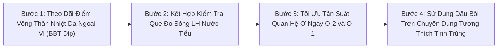
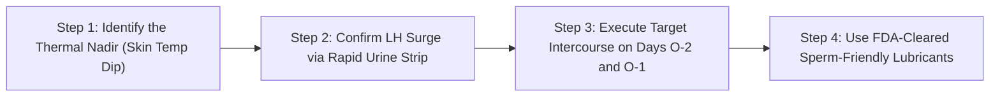

# WH_23 - Dòng Thời Gian Thụ Thai: Tuổi Thọ Giao Tử & Nghệ Thuật Canh Cửa Sổ Thụ Thai Chuẩn Xác
**Category:** Fertility & Pregnancy — Conception & Fertile Window 
**Screen:** Menstrual Cycle Screen & Fertility Mode 
**Metric:** Fertile Window & Ovulation Timing (HO-03 / HO-04 / HO-05) 
**Reading Time:** 8 phút đọc / 8 min 
**Hero Image:**  *(Source: [https://images.unsplash.com/photo-1516585427167-9f4af9627e6c?auto=format&fit=crop&w=1200&q=85](https://images.unsplash.com/photo-1516585427167-9f4af9627e6c?auto=format&fit=crop&w=1200&q=85))* 
**Inline Figure:**  *(Source: [https://commons.wikimedia.org/wiki/File:Fertile_window.svg](https://commons.wikimedia.org/wiki/File:Fertile_window.svg))* 
**Clinical Source:** [N Engl J Med (Wilcox et al., 1995) & Hum Reprod (Dunson et al., 2002)](https://pubmed.ncbi.nlm.nih.gov/7477165/) 

---

## 🇻🇳 Phiên Bản Tiếng Việt (Vietnamese Edition)

# Dòng Thời Gian Thụ Thai: Tuổi Thọ Giao Tử & Nghệ Thuật Canh Cửa Sổ Thụ Thai Chuẩn Xác

> **Tóm tắt (Sapo):** Nhiều cặp đôi lầm tưởng rằng chỉ có thể thụ thai vào đúng ngày rụng trứng, dẫn đến việc bỏ lỡ những thời điểm vàng quý giá nhất. Khám phá bí mật tuổi thọ giao tử, hiện tượng biến đổi tinh trùng (Capacitation) và cách công nghệ thiết bị đeo giúp bạn xác định chuẩn xác cửa sổ sinh sản 6 ngày.

> 💡 **Điểm Cốt Lõi & Hành Động Thực Tế (Key Takeaway):** Trứng chỉ sống được 12–24 giờ sau khi rụng, nhưng tinh trùng có thể sống khỏe mạnh tới 3–5 ngày trong dịch nhầy cổ tử cung giàu estrogen. Để tối đa hóa cơ hội có thai, hãy quan hệ vào 1–2 ngày TRƯỚC KHI rụng trứng thay vì chờ đến khi nhiệt độ cơ thể đã tăng vọt.

## Hiểu Lầm Phổ Biến Nhất Về Ngày Thụ Thai

Trong hành trình mong con hoặc ngừa thai tự nhiên, một định kiến sai lầm rất phổ biến là: *"Muốn có thai thì phải quan hệ vào đúng ngày rụng trứng (Ngày thứ 14)"*.

Tuy nhiên, sinh học sinh sản hoạt động theo một quy luật thời gian tinh vi hơn rất nhiều. Trong công trình nghiên cứu đột phá công bố trên tạp chí y khoa danh giá nhất thế giới **The New England Journal of Medicine**, **Giáo sư Allen J. Wilcox và cộng sự (1995)** đã phân tích 696 chu kỳ kinh nguyệt và chứng minh rằng:
- **Khả năng thụ thai thực tế mở rộng trong một khung thời gian chính xác là 6 ngày:** Gồm **5 ngày trước khi rụng trứng** và **ngày rụng trứng**.
- Sau khi trứng đã rụng quá 24 giờ, xác suất thụ thai thực tế giảm về **0%**.
- Đáng ngạc nhiên hơn: Ngày có xác suất thụ thai thành công cao nhất không phải là ngày rụng trứng, mà là **1 đến 2 ngày TRƯỚC rụng trứng (Ngày O-2 và O-1)**!

<figure class="article-inline-diagram">
 
 <figcaption>⏳ <strong>Đường Cong Xác Suất Thụ Thai:</strong> Xác suất thụ thai đạt đỉnh 27%–31% vào 2 ngày trước khi trứng rụng nhờ sự tương thích giữa dịch cổ tử cung và khả năng sống của tinh trùng. <a href="https://commons.wikimedia.org/wiki/File:Fertile_window.svg" target="_blank" rel="noopener">Nguồn sơ đồ: Wikimedia Commons ↗</a></figcaption>
</figure>

---

## Cuộc Đua Thời Gian: Tuổi Thọ Giao Tử (Gamete Lifespan)

Sự chênh lệch kỳ diệu về tuổi thọ giữa trứng và tinh trùng là yếu tố quyết định cửa sổ sinh sản:

### 1. Trứng (Oocyte) — Sinh Mệnh Ngắn Ngủi 12 Đến 24 Giờ
- Sau khi nang Graaf vỡ ra giải phóng noãn bào trong sự kiện rụng trứng, noãn bào được các loa vòi tử cung đón lấy và đưa vào 1/3 ngoài của ống dẫn trứng (**Bóng vòi trứng - Ampulla**).
- Tại đây, trứng chỉ duy trì được khả năng thụ tinh trong vòng **12 đến tối đa 24 giờ**. Nếu không gặp được tinh trùng trong cửa sổ này, trứng sẽ thoái hóa, bị đại thực bào tiêu hóa và chu kỳ bước vào pha hoàng thể thoái triển.

### 2. Tinh Trùng (Spermatozoa) — Chiến Binh Bền Bỉ 3 Đến 5 Ngày
- Trong môi trường âm đạo thông thường có tính axit cao (pH 3.8–4.2), tinh trùng chỉ sống sót được vài giờ.
- Nhưng trong cửa sổ 5 ngày trước rụng trứng, **Estradiol (E2)** tăng cao kích thích các tuyến cổ tử cung tiết ra loại dịch nhầy màu mỡ (loại E - Estrogenic mucus) có tính kiềm, dạng sợi trong suốt.
- Dịch nhầy này đóng vai trò như một **"ốc đảo sinh tồn"**: cung cấp đường fructose nuôi dưỡng tinh trùng, bảo vệ tinh trùng khỏi bạch cầu miễn dịch của người phụ nữ, và giúp tinh trùng có thể sống khỏe mạnh, bơi lội từ **72 đến 120 giờ (3 đến 5 ngày)** bên trong các hốc cổ tử cung (*Cervical crypts*).

### 3. Hiện Tượng "Biến Đổi Khả Năng Thụ Tinh" (Capacitation)
- Tinh trùng khi vừa xuất trận chưa thể thụ tinh ngay cho trứng. Chúng cần phải trải qua quá trình **Thích ứng thụ tinh (Capacitation)** kéo dài từ **5 đến 7 giờ** trong đường sinh dục nữ: lớp màng glycoprotein bảo vệ trên đầu tinh trùng bị rửa trôi, giải phóng các enzyme hyaluronidase tại thể cực đầu (**Acrosome**) để khoan thủng lớp màng trong suốt (*Zona Pellucida*) của trứng.
- Do đó, việc tinh trùng đã có mặt sẵn trong vòi trứng trước thời điểm rụng trứng sẽ giúp chúng kịp hoàn thành quá trình Capacitation và sẵn sàng thụ tinh ngay khoảnh khắc trứng vừa rụng!

---

## Bảng Xác Suất Thụ Thai Hàng Ngày Trong Cửa Sổ Sinh Sản (Wilcox & Dunson Data)

| Ngày Quan Hệ So Với Rụng Trứng | Trạng Thái Sinh Lý Của Giao Tử | Đặc Điểm Dịch Cổ Tử Cung | Xác Suất Thụ Thai Thành Công |
| :--- | :--- | :--- | :--- |
| **Ngày O - 5 (5 ngày trước)** | Tinh trùng phải sống sót cực hạn 5 ngày chờ trứng. | Bắt đầu chuyển từ dính sang ẩm ướt nhẹ. | **4% - 5%** |
| **Ngày O - 4 (4 ngày trước)** | Tinh trùng cư trú an toàn trong hốc cổ tử cung. | Ẩm ướt, lượng dịch nhầy bắt đầu tăng. | **10% - 12%** |
| **Ngày O - 3 (3 ngày trước)** | Mật độ tinh trùng sống sót trong vòi trứng cao. | Dịch nhiều, bắt đầu trong và hơi dai. | **15% - 18%** |
| **Ngày O - 2 (2 ngày trước)** | **Thời điểm vàng:** Tinh trùng hoàn thành capacitation, sẵn sàng đón đầu trứng. | **Lòng trắng trứng sống (Spinnbarkeit > 8cm)**, trơn trượt, pH kiềm thuận lợi. | **27% - 30% (Đỉnh cao nhất)** |
| **Ngày O - 1 (1 ngày trước)** | Tinh trùng dồi dào, khả năng di động tối đa. | Dịch nhầy bôi trơn đạt số lượng cực đại. | **28% - 31% (Đỉnh cao nhất)** |
| **Ngày Rụng Trứng (Ngày O)** | Trứng vừa rụng; tinh trùng cần 5-7 tiếng capacitation nên thời gian khá gấp rút. | Dịch nhầy bắt đầu đặc dần sau đỉnh rụng trứng. | **12% - 15%** |
| **Ngày O + 1 (1 ngày sau)** | Trứng đã thoái hóa; màng zona pellucida cứng lại. | Progesterone làm đặc dịch nhầy, chặn lối vào của tinh trùng. | **0% (Hết cửa sổ)** |

---

## 4 Sai Lầm Kinh Điển Của Các Cặp Đôi Khi Canh Ngày Có Thai

1. **Chờ Đến Khi Thấy Thân Nhiệt Tăng (BBT Shift) Mới Quan Hệ:** Nhiệt độ cơ thể chỉ tăng vọt (+0.3°C) SAU KHI trứng đã rụng 24–48 giờ do progesterone tiết ra. Quan hệ vào lúc nhiệt độ đã tăng đồng nghĩa với việc trứng đã chết, cơ hội mang thai chu kỳ đó bằng 0!
2. **Quan Hệ Liên Tục Nhiều Lần Mỗi Ngày:** Việc quan hệ dồn dập 2–3 lần trong ngày làm giảm đáng kể mật độ tinh trùng và thể tích tinh dịch trong mỗi lần xuất tinh. Tần suất tối ưu được y học khuyến cáo là **1 lần mỗi ngày hoặc cách ngày** trong cửa sổ 6 ngày.
3. **Sử Dụng Chất Bôi Trơn Thông Thường:** Các loại gel bôi trơn gốc nước hoặc silicon đại trà có độ pH và áp suất thẩm thấu không tương thích, có thể làm tê liệt và giết chết hơn 80% tinh trùng chỉ sau 30 phút tiếp xúc.
4. **Bỏ Qua Vai Trò Của Dịch Cổ Tử Cung (Cervical Mucus):** Dù que thử rụng trứng có thể báo 2 vạch, nhưng nếu cơ thể bạn bị thiếu nước hoặc thiếu estrogen khiến dịch cổ tử cung khô cạn, tinh trùng sẽ không thể sống sót để bơi qua buồng tử cung.

---

## Giao Thức 4 Bước Làm Chủ Cửa Sổ Thụ Thai Bằng Dữ Liệu Thiết Bị Đeo

1. **Nhận Diện Điểm "Võng Nhiệt Độ" (Thermal Nadir):** Trên biểu đồ nhiệt độ da ban đêm của thiết bị đeo (Apple Watch, Oura Ring), ngay trước khi nồng độ progesterone đẩy nhiệt độ tăng cao, bạn sẽ thấy nhiệt độ chạm một **điểm trũng thấp nhất (Nadir)** kéo dài 24 giờ—đó chính là tín hiệu rụng trứng sắp diễn ra trong 12–24 giờ tới.
2. **Xác Định Đỉnh Sóng LH (LH Surge):** Sử dụng que thử rụng trứng (OPK) từ ngày thứ 10 của chu kỳ. Khi vạch thử đậm hơn hoặc bằng vạch chứng (dương tính), đỉnh sóng LH đã xuất hiện; trứng sẽ vỡ rụng sau đó **24 đến 36 giờ**.
3. **Khóa Chặt Lịch Quan Hệ Ở Ngày O-2 và O-1:** Bắt đầu quan hệ từ khi thấy xuất hiện dịch nhầy dạng lòng trắng trứng sống, đặc biệt duy trì sinh hoạt vào buổi tối ngày O-2 và sáng ngày O-1 để đội quân tinh trùng đã sẵn sàng túc trực trong vòi trứng.
4. **Duy Trì Môi Trường Thân Thiện Với Giao Tử:** Uống đủ 2–2.5 lít nước mỗi ngày để tăng tiết dịch cổ tử cung; nếu cần hỗ trợ bôi trơn, chỉ sử dụng các loại gel chuyên dụng cho sinh sản (**Fertility-Friendly Lubricant** có dán nhãn *Sperm-Friendly* hoặc dầu hạt cải tự nhiên) đã được FDA chứng nhận không gây độc cho tinh trùng.

---

## Nguồn Y Khoa Lâm Sàng & Tài Liệu Tham Khảo

1. **Wilcox, A. J., et al. (1995).** Timing of sexual intercourse in relation to ovulation: effects on the probability of conception, study of the fertile window. *The New England Journal of Medicine*, 333(23), 1517-1521. [PMID: 7477165](https://pubmed.ncbi.nlm.nih.gov/7477165/)
2. **Dunson, D. B., et al. (2002).** Changes with age in the level and duration of fertility in the menstrual cycle. *Human Reproduction*, 17(5), 1399-1403. [PMID: 11980771](https://pubmed.ncbi.nlm.nih.gov/11980771/)
3. **Stirnemann, J., et al. (2013).** Day-specific probabilities of conception in fertile cycles resulting in spontaneous pregnancy. *Human Reproduction*, 28(4), 1110-1116.
4. **WHOOP & Apple HealthKit Fertility Algorithms (2025).** Biphasic Temperature Shift & Fertile Window Estimation (HO-03, HO-04, HO-05).

---

## 🇬🇧 English Edition

# The Conception Timeline: Gamete Lifespans, Capacitation & The 6-Day Window

> **Abstract (Sapo):** Many couples believe conception is restricted exclusively to the day of ovulation, inadvertently missing the most fertile biological windows. Discover gamete longevity, the biochemical miracle of sperm capacitation, and how wearable biometric algorithms accurately delineate the 6-day fertile window.

> 💡 **Key Takeaway & Clinical Action:** An unfertilized oocyte survives only 12–24 hours post-ovulation, while spermatozoa can thrive for 3–5 days within fertile cervical mucus. Maximize conception probability by timing intercourse 1 to 2 days BEFORE ovulation, rather than waiting for the post-ovulatory basal temperature spike.

## The Pervasive Conception Fallacy: "It Only Happens on Day 14"

In reproductive planning, a misleading myth endures: *"To conceive, you must time intercourse exclusively on the day of ovulation (Day 14)."*

Reproductive endocrinology follows far more nuanced temporal dynamics. In a landmark clinical study published in **The New England Journal of Medicine**, **Dr. Allen J. Wilcox and colleagues (1995)** evaluated 696 menstrual cycles, revealing crucial biological insights:
- **The true biological window of conception spans exactly 6 days:** Comprising the **5 days immediately preceding ovulation** plus the **day of ovulation itself**.
- Once 24 hours elapse post-ovulation, the probability of conception drops to absolute **0%**.
- Crucially: Peak conception probability does NOT occur on the day of ovulation, but rather **1 to 2 days BEFORE ovulation (Days O-2 and O-1)**!

<figure class="article-inline-diagram">
 
 <figcaption>⏳ <strong>Conception Probability Architecture:</strong> Likelihood of pregnancy peaks at 27%–31% on Days O-2 and O-1, driven by optimal cervical mucus hydration and sperm longevity. <a href="https://commons.wikimedia.org/wiki/File:Fertile_window.svg" target="_blank" rel="noopener">Source: Wikimedia Commons ↗</a></figcaption>
</figure>

---

## The Race Against Time: Gamete Longevity & Capacitation

The stark divergence in biological lifespan between the female oocyte and male spermatozoa dictates the fertile window:

### 1. The Oocyte — A Fragile 12 to 24-Hour Lifespan
- Following Graafian follicle rupture during ovulation, the fimbriae sweep the secondary oocyte into the **ampulla of the fallopian tube**.
- Here, the unfertilized egg retains viability for a fleeting **12 to 24 hours**. If unfertilized, the cell rapidly degenerates, undergoing phagocytosis as the cycle transitions into luteal regression.

### 2. Spermatozoa — Resilient 3 to 5-Day Longevity
- In the standard acidic vaginal canal (pH 3.8–4.2), spermatozoa perish within hours.
- However, during the 5 days prior to ovulation, surging **Estradiol (E2)** stimulates endocervical crypts to secrete profuse, alkaline, highly hydrated mucus (Type E mucus).
- This mucus acts as a **biological haven**: rich in fructose, shielding sperm from maternal phagocytes, and allowing spermatozoa to maintain motility for **72 to 120 hours (3 to 5 full days)** within cervical crypts.

### 3. The Phenomenon of Capacitation
- Ejaculated spermatozoa cannot immediately penetrate an oocyte; they require **capacitation**—a 5 to 7-hour biochemical maturation within the female tract. The protective acrosomal glycoprotein coat is destabilized, priming hydrolytic enzymes (hyaluronidase, acrosin) to digest the egg's *Zona Pellucida*.
- Having spermatozoa pre-positioned in the fallopian ampulla prior to ovulation ensures capacitation is complete, enabling immediate fertilization the instant the oocyte emerges!

---

## Daily Conception Probabilities Across the Fertile Window (Wilcox & Dunson Data)

| Timing Relative to Ovulation | Gamete Physiological State | Cervical Mucus Consistency | Conception Probability per Cycle |
| :--- | :--- | :--- | :--- |
| **Day O - 5 (5 days prior)** | Spermatozoa must survive for 120 hours. | Transitioning from tacky to moist. | **4% - 5%** |
| **Day O - 4 (4 days prior)** | Sperm securely sequestered in cervical crypts. | Hydration increasing; volume expanding. | **10% - 12%** |
| **Day O - 3 (3 days prior)** | Dense viable sperm pools reaching the ampulla. | Thinning, translucent, forming parallel micelle channels. | **15% - 18%** |
| **Day O - 2 (2 days prior)** | **Optimal Golden Window:** Capacitation complete; waiting at the ampulla. | **Egg-white mucus (Spinnbarkeit > 8cm)**; high alkaline pH. | **27% - 30% (Cycle Maximum)** |
| **Day O - 1 (1 day prior)** | Abundant capacitated sperm ready for encounter. | Peak volume; maximum fluidity and lubrication. | **28% - 31% (Cycle Maximum)** |
| **Ovulation Day (Day O)** | Fresh oocyte released; sperm racing to complete 6-hour capacitation. | Rapidly thickening post-LH surge. | **12% - 15%** |
| **Day O + 1 (1 day post)** | Oocyte non-viable; zona pellucida hardens. | Progesterone closes the cervix with dense barrier mucus. | **0% (Window Terminated)** |

---

## 4 Common Conception Mistakes Couples Make

1. **Waiting for the Basal Body Temperature (BBT) Rise:** Peripheral temperature shifts (+0.3°C) occur only AFTER the corpus luteum produces progesterone—24 to 48 hours post-ovulation. Inseminating after the temperature jump means the oocyte is already non-viable.
2. **Engaging in Multiple Daily Intercourse Sessions:** Intercourse multiple times daily depletes semen volume and reduces mature sperm density per ejaculate. The evidence-based frequency is **once daily or every other day** across the 6-day fertile window.
3. **Using Conventional Over-the-Counter Lubricants:** Standard water- or silicone-based lubricants have non-physiological pH and osmolarities, immobilizing and destroying over 80% of spermatozoa within 30 minutes.
4. **Disregarding Cervical Mucus Biomarkers:** A positive LH strip is futile if dehydration or hormonal imbalances leave the cervix devoid of fertile mucus; sperm cannot survive the vaginal acidic barrier without it.

---

## 4-Step Wearable-Assisted Conception Protocol

1. **Detect the Pre-Ovulatory Thermal Nadir:** On continuous wearable nocturnal temperature graphs (Apple Watch, Oura Ring), look for a distinct **thermal dip (Nadir)** lasting 24 hours prior to the progesterone rise—signaling imminent ovulation within 12 to 24 hours.
2. **Validate with Urinary LH Strips:** Initiate daily rapid ovulation prediction kits (OPK) from cycle Day 10. When the test line equals or exceeds control intensity, the LH surge has peaked; follicular rupture follows in **24 to 36 hours**.
3. **Anchor Intercourse on Days O-2 and O-1:** Commence coitus as soon as clear, stretchy cervical mucus appears, ensuring sexual contact on the evening of Day O-2 and morning of Day O-1.
4. **Maintain a Sperm-Friendly Microenvironment:** Hydrate with 2–2.5 liters of water daily to support cervical fluid volume. If lubrication is needed, exclusively utilize **FDA-cleared sperm-friendly lubricants** formulated with balanced osmolarity and physiological pH (7.2–7.5).

---

## Clinical Citations & Reference Literature

1. **Wilcox, A. J., et al. (1995).** Timing of sexual intercourse in relation to ovulation: effects on the probability of conception, study of the fertile window. *The New England Journal of Medicine*, 333(23), 1517-1521. [PMID: 7477165](https://pubmed.ncbi.nlm.nih.gov/7477165/)
2. **Dunson, D. B., et al. (2002).** Changes with age in the level and duration of fertility in the menstrual cycle. *Human Reproduction*, 17(5), 1399-1403. [PMID: 11980771](https://pubmed.ncbi.nlm.nih.gov/11980771/)
3. **Stirnemann, J., et al. (2013).** Day-specific probabilities of conception in fertile cycles resulting in spontaneous pregnancy. *Human Reproduction*, 28(4), 1110-1116.
4. **WHOOP & Apple HealthKit Fertility Algorithms (2025).** Biphasic Temperature Shift & Fertile Window Estimation (HO-03, HO-04, HO-05).

