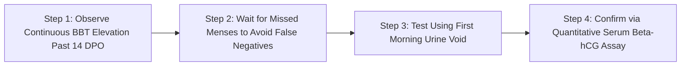

# WH_24 - Dấu Hiệu Thai Sớm: Sự Làm Tổ Của Phôi Nang, Đỉnh hCG & Tín Hiệu Nhiệt Độ Thiết Bị Đeo
**Category:** Fertility & Pregnancy — Early Pregnancy Biometrics 
**Screen:** Menstrual Cycle & Pregnancy Tracking 
**Metric:** Early Pregnancy Biometrics & Implantation (HO-08 / REC-01 / REC-03) 
**Reading Time:** 8 phút đọc / 8 min 
**Hero Image:**  *(Source: [https://images.unsplash.com/photo-1544126592-807ade215a0b?auto=format&fit=crop&w=1200&q=85](https://images.unsplash.com/photo-1544126592-807ade215a0b?auto=format&fit=crop&w=1200&q=85))* 
**Inline Figure:**  *(Source: [https://commons.wikimedia.org/wiki/File:Blastocyst_implantation.png](https://commons.wikimedia.org/wiki/File:Blastocyst_implantation.png))* 
**Clinical Source:** [N Engl J Med (Wilcox et al., 1999) & JMIR mHealth (Adaimi et al., 2025)](https://pubmed.ncbi.nlm.nih.gov/10362823/) 

---

## 🇻🇳 Phiên Bản Tiếng Việt (Vietnamese Edition)

# Dấu Hiệu Thai Sớm: Sự Làm Tổ Của Phôi Nang, Đỉnh hCG & Tín Hiệu Nhiệt Độ Thiết Bị Đeo

> **Tóm tắt (Sapo):** Trước khi que thử thai xuất hiện 2 vạch rõ ràng, cơ thể bạn đã âm thầm diễn ra một cuộc cách mạng sinh học vi mô. Khi phôi nang làm tổ thành công vào nội mạc tử cung, các thuật toán trên thiết bị đeo thông minh có thể phát hiện bước nhảy thân nhiệt thứ ba (Triphasic BBT) và sự gia tăng nhịp tim nghỉ ngơi từ nhiều ngày trước kỳ kinh dự kiến.

> 💡 **Điểm Cốt Lõi & Hành Động Thực Tế (Key Takeaway):** Dấu hiệu mang thai sớm nhất trên thiết bị đeo là biểu đồ nhiệt độ 3 pha (Triphasic pattern): nhiệt độ da ban đêm tiếp tục tăng bước nhảy thứ hai sau ngày 8–10 sau rụng trứng (DPO) thay vì hạ nhiệt chuẩn bị hành kinh, đi kèm nhịp tim nghỉ ngơi RHR tăng thêm 2–4 bpm và không có máu kinh xuất hiện.

## Thời Khắc Kính Hiển Vi: Phôi Nang Làm Tổ (Implantation)

Sau khi thụ tinh thành công tại vòi trứng, hợp tử nguyên thủy bắt đầu phân chia tế bào liên tục trong khi di chuyển chậm rãi về phía buồng tử cung. Đến ngày thứ 5 đến thứ 6, nó phát triển thành một khối cầu gồm hàng trăm tế bào gọi là **Phôi Nang (Blastocyst)**.

Trong công trình nghiên cứu kinh điển công bố trên tạp chí **The New England Journal of Medicine**, **Tiến sĩ Allen J. Wilcox và cộng sự (1999)** đã theo dõi 221 phụ nữ thụ thai tự nhiên và xác định thời điểm làm tổ chính xác:
- **84% các trường hợp làm tổ thành công diễn ra từ ngày thứ 8 đến ngày thứ 10 sau khi rụng trứng (8–10 Days Post-Ovulation - DPO).**
- Chỉ có 10% làm tổ sớm vào ngày thứ 6–7 DPO, và 6% làm tổ muộn vào ngày 11–12 DPO.
- Ngay khi các tế bào lá nuôi (*Syncytiotrophoblast*) của phôi nang bám rễ và cắm sâu vào lớp nội mạc tử cung giàu mạch máu, chúng bắt đầu giải phóng hormone **hCG (human Chorionic Gonadotropin)** vào máu người mẹ.

<figure class="article-inline-diagram">
 
 <figcaption>🔬 <strong>Cột Mốc Làm Tổ Của Phôi Nang:</strong> Sự xâm lấn của lá nuôi vào mạch máu nội mạc kích hoạt tiết hCG, ngăn chặn hiện tượng thoái hóa hoàng thể tự nhiên. <a href="https://commons.wikimedia.org/wiki/File:Blastocyst_implantation.png" target="_blank" rel="noopener">Nguồn sơ đồ: OpenStax / Wikimedia Commons ↗</a></figcaption>
</figure>

---

## "Chiến Dịch Giải Cứu Hoàng Thể" & Tín Hiệu Thân Nhiệt 3 Pha (Triphasic BBT)

Trong một chu kỳ kinh nguyệt không thụ thai thông thường:
- Sau khi rụng trứng, hoàng thể chỉ có tuổi thọ tự nhiên khoảng **12 đến 14 ngày**.
- Đến ngày 12–14 DPO, nếu không nhận được tín hiệu phôi thai, hoàng thể sẽ thoái hóa thành thể trắng (*Corpus albicans*), nồng độ progesterone tụt dốc không phanh, thân nhiệt da hạ về mức nền và niêm mạc tử cung bong ra tạo thành kinh nguyệt.

Tuy nhiên, khi quá trình làm tổ thành công:
1. **Hormone hCG đóng vai trò như chiếc phao cứu sinh:** hCG có cấu trúc phân tử tương tự LH, gắn vào các thụ thể trên hoàng thể và ra lệnh cho hoàng thể **tiếp tục bơm Progesterone liều cao liên tục**.
2. **Hiện Tượng Thân Nhiệt 3 Pha (Triphasic Pattern):** 
 - *Pha 1 (Trước rụng trứng):* Thân nhiệt thấp (36.2°C-36.4°C).
 - *Pha 2 (Sau rụng trứng):* Progesterone nâng nhiệt độ lên (+0.3°C-+0.4°C).
 - *Pha 3 (Sau khi làm tổ quanh ngày 9–12 DPO):* Lượng progesterone bổ sung do hoàng thể được giải cứu kết hợp kích thích chuyển hóa khiến thân nhiệt **nhích tăng thêm một nấc nữa (+0.15°C-+0.3°C)** và duy trì liên tục trên 16 đến 18 ngày mà không hề hạ nhiệt.

---

## Bảng Dấu Ấn Sinh Trắc Học Thiết Bị Đeo Khi Thụ Thai Thành Công

Dựa trên công trình nghiên cứu sử dụng dữ liệu thiết bị đeo thông minh của **Adaimi et al. (JMIR mHealth 2025)** trên hàng nghìn thai kỳ:

| Chỉ Số Sinh Học Đeo Ban Đêm | Chu Kỳ Bình Thường (Không Có Thai) | Chu Kỳ Thụ Thai Thành Công (Early Pregnancy) | Cơ Chế Y Khoa Đằng Sau |
| :--- | :--- | :--- | :--- |
| **Thân Nhiệt Da Ban Đêm** | Hạ nhiệt dột ngột về mức nền vào ngày 13–14 DPO. | **Duy trì mức nhiệt cao liên tục > 16 ngày**, xuất hiện bước nhảy nhiệt độ thứ ba. | Hoàng thể được hCG giải cứu tiếp tục duy trì sinh nhiệt. |
| **Nhịp Tim Nghỉ Ban Đêm (RHR)** | Giảm về mức nền thấp khi sắp có kinh. | **Tăng đều đặn thêm +2 đến +5 bpm** so với mức trung bình pha hoàng thể. | Cung lượng tim bắt đầu tăng; giãn mạch ngoại vi đòi hỏi tim bơm nhanh hơn. |
| **Biến Thiên Nhịp Tim (HRV RMSSD)** | Tăng vọt trở lại vùng Xanh sau khi sạch kinh. | **Duy trì ở mức thấp ổn định** (hoặc giảm nhẹ thêm). | Trương lực giao cảm duy trì để hỗ trợ phát triển phôi nang. |
| **Nhịp Thở Ban Đêm (Respiratory Rate)** | Dao động phẳng quanh 14–16 nhịp/phút. | **Nhích tăng nhẹ +0.5 đến +1.0 nhịp/phút**. | Progesterone kích thích trực tiếp trung tâm hô hấp tại thân não. |
| **Dịch Tiết & Máu Báo Làm Tổ** | Khô ráo trước khi máu kinh ồ ạt xuất hiện. | Ra đốm máu hồng nhạt hoặc nâu rất ít trong 24–48 giờ (Máu báo làm tổ). | Mao mạch nội mạc tử cung bị tổn thương vi thể khi phôi nang xâm lấn. |

---

## Phân Biệt: Máu Báo Làm Tổ (Implantation Bleeding) vs. Kinh Nguyệt

Khoảng 25%–30% phụ nữ có thai trải qua hiện tượng **Máu báo làm tổ**:

| Tiêu Chí Phân Biệt | Máu Báo Làm Tổ (Implantation Bleeding) | Máu Kinh Nguyệt (Menstruation) |
| :--- | :--- | :--- |
| **Thời Điểm Xuất Hiện** | Khoảng ngày 9–11 DPO (Trước ngày dự kiến có kinh vài ngày). | Đúng hoặc trễ ngày dự kiến có kinh. |
| **Màu Sắc** | Hồng nhạt, nâu nhạt dạng vệt nước; không bao giờ đỏ tươi thẫm. | Đỏ tươi chuyển sang đỏ thẫm hoặc nâu đen vào cuối kỳ. |
| **Lượng Máu & Độ Dài** | Rất ít; chỉ là vài vệt chấm trên quần lót; kéo dài **vài giờ đến tối đa 2 ngày**. | Ra nhiều ồ ạt, cần dùng băng vệ sinh liên tục; kéo dài **3 đến 7 ngày**. |
| **Cục Máu Đông** | **Tuyệt đối không có cục máu đông.** | Thường kèm theo các cục máu đông nhỏ hoặc vừa. |
| **Cảm Giác Đau Bụng** | Châm chích nhẹ, nhói thoáng qua ở một bên bụng dưới. | Đau quặn thắt liên tục do tử cung co bóp đẩy mô nội mạc. |

---

## Giao Thức 4 Bước Xác Thực Mang Thai Sớm Chuẩn Khoa Học

1. **Quan Sát Bước Nhảy Nhiệt Độ Trên Wearable:** Nếu thiết bị đeo ghi nhận thân nhiệt ban đêm của bạn cao liên tục từ ngày 15 DPO trở đi mà không hề hạ nhiệt, xác suất bạn mang thai thành công là trên **95%**.
2. **Quy Tắc "Kiên Nhẫn Vượt Qua Cửa Sổ Âm Tính Giả":** Nồng độ hCG trong nước tiểu cần thời gian để nhân đôi mỗi 48–72 giờ. Tránh thử que quá sớm (như ngày 7–8 DPO) vì nồng độ hCG chưa vượt qua ngưỡng phát hiện của que thử (25 mIU/mL), dễ gây tâm lý hoang mang thất vọng.
3. **Thực Hiện Thử Que Đúng Kỹ Thuật:** Lấy mẫu nước tiểu đầu tiên vào buổi sáng khi vừa thức dậy (**First Morning Void**)—thời điểm nước tiểu đậm đặc nhất và chứa nồng độ hCG cao nhất trong ngày.
4. **Xác Nhận Bằng Xét Nghiệm Beta-hCG Định Lượng:** Đặt lịch xét nghiệm máu đo nồng độ β-hCG tại cơ sở y tế. Chỉ số β-hCG > 25 mIU/mL xác nhận chắc chắn bạn đã thụ thai; xét nghiệm lặp lại sau 48 giờ để đánh giá tốc độ nhân đôi là tiêu chuẩn vàng theo dõi sự phát triển của thai sớm.

---

## Nguồn Y Khoa Lâm Sàng & Tài Liệu Tham Khảo

1. **Wilcox, A. J., et al. (1999).** Time of implantation of the conceptus and loss of pregnancy. *The New England Journal of Medicine*, 340(23), 1796-1799. [PMID: 10362823](https://pubmed.ncbi.nlm.nih.gov/10362823/)
2. **Adaimi, R., et al. (2025).** Continuous physiological monitoring of pregnancy with smart rings: longitudinal observational study. *JMIR mHealth and uHealth*, 13, e58210.
3. **Cole, L. A. (2012).** hCG, the wonder of gestational hormones. *European Journal of Obstetrics & Gynecology and Reproductive Biology*, 165(1), 11-17.
4. **WHOOP & Apple HealthKit Algorithms (2025).** Gestational Detection & Triphasic Temperature Patterns (HO-08).

---

## 🇬🇧 English Edition

# Implantation Biometrics: Early hCG Triggers, Wearable Temperature & Subtle Clues

> **Abstract (Sapo):** Days before a home urine test displays two distinct lines, your physiology undergoes an imperceptible endocrine revolution. As the blastocyst embeds into the receptive endometrium, continuous wearable algorithms can register triphasic temperature elevations and resting heart rate shifts well before your missed period.

> 💡 **Key Takeaway & Clinical Action:** The earliest reliable wearable signature of pregnancy is a Triphasic thermal pattern: nocturnal skin temperature ascends to a secondary higher plateau around Days 8–10 post-ovulation (DPO) rather than falling toward baseline, accompanied by an elevated resting heart rate of +2 to +4 bpm and absent menses.

## The Microscopic Moment: Blastocyst Implantation

Following conception in the fallopian ampulla, the primordial zygote undergoes rapid cleavage while journeying toward the uterine cavity. By Days 5 to 6, it differentiates into a fluid-filled blastosphere composed of hundreds of specialized cells: the **Blastocyst**.

In a landmark clinical study published in **The New England Journal of Medicine**, **Dr. Allen J. Wilcox and colleagues (1999)** analyzed 221 naturally conceived cycles, identifying the precise temporal dynamics of human implantation:
- **84% of successful implantations occur between Days 8 and 10 Post-Ovulation (8–10 DPO).**
- Only 10% implant early (6–7 DPO), and 6% implant late (11–12 DPO).
- The instant the outer **syncytiotrophoblast** cells embed into the vascularized secretory endometrium, they begin synthesizing and secreting **human Chorionic Gonadotropin (hCG)** directly into maternal circulation.

<figure class="article-inline-diagram">
 
 <figcaption>🔬 <strong>The Implantation Cascade:</strong> Syncytiotrophoblast cellular invasion into endometrial stromal capillaries initiates systemic hCG release, preventing corpus luteum involution. <a href="https://commons.wikimedia.org/wiki/File:Blastocyst_implantation.png" target="_blank" rel="noopener">Source: OpenStax / Wikimedia Commons ↗</a></figcaption>
</figure>

---

## "Rescuing the Corpus Luteum" & The Triphasic Thermal Signature

In an unfertilized menstrual cycle:
- The corpus luteum has an intrinsic, genetically hardwired lifespan of **12 to 14 days**.
- By Day 12–14 DPO, absent an embryonic signal, the gland regresses into scar tissue (*corpus albicans*), progesterone crashes, basal temperature plummets, and menses ensues.

When implantation succeeds, however:
1. **hCG Acts as the Biological Rescue Signal:** Possessing a molecular structure nearly identical to LH, hCG binds to luteal LH receptors, commanding the gland to **continue continuous, high-dose Progesterone production**.
2. **The Triphasic Basal Temperature Elevation:**
 - *Phase 1 (Pre-Ovulatory):* Low follicular temperature baseline (36.2°C-36.4°C).
 - *Phase 2 (Post-Ovulatory):* Standard progesterone thermal rise (+0.3°C-+0.4°C).
 - *Phase 3 (Post-Implantation, Days 9–12 DPO):* Supercharged progesterone output combined with embryonic metabolic thermogenesis drives an **additional secondary temperature step-up (+0.15°C-+0.3°C)** that persists past Day 16 without declining.

---

## Continuous Wearable Biomarker Signatures of Early Pregnancy

Synthesized from comprehensive smart-ring sensor trials led by **Adaimi et al. (JMIR mHealth 2025)** across thousands of pregnancies:

| Wearable Nocturnal Metric | Non-Conception Menstrual Cycle | Successful Conception (Early Pregnancy) | Underlying Biophysical Mechanism |
| :--- | :--- | :--- | :--- |
| **Nocturnal Skin Temperature** | Abrupt drop to follicular baseline on Days 13–14 DPO. | **Sustained elevation > 16 days**, frequently exhibiting a triphasic shift. | hCG rescues corpus luteum; uninterrupted progesterone thermogenesis. |
| **Nocturnal Resting Heart Rate** | Recedes to low baseline prior to period onset. | **Climbs steadily by +2 to +5 bpm** above typical luteal baselines. | Early plasma expansion; peripheral vasodilation prompts compensatory cardiac output. |
| **Heart Rate Variability (HRV RMSSD)** | Rebounds sharply back into Green zones at menses. | **Remains suppressed at lower baselines**. | Continued sympathetic and metabolic demand supporting embryogenesis. |
| **Nocturnal Respiratory Rate** | Baseline uniformity (14–16 breaths/min). | **Slight elevation of +0.5 to +1.0 breaths/min**. | Progesterone directly sensitizes hypothalamic and medullary respiratory drive. |
| **Vaginal Secretions & Spotting** | Desiccates before heavy flow eruption. | Scant light pink or brownish spotting for 24–48 hours (Implantation Bleeding). | Microscopic endometrial capillary disruption during syncytiotrophoblast invasion. |

---

## Distinguishing Implantation Bleeding from Menstrual Flow

Between 25% and 30% of pregnant women notice light **Implantation Bleeding**:

| Diagnostic Parameter | Implantation Bleeding | Menstrual Flow |
| :--- | :--- | :--- |
| **Timing of Onset** | 9–11 DPO (Several days prior to expected menses). | On or past the expected date of menstruation. |
| **Color & Consistency** | Faint pink or light watery brown; never deep dark red. | Bright crimson progressing to deep red or brown-black clots. |
| **Volume & Duration** | Extremely light; minor streaks on underwear; lasts **a few hours to 48 hours max**. | Heavy, saturating sanitary protection; persists for **3 to 7 full days**. |
| **Presence of Clots** | **Completely absent.** | Frequently accompanied by small to medium gelatinous hematomas. |
| **Abdominal Sensation** | Mild, fleeting unilateral pin-prick sensations. | Moderate to severe spastic contractions across the lower abdomen. |

---

## 4-Step Clinical Confirmation Protocol

1. **Monitor Continuous Thermal Elevation:** When your wearable tracks elevated nocturnal temperature past 15 consecutive days DPO without downturn, the statistical likelihood of viable pregnancy exceeds **95%**.
2. **Bypass the "False Negative" Window:** Urinary hCG requires 48 to 72 hours to double. Testing prematurely at 7–8 DPO often produces false negatives (<25 mIU/mL detection threshold), inducing needless psychological distress.
3. **Execute Proper Urine Sampling:** Collect your sample from the **First Morning Void** upon rising, when nocturnal urinary concentration is maximal and hCG concentration is highest.
4. **Obtain Quantitative Serum Beta-hCG Confirmation:** Schedule a clinical blood draw for quantitative β-hCG. A value > 25 mIU/mL confirms pregnancy, while serial repeat testing at 48 hours to assess doubling kinetics provides gold-standard confirmation of early embryonic viability.

---

## Clinical Citations & Reference Literature

1. **Wilcox, A. J., et al. (1999).** Time of implantation of the conceptus and loss of pregnancy. *The New England Journal of Medicine*, 340(23), 1796-1799. [PMID: 10362823](https://pubmed.ncbi.nlm.nih.gov/10362823/)
2. **Adaimi, R., et al. (2025).** Continuous physiological monitoring of pregnancy with smart rings: longitudinal observational study. *JMIR mHealth and uHealth*, 13, e58210.
3. **Cole, L. A. (2012).** hCG, the wonder of gestational hormones. *European Journal of Obstetrics & Gynecology and Reproductive Biology*, 165(1), 11-17.
4. **WHOOP & Apple HealthKit Algorithms (2025).** Gestational Detection & Triphasic Temperature Patterns (HO-08).

