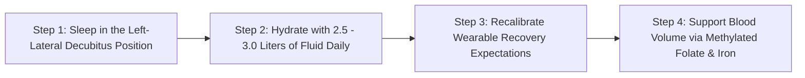

# WH_25 - Chuyển Hóa Kỳ Diệu Khi Mang Thai: Cung Lượng Tim, Dung Tích Máu & Biến Đổi Từng Tam Cá Nguyệt
**Category:** Fertility & Pregnancy — Trimester Physiology  
**Screen:** Pregnancy Mode & Vitals Screen  
**Metric:** Cardiovascular Adaptations & Trimester Biometrics (HO-08 / REC-01 / REC-03)  
**Reading Time:** 9 phút đọc / 9 min  
**Hero Image:**  *(Source: [https://images.unsplash.com/photo-1519689680058-324335c77eba?auto=format&fit=crop&w=1200&q=85](https://images.unsplash.com/photo-1519689680058-324335c77eba?auto=format&fit=crop&w=1200&q=85))*  
**Inline Figure:**  *(Source: [https://commons.wikimedia.org/wiki/File:Maternal_cardiovascular_adaptations.svg](https://commons.wikimedia.org/wiki/File:Maternal_cardiovascular_adaptations.svg))*  
**Clinical Source:** [BMC Pregnancy Childbirth (Rowan et al., 2022) & Circulation (Sanghavi & Rutherford, 2014)](https://pubmed.ncbi.nlm.nih.gov/35164716/)  

---

## 🇻🇳 Phiên Bản Tiếng Việt (Vietnamese Edition)

# Chuyển Hóa Kỳ Diệu Khi Mang Thai: Cung Lượng Tim, Dung Tích Máu & Biến Đổi Từng Tam Cá Nguyệt

> **Tóm tắt (Sapo):** Mang thai tương đương với việc chạy một cuộc thi marathon kéo dài 40 tuần liên tục: thể tích máu tăng 50%, tim phải đập thêm 15.000 nhịp mỗi ngày và hệ thống mạch máu tái cấu trúc toàn diện. Tìm hiểu các biến đổi sinh học phi thường qua từng tam cá nguyệt từ công trình nghiên cứu thai kỳ liên tục của WHOOP.

> 💡 **Điểm Cốt Lõi & Hành Động Thực Tế (Key Takeaway):** Nhịp tim nghỉ ngơi tăng thêm 10–15 bpm và điểm HRV sụt giảm sâu trong thai kỳ là sự thích nghi tim mạch hoàn toàn bình thường để nuôi dưỡng thai nhi, không phải dấu hiệu kiệt sức. Nhịp tim đạt đỉnh quanh tuần thứ 30 và bắt đầu ổn định chuẩn bị cho cuộc chuyển dạ.

## Cuộc Marathon 40 Tuần: Tải Trọng Sinh Lý Lớn Nhất Đời Người

Trong ngành sinh lý học tiến hóa, mang thai được xem là thử thách chuyển hóa khắc nghiệt nhất mà cơ thể con người có thể trải qua:
- Theo các công trình nghiên cứu đo lường năng lượng tiêu hao tối đa của con người (**Thurber et al., Science Advances 2019**), phụ nữ mang thai vận hành ở mức trao đổi chất gấp **2.2 lần tốc độ chuyển hóa cơ bản (BMR)**—chạm trần giới hạn chịu đựng tối đa của cơ thể, chỉ xếp sau các vận động viên chạy cự ly siêu dài xuyên lục địa!
- Để nuôi dưỡng một sự sống mới từ một tế bào đơn lẻ thành một em bé nặng hơn 3 kg, trái tim, phổi, thận và hệ nội tiết của người mẹ phải trải qua một cuộc tái cấu trúc toàn diện (**Maternal Hemodynamic Remodeling**).

Trong công trình nghiên cứu mang tính bước ngoặt công bố trên tạp chí y khoa **BMC Pregnancy and Childbirth**, **Tiến sĩ Rachel Rowan và cộng sự (2022)** đã phân tích hàng triệu giờ dữ liệu sinh trắc học liên tục từ thiết bị đeo thông minh (**WHOOP**) trên các sản phụ khỏe mạnh, lần đầu tiên vẽ nên bức tranh hoàn chỉnh về nhịp đập sinh học của thai kỳ.

<figure class="article-inline-diagram">
  
  <figcaption>❤️ <strong>Huyết Động Học Thai Kỳ:</strong> Cung lượng tim tăng vọt 30%–50% nhờ sự gia tăng đồng thời của thể tích tống máu và nhịp tim nghỉ ngơi để tưới máu bánh nhau. <a href="https://commons.wikimedia.org/wiki/File:Maternal_cardiovascular_adaptations.svg" target="_blank" rel="noopener">Nguồn sơ đồ: Wikimedia Commons ↗</a></figcaption>
</figure>

---

## 3 Tam Cá Nguyệt: Bản Đồ Chuyển Hóa & Huyết Động Học

### 1. Tam Cá Nguyệt 1 (Tuần 1–12): Cú Sốc Giãn Mạch & Đỉnh Sóng Nội Tiết
- **Giãn Mạch Ngoại Vi Thần Tốc:** Dưới tác động ồ ạt của Progesterone và Nitric Oxide, toàn bộ hệ thống mạch máu ngoại biên của mẹ giãn rộng để chuẩn bị đón nhận dòng máu mới. Sức cản mạch máu ngoại vi giảm sâu, khiến huyết áp tụt xuống.
- **Hiện Tượng Mệt Mỏi Cực Độ (Fatigue):** Nồng độ hormone thai nghén **hCG** tăng vọt lên đỉnh cao nhất vào tuần thứ 10. Gan và thận phải làm việc gấp đôi để lọc máu; nhịp tim nghỉ ngơi (**RHR**) bắt đầu tăng nhanh thêm 2–5 bpm.
- **Tín hiệu Wearable:** Điểm Phục hồi (Recovery) bắt đầu chuyển từ Xanh sang Vàng; cơ thể đòi hỏi nhu cầu ngủ thêm từ 60–90 phút mỗi đêm.

### 2. Tam Cá Nguyệt 2 (Tuần 13–27): "Giai Đoạn Vàng" & Dung Tích Máu Đạt Đỉnh
- **Sự Bùng Nổ Thể Tích Huyết Tương:** Thể tích máu của mẹ tăng thêm **40% đến 50%** (tương đương thêm 1.5 lít dịch tuần hoàn). Do thể tích huyết tương tăng nhanh hơn khối lượng hồng cầu, hiện tượng **Thiếu Máu Sinh Lý Do Pha Loãng (Physiologic Hemodilution Anemia)** xuất hiện tự nhiên.
- **Cung Lượng Tim Tăng 40%–50%:** Trái tim mẹ phì đại sinh lý lành mạnh để bơm được lượng máu khổng lồ này qua bánh nhau. Huyết áp chạm đáy thấp nhất quanh tuần 20 rồi bắt đầu hồi phục dần.
- **Năng Lượng Trở Lại:** Nồng độ hCG thoái trào, ốm nghén biến mất, cảm giác thèm ăn và sức sống bừng sáng trở lại. Đây là thời điểm lý tưởng nhất để vận động thể lực an toàn.

### 3. Tam Cá Nguyệt 3 (Tuần 28–40): Tải Trọng Đỉnh Cao & Chuẩn Bị Chuyển Dạ
- **Đỉnh Cao Nhịp Tim Nghỉ Ngơi:** Theo nghiên cứu của **Rowan et al. (2022)**, nhịp tim nghỉ ngơi của mẹ chạm **đỉnh cao nhất vào khoảng Tuần 30–32** (tăng thêm trung bình **+10 đến +15 bpm** so với trước khi mang thai).
- **Đáy Vực Của HRV:** Chỉ số Biến thiên nhịp tim (**HRV RMSSD**) chạm mức thấp nhất trong suốt thai kỳ do hệ giao cảm phải hoạt động tối đa để hỗ trợ thai nhi tăng trưởng cân nặng nhanh chóng.
- **Hiện Tượng Bật Tăng Thần Kỳ Trước Khi Sinh:** Vào 4 đến 6 tuần cuối cùng (Tuần 34–40), dữ liệu thiết bị đeo ghi nhận một hiện tượng bất ngờ: **HRV bắt đầu nhích tăng trở lại và RHR hơi hạ nhiệt**—đây là cơ chế sinh học chuẩn bị cho tử cung và hệ thần kinh tự chủ bước vào cuộc chuyển dạ (*Labor preparation*).

---

## Bảng So Sánh Chỉ Số Sinh Trắc Học Qua 3 Tam Cá Nguyệt (WHOOP Clinical Data)

| Giai Đoạn Thai Kỳ | Nhịp Tim Nghỉ Ngơi (RHR) | Biến Thiên Nhịp Tim (HRV RMSSD) | Thân Nhiệt Da Ban Đêm | Tần Số Hô Hấp (Nhịp Thở) | Thể Tích Máu Tuần Hoàn |
| :--- | :--- | :--- | :--- | :--- | :--- |
| **Trước Mang Thai (Baseline)** | Mức cơ sở chuẩn (Ví dụ: 55 bpm). | Mức cơ sở chuẩn (Ví dụ: 65 ms). | Dao động 2 pha theo chu kỳ. | 14.5 nhịp/phút. | $100\%$ ($~4.0	ext{ lít}$). |
| **Tam Cá Nguyệt 1 (Tuần 1–12)** | Tăng nhẹ **+3 đến +6 bpm**. | Bắt đầu giảm **10%–20%**. | Duy trì cao liên tục ($+0.3^\circ	ext{C}-+0.5^\circ	ext{C}$). | Nhích nhẹ +0.5 nhịp/phút. | Tăng dần lên $115\%$. |
| **Tam Cá Nguyệt 2 (Tuần 13–27)** | Tăng mạnh **+7 đến +11 bpm**. | Giảm sâu **25%–35%** (Vùng Vàng/Đỏ). | Ổn định ở mức cao. | Tăng thêm +1.0 nhịp/phút. | Đạt **$140\% - 150\%$** ($~5.5	ext{ lít}$). |
| **Tam Cá Nguyệt 3 (Tuần 28–34)** | **Đạt đỉnh cao nhất (+12 đến +15 bpm)**. | **Chạm đáy thấp nhất tháng** (Giảm 40%). | Cao, dễ đổ mồ hôi đêm. | Đạt đỉnh **+1.5 đến +2.0 nhịp/phút**. | Duy trì ở mức đỉnh $150\%$. |
| **Cận Sinh (Tuần 35–40)** | Bắt đầu hạ nhẹ **-2 đến -4 bpm**. | **Bật tăng nhẹ trở lại** (Báo hiệu chuẩn bị sinh). | Dao động chuẩn bị chuyển dạ. | Duy trì ở mức cao. | Bắt đầu cô đặc nhẹ. |

---

## 4 Dấu Hiệu Quá Tải Cơ Thể Cần Đi Khám Ngay

1. **Hội Chứng Chèn Ép Tĩnh Mạch Chủ Dưới (Supine Hypotensive Syndrome):** Khi nằm ngửa sau tuần thứ 20, tử cung nặng đè bẹp tĩnh mạch chủ dưới, làm cắt đứt lượng máu hồi lưu về tim, gây tụt huyết áp đột ngột, chóng mặt, buồn nôn. Mẹ bầu cần **luôn nằm nghiêng sang bên trái**.
2. **Huyết Áp Tăng Vọt Bất Thường Kèm Phù Mặt:** Sau tuần 20, nếu huyết áp đo được $\ge 140/90	ext{ mmHg}$ đi kèm sưng phù mặt, mí mắt hoặc đau đầu như búa bổ—đó là hồi chuông báo động của **Tiền Sản Giật (Preeclampsia)**.
3. **Khó Thở Dữ Dội Ngay Cả Khi Ngồi Yên:** Khó thở nhẹ khi leo cầu thang là bình thường do tử cung đẩy cơ hoành lên 4 cm; nhưng khó thở đột ngột kèm đau ngực cần loại trừ tắc mạch phổi.
4. **Nhịp Tim Nghỉ Ngơi Ban Đêm Tăng Vọt Trên 100 bpm Kèm Sốt:** Cần tầm soát nhiễm trùng ối hoặc viêm đường tiết niệu cấp.

---

## Giao Thức 4 Bước Chăm Sóc Huyết Động Học Thai Kỳ

1. **Ưu Tiên Tư Thế Nằm Nghiêng Trái (Left Lateral Decubitus):** Sử dụng gối ôm chữ U để cố định tư thế nghiêng sang trái khi ngủ. Tư thế này giúp giải phóng hoàn toàn áp lực lên tĩnh mạch chủ dưới và động mạch chủ, tối đa hóa lưu lượng máu giàu dưỡng chất đến bánh nhau.
2. **Cung Cấp Đủ Nước Cho Sự Tăng Thể Tích Máu:** Uống từ 2.5 đến 3.0 lít nước mỗi ngày; bổ sung nước khoáng giàu kali và magie để hỗ trợ tim bơm lượng dịch khổng lồ và ngăn ngừa chuột rút bắp chân ban đêm.
3. **Đọc Dữ Liệu Thiết Bị Đeo Với Tư Duy Mới:** Đừng lo lắng khi thấy điểm HRV sụt giảm và ứng dụng liên tục báo màu Đỏ/Vàng. Hãy bật chế độ Thai kỳ (**Pregnancy Mode**) trên app để các thuật toán tự động hiệu chỉnh đường cơ sở (Baseline) theo tuổi thai.
4. **Bảo Vệ Khối Lượng Hồng Cầu Bằng Dinh Dưỡng:** Bổ sung sắt hữu cơ liều chuẩn cùng **Folate hoạt tính (Methylfolate 600–800 mcg/ngày)** để hỗ trợ tủy xương tạo hồng cầu mới, phòng ngừa hội chứng thiếu máu thai kỳ gây mệt mỏi suy kiệt.

---

## Nguồn Y Khoa Lâm Sàng & Tài Liệu Tham Khảo

1. **Rowan, R., et al. (2022).** Continuous physiological monitoring of pregnancy using a wearable device: a prospective observational study. *BMC Pregnancy and Childbirth*, 22(1), 127. [PMID: 35164716](https://pubmed.ncbi.nlm.nih.gov/35164716/)
2. **Sanghavi, M., & Rutherford, J. D. (2014).** Cardiovascular physiology of pregnancy. *Circulation*, 130(12), 1003-1008. [PMID: 25223771](https://pubmed.ncbi.nlm.nih.gov/25223771/)
3. **Thurber, C. C., et al. (2019).** Extreme events reveal an alimentary limit on sustained human energy expenditure. *Science Advances*, 5(6), eaaw0341.
4. **WHOOP Maternal Health Research Group (2025).** Trimester-Specific Cardiovascular Strain & Autonomic Recovery Modeling (HO-08).

---

## 🇬🇧 English Edition

# Cardiovascular & Metabolic Adaptations: What Happens During Each Trimester

> **Abstract (Sapo):** Gestation is the physiological equivalent of a 40-week continuous ultra-marathon: circulating blood volume expands by 50%, the heart beats an extra 15,000 times daily, and vascular beds undergo massive remodeling. Discover the remarkable trimester-by-trimester adaptations captured via continuous biometric monitoring.

> 💡 **Key Takeaway & Clinical Action:** A resting heart rate increase of 10–15 bpm and deeply depressed HRV throughout gestation represent normal, essential hemodynamic adaptations to nourish the placenta, not pathological fatigue. Cardiac workload peaks around Week 30, stabilizing in the final weeks as the body prepares for labor.

## The 40-Week Metabolic Ultra-Marathon

In evolutionary energetics, pregnancy represents the ultimate physiological challenge that human biology can endure:
- According to landmark human metabolic ceiling trials (**Thurber et al., Science Advances 2019**), pregnant women operate at an energetic metabolic ceiling equivalent to **2.2 times their Basal Metabolic Rate (BMR)**—touching the absolute biological limit of sustained human energy expenditure, rivaled only by transcontinental ultra-endurance runners!
- To nurture an embryo from a microscopic blastocyst into a 3.5 kg infant, maternal cardiovascular, renal, and endocrine systems execute complete architectural remodeling (**Maternal Hemodynamic Adaptation**).

In a milestone prospective cohort study published in **BMC Pregnancy and Childbirth**, **Dr. Rachel Rowan and colleagues (2022)** analyzed millions of continuous physiological data hours from the **WHOOP** wearable platform across healthy gestations, decoding maternal circulatory dynamics in real time.

<figure class="article-inline-diagram">
  
  <figcaption>❤️ <strong>Maternal Hemodynamic Overhaul:</strong> Cardiac output surges 30%–50% via the coordinated elevation of stroke volume and resting heart rate to perfuse the placental bed. <a href="https://commons.wikimedia.org/wiki/File:Maternal_cardiovascular_adaptations.svg" target="_blank" rel="noopener">Source: Wikimedia Commons ↗</a></figcaption>
</figure>

---

## The 3 Trimesters: Metabolic & Hemodynamic Roadmap

### 1. Trimester 1 (Weeks 1–12): Vasodilation & Endocrine Flood
- **Profound Peripheral Vasodilation:** Floods of Progesterone and vascular endothelial Nitric Oxide dilate maternal peripheral capillary networks. Systemic Vascular Resistance (SVR) plunges by up to 30%, triggering an early drop in systemic arterial blood pressure.
- **Profound Exhaustion & Organ Load:** Circulating **hCG** surges toward its Week 10 zenith. Renal plasma filtration increases by 50%; nocturnal Resting Heart Rate (**RHR**) climbs by 2–5 bpm.
- **Wearable Signatures:** Recovery scores transition from Green to persistent Yellow; sleep algorithms register 60 to 90 minutes of additional biological sleep need nightly.

### 2. Trimester 2 (Weeks 13–27): Plasma Expansion & The "Golden Trimester"
- **Massive Plasma Volume Expansion:** Circulating blood volume expands by **40% to 50%** (an extra 1.5 liters of fluid). Because plasma volume expands faster than red cell mass, **Physiological Dilutional Anemia** naturally emerges.
- **Cardiac Output Surges 40%–50%:** The maternal left ventricle experiences benign eccentric hypertrophy to circulate this immense fluid volume. Blood pressure hits its mid-pregnancy nadir around Week 20 before gradually rebounding.
- **Energy Resurgence:** hCG recedes, morning sickness abates, appetite returns, and aerobic vitality stabilizes. This is the optimal window for safe prenatal exercise.

### 3. Trimester 3 (Weeks 28–40): Peak Hemodynamic Strain & Pre-Labor Taper
- **Resting Heart Rate Reaches Zenith:** As proven by **Rowan et al. (2022)**, maternal resting heart rate reaches its **maximum elevation around Weeks 30–32** (an average increase of **+10 to +15 bpm** above pre-pregnancy baselines, translating into ~15,000 extra heartbeats daily).
- **The HRV Trough:** Heart Rate Variability (**HRV RMSSD**) hits its absolute lowest point, reflecting prolonged sympathetic dominance required to meet fetal growth demands.
- **The Pre-Labor Autonomic Rebound:** Across the final 4 to 6 weeks (Weeks 34–40), continuous biometrics reveal an unexpected phenomenon: **HRV begins a subtle upward inflection while RHR slightly cools**—a physiological sign of autonomic readiness as the body prepares for labor and delivery.

---

## Comparative Trimester Biometric Reference Matrix (WHOOP Clinical Data)

| Gestational Stage | Resting Heart Rate Shift (RHR) | Heart Rate Variability (HRV RMSSD) | Nocturnal Skin Temp Shift | Respiratory Rate (Breaths/min) | Total Circulating Blood Volume |
| :--- | :--- | :--- | :--- | :--- | :--- |
| **Pre-Conception Baseline** | Individual baseline (e.g., 55 bpm). | Individual baseline (e.g., 65 ms). | Standard biphasic cycling. | ~14.5 breaths/min. | $100\%$ (~4.0 Liters). |
| **Trimester 1 (Weeks 1–12)** | Elevated **+3 to +6 bpm**. | Decreased by **10%–20%**. | Sustained high ($+0.3^\circ	ext{C}-+0.5^\circ	ext{C}$). | +0.5 breaths/min elevation. | Expands to $115\%$. |
| **Trimester 2 (Weeks 13–27)** | Elevated **+7 to +11 bpm**. | Decreased by **25%–35%** (Yellow Zone). | Stable elevated plateau. | +1.0 breaths/min elevation. | Peaks at **$140\% - 150\%$** (~5.5 Liters). |
| **Trimester 3 (Weeks 28–34)** | **Peak Elevation (+12 to +15 bpm)**. | **Deepest Trough** (Down 40%). | Elevated; nocturnal flushes. | **Peaks (+1.5 to +2.0 breaths/min)**. | Sustained at $150\%$. |
| **Pre-Labor (Weeks 35–40)** | Slight cooling **-2 to -4 bpm**. | **Autonomous Rebound** (+5 to +10 ms). | Dynamic pre-labor variance. | Stable high. | Mild physiological hemoconcentration. |

---

## 4 Cardiovascular Red Flags Requiring Immediate Evaluation

1. **Supine Hypotensive Syndrome:** After Week 20, lying flat on your back compresses the inferior vena cava beneath the gravid uterus, suffocating venous return to the right atrium and inducing abrupt hypotension, nausea, and syncope. **Always sleep in the left-lateral position.**
2. **Sudden Blood Pressure Elevation With Facial Edema:** Past Week 20, any blood pressure reading $\ge 140/90	ext{ mmHg}$ accompanied by sudden facial or periorbital edema and throbbing temporal headaches indicates possible **Preeclampsia**.
3. **Severe Resting Dyspnea:** Mild breathlessness on exertion is physiological as the growing uterus elevates the diaphragm by 4 cm; however, sudden unprovoked dyspnea or pleuritic chest pain mandates exclusion of pulmonary embolism.
4. **Nocturnal Tachycardia > 100 bpm with Chills:** Requires clinical evaluation to rule out chorioamnionitis or acute pyelonephritis.

---

## 4-Step Maternal Hemodynamic Support Protocol

1. **Adopt the Left-Lateral Decubitus Sleep Posture:** Utilize a supportive pregnancy pillow to maintain a left-side sleeping posture. This unweights the inferior vena cava and descending aorta, maximizing uteroplacental blood flow.
2. **Hydrate to Support Massive Plasma Volume:** Ingest 2.5 to 3.0 liters of fluids daily, fortifying with natural potassium and magnesium to manage vascular expansion and prevent nocturnal leg cramps.
3. **Recalibrate Biometric Expectations:** Suppress anxiety regarding declining HRV and persistent Yellow recovery scores. Enable **Pregnancy Mode** on your wearable app so algorithms benchmark performance against gestational norms rather than pre-pregnancy standards.
4. **Fuel Erythropoiesis with Bioavailable Nutrients:** Pair gentle chelated iron with **L-Methylfolate (600–800 mcg/day)** to support bone marrow production of new red blood cells, buffering against severe dilutional anemia.

---

## Clinical Citations & Reference Literature

1. **Rowan, R., et al. (2022).** Continuous physiological monitoring of pregnancy using a wearable device: a prospective observational study. *BMC Pregnancy and Childbirth*, 22(1), 127. [PMID: 35164716](https://pubmed.ncbi.nlm.nih.gov/35164716/)
2. **Sanghavi, M., & Rutherford, J. D. (2014).** Cardiovascular physiology of pregnancy. *Circulation*, 130(12), 1003-1008. [PMID: 25223771](https://pubmed.ncbi.nlm.nih.gov/25223771/)
3. **Thurber, C. C., et al. (2019).** Extreme events reveal an alimentary limit on sustained human energy expenditure. *Science Advances*, 5(6), eaaw0341.
4. **WHOOP Maternal Health Research Group (2025).** Trimester-Specific Cardiovascular Strain & Autonomic Recovery Modeling (HO-08).

