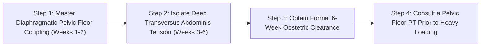

# WH_27 - Tam Cá Nguyệt Thứ Tư: Phục Hồi Tách Cơ Bụng (Diastasis Recti), Sàn Chậu & Sức Bền Thần Kinh
**Category:** Fertility & Pregnancy — Postpartum Recovery  
**Screen:** Postpartum Screen & Vitals  
**Metric:** Diastasis Recti, Pelvic Floor Healing & HRV Rebound (HO-08 / REC-01 / REC-03)  
**Reading Time:** 9 phút đọc / 9 min  
**Hero Image:**  *(Source: [https://images.unsplash.com/photo-1555252333-9f8e92e65df9?auto=format&fit=crop&w=1200&q=85](https://images.unsplash.com/photo-1555252333-9f8e92e65df9?auto=format&fit=crop&w=1200&q=85))*  
**Inline Figure:**  *(Source: [https://commons.wikimedia.org/wiki/File:Diastasis_recti.png](https://commons.wikimedia.org/wiki/File:Diastasis_recti.png))*  
**Clinical Source:** [BMC Pregnancy Childbirth (Rowan et al., 2022) & Br J Sports Med (Mota et al., 2015)](https://pubmed.ncbi.nlm.nih.gov/35164716/)  

---

## 🇻🇳 Phiên Bản Tiếng Việt (Vietnamese Edition)

# Tam Cá Nguyệt Thứ Tư: Phục Hồi Tách Cơ Bụng (Diastasis Recti), Sàn Chậu & Sức Bền Thần Kinh

> **Tóm tắt (Sapo):** Hành trình làm mẹ không dừng lại ở phòng sinh; 12 tuần đầu tiên sau khi sinh—được y học gọi là 'Tam Cá Nguyệt Thứ Tư'—là giai đoạn cơ thể trải qua cú sốc tụt dốc hormone lớn nhất đời người cùng sự tái cấu trúc cơ bụng và sàn chậu. Khám phá cách chẩn đoán tách cơ bụng (Diastasis Recti) và phác đồ phục hồi thể lực an toàn.

> 💡 **Điểm Cốt Lõi & Hành Động Thực Tế (Key Takeaway):** Đừng vội vàng gập bụng truyền thống (Crunches/Sit-ups) sau sinh vì chúng làm tăng áp lực ổ bụng và khiến vết tách cơ bụng hở rộng hơn. Hãy bắt đầu bằng các bài tập kích hoạt cơ ngang bụng sâu (Transversus Abdominis) qua nhịp thở cơ hoành, và cho phép hệ thần kinh 1–2 tuần để nhịp tim nghỉ ngơi hạ nhiệt tự nhiên.

## Cú Sốc Sinh Học Lớn Nhất Đời Người: "Vách Đá Hormone" Sau Sinh

Khoảnh khắc bánh nhau được sổ ra ngoài sau cuộc sinh nở đánh dấu một sự thay đổi nội tiết chưa từng có trong cơ thể người mẹ:
- Trong suốt 9 tháng mang thai, bánh nhau đóng vai trò như một nhà máy khổng lồ sản xuất lượng Estrogen và Progesterone gấp hàng trăm lần bình thường.
- Nhưng chỉ trong vòng **48 đến 72 giờ sau sinh**, khi bánh nhau rời khỏi cơ thể, nồng độ Estrogen và Progesterone **lao dốc hơn 95% về mức gần như số 0**—một sự sụt giảm nội tiết nhanh và sâu sắc hơn bất kỳ giai đoạn nào trong cuộc đời, kể cả thời kỳ mãn kinh!
- Đồng thời, tuyến yên bắt đầu bơm ồ ạt hormone **Prolactin** (để sản xuất sữa mẹ) và **Oxytocin** (để co hồi tử cung và tạo sợi dây gắn kết mẫu tử).

Cú sốc nội tiết đột ngột này, kết hợp cùng tình trạng thiếu ngủ kinh niên và vết thương thực thể từ cuộc sinh, chính là căn nguyên sinh học thực sự đằng sau hội chứng **Baby Blues** và sự kiệt sức của sản phụ trong **Tam Cá Nguyệt Thứ Tư (The Fourth Trimester)**.

<figure class="article-inline-diagram">
  
  <figcaption>🔍 <strong>Giải Phẫu Tách Cơ Bụng (DRA):</strong> Đường trắng giữa (Linea Alba) bị kéo giãn mỏng manh dưới áp lực của thai nhi. Tập gập bụng sai cách sẽ tạo khối phồng hình chóp và cản trở hồi phục. <a href="https://commons.wikimedia.org/wiki/File:Diastasis_recti.png" target="_blank" rel="noopener">Nguồn sơ đồ: Wikimedia Commons ↗</a></figcaption>
</figure>

---

## Tách Cơ Bụng (Diastasis Recti Abdominis - DRA): Nhận Diện & Đánh Giá

Trong thai kỳ, để tạo không gian cho em bé phát triển, hai dải cơ thẳng bụng (*Rectus Abdominis*) buộc phải tách xa nhau, làm giãn rộng dải mô liên kết ở giữa gọi là **Đường Trắng Giữa (Linea Alba)**.

Theo nghiên cứu theo dõi của **Tiến sĩ Patricia Mota và cộng sự (British Journal of Sports Medicine 2015)**: **100% phụ nữ mang thai đều bị tách cơ bụng ở tuần thứ 35, và khoảng 40%–60% vẫn còn khoảng cách tách cơ đáng kể sau sinh 6 tháng nếu không tập phục hồi đúng cách.**

### Cách Tự Kiểm Tra Tách Cơ Bụng Tại Nhà (The 2-Finger Test):
1. Nằm ngửa trên thảm phẳng, co hai đầu gối, hai bàn chân đặt vững trên sàn.
2. Đặt 2 hoặc 3 ngón tay nằm ngang vào chính giữa bụng, ngay trên rốn khoảng 2–3 cm.
3. Hít một hơi nhẹ, sau đó từ từ nâng nhẹ đầu và vai lên khỏi sàn (chỉ nhấc nhẹ như chuẩn bị gập bụng, không nâng toàn bộ thân trên).
4. Cảm nhận hai mép cơ thẳng bụng khép lại ép vào ngón tay bạn:
   - **Bình thường:** Khoảng cách giữa 2 mép cơ dưới 2 khoát ngón tay ($< 2	ext{ cm}$) và đáy mô liên kết cảm thấy săn chắc đàn hồi.
   - **Tách cơ bụng lâm sàng (DRA):** Ngón tay bạn lọt thỏm sâu vào một rãnh mềm rộng từ **2.5 đến 4 ngón tay trở lên** ($> 2.5	ext{ cm}$).

---

## Sự Hồi Phục Thần Kỳ Của Nhịp Tim & HRV (WHOOP Postpartum Data)

Trong nghiên cứu thai kỳ của **Rowan et al. (BMC Pregnancy & Childbirth 2022)**, các nhà khoa học đã chứng kiến một sự đảo ngược ngoạn mục về chỉ số sinh trắc học ngay sau sinh:
- **Cú Giảm Thần Tốc Của Nhịp Tim Nghỉ Ngơi (RHR):** Ngay trong tuần đầu tiên sau sinh, khi thể tích máu thừa bắt đầu được thận đào thải ồ ạt qua đường tiểu và mồ hôi, nhịp tim nghỉ ngơi của mẹ **hạ nhiệt đột ngột từ 10 đến 12 bpm**, nhanh chóng trở về gần mức trước khi mang thai.
- **HRV Bật Tăng Trở Lại:** Chỉ số Biến thiên nhịp tim (**HRV RMSSD**) tăng vọt từ vùng Đỏ sang vùng Xanh, phản ánh việc hệ thần kinh thực vật được giải phóng khỏi gánh nặng nuôi dưỡng bánh nhau.
- Tuy nhiên, sự phân mảnh giấc ngủ do phải thức cho con bú mỗi 2–3 giờ sẽ tạo ra các đợt sụt giảm HRV thứ cấp vào ban ngày; việc ngủ bù ngắn (**Power Naps**) là chìa khóa sống còn.

---

## Bảng So Sánh Các Bài Tập Nên Làm vs. Cực Kỳ Nguy Hiểm Sau Sinh

| Nhóm Bài Tập | Mức Độ An Toàn | Cơ Chế Tác Động Cơ Học | Ví Dụ Bài Tập Điển Hình |
| :--- | :--- | :--- | :--- |
| **Kích Hoạt Cơ Ngang Bụng Sâu (TVA Activation)** | **Ưu tiên số 1 (Bắt buộc)** | Thu hẹp khoảng cách Linea Alba từ trong ra ngoài; không làm tăng áp lực ổ bụng. | Thở hoành rút rốn (Transverse draw-in), bài tập Glute Bridge nhẹ nhàng. |
| **Trị Liệu Phục Hồi Sàn Chậu** | **Khuyên dùng từ tuần 2** | Tăng tưới máu hồi phục vết rạch tầng sinh môn hoặc vết mổ; kiểm soát són tiểu. | Thở Piston, nâng hạ sàn chậu có kiểm soát kết hợp thở ra. |
| **Gập Bụng Truyền Thống (Crunches / Sit-ups)** | **CẤM TUYỆT ĐỐI** | Ép dồn áp lực ổ bụng về phía trước, **xé toạc vết tách Linea Alba rộng hơn**. | Gập bụng gối chạm ngực, máy cuộn bụng trong phòng gym. |
| **Plank Chống Đẩy Tĩnh (Standard Plank)** | **Tránh trong 8–12 tuần đầu** | Trọng lực kéo nội tạng đè thẳng xuống đường trắng đang yếu, gây phồng bụng hình chóp. | Thay thế bằng Plank tựa tay trên tường hoặc tựa đầu gối. |
| **Chạy Bộ & Nhảy Dây Cường Độ Cao** | **Tránh trước tuần 12** | Lực phản chấn từ mặt đất gấp 2–3 lần trọng lượng cơ thể dội thẳng vào sàn chậu chưa hồi phục. | Thay bằng đi bộ nhanh hoặc đạp xe nhẹ nhàng. |

---

## 4 Lời Khuyên Vàng Cho Mẹ Bầu Trong 12 Tuần Đầu

1. **Quy Tắc "5 Ngày Trên Giường, 5 Ngày Quanh Giường, 5 Ngày Quanh Nhà":** Trong 15 ngày đầu tiên, hãy dành tối đa thời gian nằm nghỉ ngơi để các cơ quan vùng chậu có cơ hội co hồi giải phẫu; đứng và đi lại quá nhiều trong tuần đầu làm tăng nguy cơ sa tử cung.
2. **Theo Dõi Sản Dịch (Lochia):** Sản dịch chuyển từ đỏ tươi (*Lochia rubra*) sang hồng nhạt (*serosa*) và trắng trong (*alba*) trong 4–6 tuần. Nếu máu tươi đột ngột ộc ra nhiều trở lại sau khi đã giảm, đó là dấu hiệu bạn đang vận động quá sức.
3. **Chăm Sóc Vết Mổ Hoặc Vết Khâu Tầng Sinh Môn:** Vệ sinh bằng bình xịt nước ấm (*Peri bottle*), thấm khô nhẹ nhàng, không chà xát; massage nhẹ mô sẹo mổ sau tuần thứ 6 để tránh xơ dính dải cơ.
4. **Không Ăn Kiêng Giảm Cân Cực Đoan Khi Đang Cho Con Bú:** Cơ thể cần thêm **500 kcal mỗi ngày** để tạo sữa. Cắt giảm calo đột ngột làm tụt nguồn sữa mẹ và cạn kiệt canxi từ xương của chính bạn.

---

## Giao Thức 4 Bước Phục Hồi Thể Lực Hậu Sản Toàn Diện

1. **Tuần 1–2 (Hồi Phục Tĩnh):** Nằm ngửa co chân, đặt tay lên bụng. Hít vào mở rộng khung sườn 360 độ; thở ra chậm rãi và tưởng tượng như đang kéo nhẹ khóa quần jean từ xương mu lên rốn. Thực hiện 10 nhịp thở mỗi sáng và tối.
2. **Tuần 3–6 (Kích Hoạt Nhẹ Nhàng):** Bổ sung các bài tập: *Heel Slides (Trượt gót chân trên sàn)*, *Bird-Dog (Quỳ bốn điểm duỗi tay chân)* và *Glute Bridge (Nâng mông)*. Chú ý luôn thở ra ngay trước khi chuyển động để khóa cơ lõi sâu.
3. **Khám Hậu Sản 6 Tuần (The 6-Week Clearance):** Đến gặp bác sĩ sản phụ khoa để kiểm tra độ co hồi tử cung, lành vết khâu và siêu âm loại trừ ứ dịch lòng tử cung trước khi nhận giấy phê duyệt vận động.
4. **Tầm Soát Với Chuyên Gia Vật Lý Trị Liệu Sàn Chậu:** Nếu khoảng cách tách cơ bụng vẫn $> 2$ ngón tay hoặc bạn vẫn bị rò rỉ nước tiểu khi hắt hơi sau 8 tuần, hãy đặt lịch hẹn với chuyên gia vật lý trị liệu sàn chậu để được hướng dẫn phác đồ nén ép mạc chuyên biệt.

---

## Nguồn Y Khoa Lâm Sàng & Tài Liệu Tham Khảo

1. **Rowan, R., et al. (2022).** Continuous physiological monitoring of pregnancy using a wearable device: a prospective observational study. *BMC Pregnancy and Childbirth*, 22(1), 127. [PMID: 35164716](https://pubmed.ncbi.nlm.nih.gov/35164716/)
2. **Mota, P., et al. (2015).** Prevalence and risk factors of diastasis recti abdominis from late pregnancy to 6 months postpartum. *British Journal of Sports Medicine*, 49(15), 992-995. [PMID: 26089309](https://pubmed.ncbi.nlm.nih.gov/26089309/)
3. **Dufour, S., et al. (2019).** Establishing expert-based recommendations for the conservative management of pregnancy-related diastasis rectus abdominis: a Delphi consensus study. *Journal of Women's Health Physical Therapy*, 43(2), 73-81.
4. **WHOOP Postpartum & Sleep Debt Tracking Protocols (2025).** Autonomic Rebound and Sleep Disruption in New Mothers (HO-08).

---

## 🇬🇧 English Edition

# The 4th Trimester: Diastasis Recti, Pelvic Floor Healing & Autonomic Rebalance

> **Abstract (Sapo):** The maternal journey does not conclude in the delivery room; the first 12 weeks postpartum—clinically designated 'The 4th Trimester'—witnesses the most precipitous endocrine drop in human physiology alongside core-pelvic remodeling. Discover how to accurately assess Diastasis Recti and restore neuromuscular vitality.

> 💡 **Key Takeaway & Clinical Action:** Avoid premature conventional crunches and sit-ups postpartum; they generate excessive intra-abdominal pressure that forces the linea alba further apart. Prioritize deep Transversus Abdominis activation via diaphragmatic piston breathing, and allow 1–2 weeks for the massive physiological resting heart rate reset.

## The Ultimate Endocrine Drop: The Postpartum "Hormonal Cliff"

The biological instant the placenta detaches from the uterine decidua triggers the most dramatic endocrine crash in human biology:
- Throughout 40 weeks of gestation, the placenta functioned as a massive endocrine powerhouse, flooding maternal circulation with estrogen and progesterone concentrations up to hundreds of times above non-pregnant levels.
- Within **48 to 72 hours of delivery**, following placental expulsion, circulating estrogen and progesterone **plummet by over 95% down to near-zero levels**—an endocrine collapse steeper and more abrupt than any other transition across the human lifecycle, including natural menopause.
- Simultaneously, the anterior pituitary releases surges of **Prolactin** (to initiate galactopoiesis) and the posterior pituitary pulses **Oxytocin** (driving uterine myometrial involution and maternal bonding).

This sudden neuro-chemical shockwave, compounded by chronic sleep fragmentation and physical birth trauma, constitutes the concrete biological substrate of the **Baby Blues** and profound maternal exhaustion during **The Fourth Trimester** (the first 12 weeks postpartum).

<figure class="article-inline-diagram">
  
  <figcaption>🔍 <strong>Pathomechanics of Diastasis Recti:</strong> The linea alba experiences pathological mechanical thinning under gestational expansile forces. Performing conventional crunches drives anterior doming, exacerbating separation. <a href="https://commons.wikimedia.org/wiki/File:Diastasis_recti.png" target="_blank" rel="noopener">Source: Wikimedia Commons ↗</a></figcaption>
</figure>

---

## Diastasis Recti Abdominis (DRA): Clinical Diagnosis & Assessment

To accommodate full-term fetal development, the two parallel muscle bellies of the *Rectus Abdominis* naturally diverge laterally, stretching the central fibrous connective tissue bridge known as the **Linea Alba**.

In prospective clinical trials directed by **Dr. Patricia Mota and colleagues (British Journal of Sports Medicine 2015)**: **100% of women demonstrate inter-recti distance separation by Week 35 of gestation, and roughly 40%–60% retain clinically significant diastasis at 6 months postpartum without structured rehabilitation.**

### The Evidence-Based Self-Assessment Protocol (The 2-Finger Test):
1. Lie supine on a firm surface with knees bent at $90^\circ$ and soles flat on the floor.
2. Position 2 or 3 fingertips horizontally across your abdominal midline, approximately 2–3 cm superior to the umbilicus.
3. Inhale gently, then slowly lift your head and neck just off the floor (a minimal head curl, without lifting the thoracic spine).
4. Palpate the medial borders of the rectus bellies as they approximate:
   - **Functional Integrity:** Inter-recti distance is under 2 finger-widths ($< 2	ext{ cm}$), and the underlying linea alba feels firm and springy under tension.
   - **Clinical Diastasis Recti (DRA):** Fingertips sink into a soft, sunken void spanning **2.5 to 4+ finger-widths** ($> 2.5	ext{ cm}$) without tensile resistance.

---

## The Remarkable Postpartum Autonomic Reset (WHOOP Clinical Data)

In continuous biometric monitoring trials led by **Rowan et al. (BMC Pregnancy & Childbirth 2022)**, maternal biometrics demonstrated rapid hemodynamic normalization:
- **Precipitous Resting Heart Rate Drop:** Within the initial 7 to 14 days postpartum, as massive diuresis sheds third-space fluid volume, maternal nocturnal Resting Heart Rate (**RHR**) **plunges by 10 to 12 bpm**, rapidly returning toward pre-gestational levels.
- **Autonomic Vagal Rebound:** Nocturnal Heart Rate Variability (**HRV RMSSD**) rebounds out of pregnancy troughs back toward baseline Green zones as myocardial strain resolves.
- However, around-the-clock newborn feeding schedules create acute sleep fragmentation; strategic daytime naps (**Power Naps**) are biologically mandatory to safeguard cognitive executive function.

---

## Postpartum Exercise Risk Matrix: Restorative vs. High-Hazard Regimens

| Exercise Category | Safety Classification | Biomechanical Mechanism | Clinical Examples |
| :--- | :--- | :--- | :--- |
| **Deep Transversus Abdominis (TVA) Activation** | **Mandatory First-Line** | Generates lateral tensile tension across the Linea Alba without intra-abdominal spikes. | Diaphragmatic belly vacuums, gentle supine pelvic tilts, glute bridges. |
| **Pelvic Floor Motor Re-Education** | **Recommended from Week 2** | Restores vascular perfusion to healing perineal tissue or Cesarean incisions; curbs incontinence. | Diaphragmatic piston coordination (exhale to ascend). |
| **Conventional Crunches & Sit-Ups** | **CONTRAINDICATED** | Forces high intra-abdominal pressure anteriorly, **shearing the healing Linea Alba further apart**. | Standard floor crunches, hanging leg raises, abdominal gym machines. |
| **Full Prone Planks** | **Prohibited Weeks 1–8** | Gravity pulls viscera directly against an unconditioned, lax abdominal wall, precipitating doming. | Replace with inclined wall planks or quadruped Bird-Dog drills. |
| **High-Impact Plyometrics & Running** | **Contraindicated < Week 12** | Ground reaction forces 2–3x body weight transmit directly into unconditioned pelvic floor tissues. | Substitute with brisk incline walking or low-resistance stationary cycling. |

---

## 4 Foundational Postpartum Care Directives

1. **The "5-5-5 Rule" of Perineal Rest:** Dedicate the first 5 days in bed, the next 5 days on the bed/couch, and the following 5 days quietly resting around the house. Excessive vertical gravity loading during the first 2 weeks elevates pelvic organ prolapse hazards.
2. **Audit Lochia Drainage Stages:** Menstrual-like discharge shifts from bright red (*Lochia rubra*) to pink-brown (*serosa*) to yellowish-white (*alba*) across 4 to 6 weeks. A sudden return of bright red bleeding indicates excessive maternal physical exertion.
3. **Cesarean & Perineal Scar Mobilization:** Clean with warm water and pat dry. Once cleared by your obstetrician at Week 6, initiate gentle desensitization massage along the incision margins to prevent restrictive myofascial adhesions.
4. **Avoid Restrictive Starvation While Lactating:** Exclusive breastfeeding demands an additional **500 kcal daily**. Severe caloric restriction immediately suppresses milk production and triggers maternal skeletal demineralization.

---

## 4-Step Progressive Postpartum Rehabilitation Protocol

1. **Weeks 1–2 (Gentle Neuro-Muscular Priming):** Lie supine with knees bent. Inhale into your lower ribs; exhale gently through parted lips, imagining zipping up a tight pair of jeans from the pubic bone to the navel. Execute 10 controlled breath cycles twice daily.
2. **Weeks 3–6 (Progressive Core Integration):** Advance into *Heel Slides*, *Bird-Dogs*, and *Glute Bridges*, maintaining continuous awareness of abdominal tension. Ensure the midline does not peak or dome into a ridge during movement.
3. **Formal 6-Week Clinical Clearance:** Complete your comprehensive postnatal OB/GYN examination to confirm complete uterine involution, wound healing, and pelvic organ stability.
4. **Pelvic Floor Physical Therapy Evaluation:** If an abdominal separation exceeding 2 finger-widths or stress urinary incontinence persists beyond Week 8, schedule an evaluation with a certified pelvic health physical therapist for targeted fascial tensioning protocols.

---

## Clinical Citations & Reference Literature

1. **Rowan, R., et al. (2022).** Continuous physiological monitoring of pregnancy using a wearable device: a prospective observational study. *BMC Pregnancy and Childbirth*, 22(1), 127. [PMID: 35164716](https://pubmed.ncbi.nlm.nih.gov/35164716/)
2. **Mota, P., et al. (2015).** Prevalence and risk factors of diastasis recti abdominis from late pregnancy to 6 months postpartum. *British Journal of Sports Medicine*, 49(15), 992-995. [PMID: 26089309](https://pubmed.ncbi.nlm.nih.gov/26089309/)
3. **Dufour, S., et al. (2019).** Establishing expert-based recommendations for the conservative management of pregnancy-related diastasis rectus abdominis: a Delphi consensus study. *Journal of Women's Health Physical Therapy*, 43(2), 73-81.
4. **WHOOP Postpartum & Sleep Debt Tracking Protocols (2025).** Autonomic Rebound and Sleep Disruption in New Mothers (HO-08).

