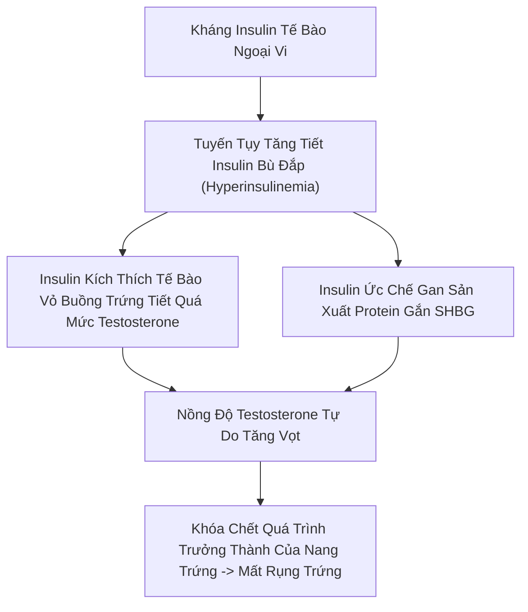
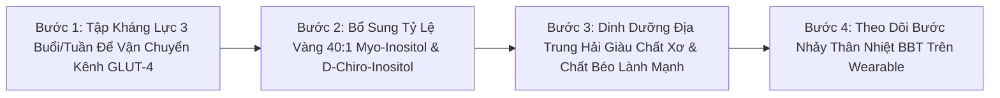
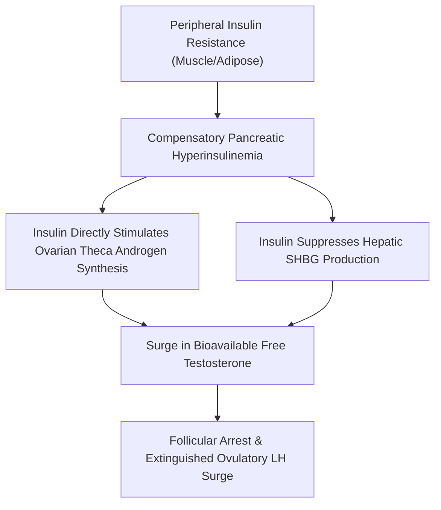
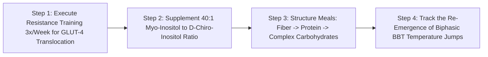

# WH_28 - Hội Chứng Buồng Trứng Đa Nang (PCOS): Tiêu Chuẩn Rotterdam & Giải Pháp Kháng Insulin
**Category:** Women's Health 
**Screen:** Menstrual Cycle & Metabolic Health Screen 
**Metric:** PCOS Symptoms, Cycle Irregularity & Insulin Dynamics (HO-02 / HO-06 / STR-01) 
**Reading Time:** 9 phút đọc / 9 min 
**Hero Image:**  *(Source: [https://images.unsplash.com/photo-1576091160550-2173dba999ef?auto=format&fit=crop&w=1200&q=85](https://images.unsplash.com/photo-1576091160550-2173dba999ef?auto=format&fit=crop&w=1200&q=85))* 
**Inline Figure:**  *(Source: [https://commons.wikimedia.org/wiki/File:Polycystic_ovary.jpg](https://commons.wikimedia.org/wiki/File:Polycystic_ovary.jpg))* 
**Clinical Source:** [International ESHRE/ASRM PCOS Guidelines (Teede et al., 2018) & Fertility and Sterility](https://academic.oup.com/humrep/article/33/9/1602/5055088) 

---

## 🇻🇳 Phiên Bản Tiếng Việt (Vietnamese Edition)

# Hội Chứng Buồng Trứng Đa Nang (PCOS): Tiêu Chuẩn Rotterdam & Giải Pháp Kháng Insulin

> **Tóm tắt (Sapo):** PCOS không đơn thuần là sự xuất hiện của các nang nhỏ trên buồng trứng; đó là một hội chứng rối loạn chuyển hóa và nội tiết toàn thân phức tạp ảnh hưởng đến 1 trên 10 phụ nữ. Tìm hiểu tiêu chuẩn chẩn đoán Rotterdam quốc tế, vai trò cốt lõi của tình trạng kháng insulin và phác đồ tập luyện dinh dưỡng để phục hồi chu kỳ rụng trứng.

> 💡 **Điểm Cốt Lõi & Hành Động Thực Tế (Key Takeaway):** Để chẩn đoán PCOS chuẩn xác, bạn cần thỏa mãn ít nhất 2 trong 3 tiêu chuẩn Rotterdam: kinh nguyệt thưa/vô kinh, dấu hiệu thừa androgen (rậm lông, mụn bọc, rụng tóc), hoặc hình ảnh đa nang trên siêu âm. Chìa khóa điều trị số 1 không phải là thuốc tránh thai mà là giải quyết tình trạng Kháng Insulin bằng tập tạ kháng lực và bổ sung Myo-Inositol.

## Căn Bệnh Bị Đặt Tên Sai Lạc Nhất Trong Phụ Khoa

Cái tên **Hội Chứng Buồng Trứng Đa Nang (Polycystic Ovary Syndrome - PCOS)** thường khiến nhiều phụ nữ hiểu lầm tai hại:
- Nhiều người nghĩ rằng trong buồng trứng của mình có những khối u nang nguy hiểm cần phải phẫu thuật cắt bỏ.
- Một số phụ nữ đi siêu âm thấy buồng trứng bình thường thì vội kết luận mình không bị PCOS, hoặc ngược lại, thấy vài nang nhỏ thì hoảng sợ nghĩ mình bị vô sinh.

Sự thật y khoa là: **Các "nang" trong PCOS hoàn toàn không phải là khối u; chúng chỉ là các nang trứng bình thường phát triển dở dang nhưng bị khựng lại giữa chừng (Follicular Arrest) do thiếu hụt tín hiệu nội tiết, không thể đạt đến độ chín để rụng.**

Theo Hướng dẫn Y khoa Quốc tế dựa trên Bằng chứng (**Teede et al., Human Reproduction 2018 và bản cập nhật 2023**): **PCOS thực chất là một rối loạn chuyển hóa - nội tiết toàn thân**, trong đó tuyến tụy, gan, tuyến thượng thận và buồng trứng cùng bị cuốn vào một vòng xoáy bệnh lý tương tác lẫn nhau.

<figure class="article-inline-diagram">
 
 <figcaption>🔬 <strong>Hình Ảnh Chuỗi Hạt (String of Pearls):</strong> Siêu âm đầu dò âm đạo cho thấy ≥ 20 nang nhỏ kích thước 2–9 mm nằm rải rác ở ngoại vi buồng trứng, phản ánh tình trạng các nang noãn bị đình trệ phát triển. <a href="https://commons.wikimedia.org/wiki/File:Polycystic_ovary.jpg" target="_blank" rel="noopener">Nguồn ảnh: Wikimedia Commons ↗</a></figcaption>
</figure>

---

## Tiêu Chuẩn Chẩn Đoán Rotterdam Quốc Tế (The Rotterdam Consensus)

Để chẩn đoán xác định một người phụ nữ có mắc PCOS hay không, các hiệp hội sản phụ khoa thế giới (ASRM/ESHRE) áp dụng **Tiêu chuẩn Rotterdam**—bệnh nhân phải thỏa mãn **ít nhất 2 trong 3 tiêu chí sau** (sau khi đã loại trừ các bệnh lý khác như suy giáp hay tăng sinh tuyến thượng thận bẩm sinh):

1. **Rối Loạn Rụng Trứng (Oligo- or Anovulation):** Chu kỳ kinh nguyệt kéo dài bất thường trên 35 ngày (Kinh thưa - *Oligomenorrhea*), hoặc hoàn toàn không có kinh trên 3–6 tháng (*Amenorrhea*).
2. **Thừa Hormone Nam (Hyperandrogenism):**
 - *Biểu hiện lâm sàng:* Rậm lông ở các vị trí nam tính như mép, cằm, ngực, bụng dưới (Thang điểm Ferriman-Gallwey); mụn trứng cá bọc dai dẳng ở vùng quai hàm; rụng tóc kiểu hói nam ở đỉnh đầu (*Androgenic Alopecia*).
 - *Xét nghiệm sinh hóa:* Nồng độ **Testosterone tự do** hoặc hormone **DHEA-S** tăng cao trong máu.
3. **Hình Ảnh Đa Nang Trên Siêu Âm (Polycystic Ovarian Morphology - PCOM):** Siêu âm ghi nhận có **từ 20 nang noãn trở lên** trên mỗi buồng trứng (kích thước 2–9 mm) và/hoặc thể tích buồng trứng phì đại ≥ 10 mL.

---

## Căn Nguyên Cốt Lõi: Kháng Insulin & Độc Tính Androgen

Có tới **70%–80% phụ nữ mắc PCOS** (kể cả những người có thể trạng gầy gò - *Lean PCOS*) sở hữu một rối loạn chung: **Tình Trạng Kháng Insulin (Insulin Resistance)**:

1. **Tuyến tụy sản xuất quá nhiều Insulin:** Do các tế bào cơ bắp bị trơ với tín hiệu của insulin, tuyến tụy buộc phải bơm vào máu lượng insulin gấp 3–5 lần bình thường (**Hyperinsulinemia**).
2. **Insulin đóng vai trò như hormone kích dục nam:** Nồng độ insulin cao kích thích trực tiếp các tế bào vỏ buồng trứng (*Theca cells*) tăng tốc sản xuất **Testosterone**.
3. **Bóp nghẹt protein bảo vệ (SHBG):** Insulin ức chế gan sản xuất phân tử **SHBG (Sex Hormone-Binding Globulin)**—chiếc bẫy chuyên gom giữ testosterone dư thừa. Khi SHBG tụt giảm, lượng testosterone tự do hoạt tính độc hại tràn ngập trong máu, khóa chết sự trưởng thành của nang noãn.

---

## Bảng Đối Chiếu 4 Phân Nhóm Phenotype Lâm Sàng Của PCOS

| Phân Loại Phenotype | Thỏa Mãn Các Tiêu Chuẩn Rotterdam | Mức Độ Kháng Insulin & Chuyển Hóa | Nguy Cơ Tim Mạch & Đái Tháo Đường | Chiến Lược Điều Trị Trọng Tâm |
| :--- | :--- | :--- | :--- | :--- |
| **Phenotype A (Kinh Điển Nặng)** | Đủ cả 3: Thừa Androgen + Không rụng trứng + Siêu âm đa nang. | Rất cao; thường kèm thừa cân, béo bụng. | Rất cao nếu không can thiệp. | Giảm kháng insulin, tập kháng lực mạnh, kiểm soát carb gắt gao. |
| **Phenotype B (Không Siêu Âm)** | Thừa Androgen + Không rụng trứng (Siêu âm buồng trứng bình thường). | Cao đến rất cao. | Cao. | Hạ Androgen, phục hồi đỉnh sóng rụng trứng bằng dinh dưỡng. |
| **Phenotype C (Có Rụng Trứng)** | Thừa Androgen + Siêu âm đa nang (Kinh nguyệt vẫn tương đối đều). | Mức độ trung bình. | Trung bình. | Chống viêm mãn tính, kiểm soát stress thượng thận. |
| **Phenotype D (Không Androgen)** | Không rụng trứng + Siêu âm đa nang (Không có dấu hiệu thừa nam). | Thường gặp ở người gầy (*Lean PCOS*). | Thấp hơn; chủ yếu liên quan đến trục hạ đồi. | Giảm allostatic stress, bổ sung chất béo, điều chỉnh nhịp sinh học. |

---

## 4 Sai Lầm Nghiêm Trọng Trong Điều Trị PCOS

1. **Uống Thuốc Tránh Thai Để "Chữa Khỏi PCOS":** Thuốc tránh thai chỉ đơn thuần che giấu triệu chứng bằng cách tạo ra các kỳ ra máu giả tạo; nó không hề chữa được gốc rễ của tình trạng kháng insulin, và khi dừng thuốc, các triệu chứng mụn, rậm lông và mất kinh sẽ bùng phát trở lại nặng hơn.
2. **Cắt Sạch Tinh Bột Đến Mức Kiệt Quệ:** Việc kiêng khem tinh bột cực đoan khiến tuyến thượng thận tăng tiết cortisol, làm trầm trọng thêm tình trạng rối loạn hormone ở nhóm PCOS do stress.
3. **Tập Cardio Điên Cuồng Để Ép Cân:** Chạy bộ quá nhiều trong tình trạng thiếu năng lượng làm tăng hormone căng thẳng, ức chế nốt phần rụng trứng còn lại.
4. **Bỏ Qua Giấc Ngủ & Hội Chứng Ngưng Thở Khi Ngủ:** Phụ nữ mắc PCOS có tỷ lệ ngưng thở khi ngủ (**Sleep Apnea**) cao gấp 5–10 lần người bình thường, là thủ phạm âm thầm khiến đường huyết ban đêm tăng vọt.

---

## Giao Thức 4 Bước Phục Hồi Chuyển Hóa & Đánh Thức Rụng Trứng

1. **Tập Kháng Lực Tối Ưu Độ Nhạy Insulin:** Tập tạ 3 buổi mỗi tuần (các bài tập compound: Squat, Deadlift, Lunge) giúp kích thích cơ bắp mở các kênh **GLUT-4**, hút sạch đường glucose trong máu vào tế bào cơ **mà không cần đến insulin**, giúp hạ nhanh nồng độ insulin tuần hoàn.
2. **Bổ Sung "Cặp Bài Trùng" Inositol Tỷ Lệ Vàng 40:1:** Sử dụng kết hợp **2.000 mg Myo-Inositol và 50 mg D-Chiro-Inositol** hai lần mỗi ngày. Các thử nghiệm lâm sàng đối chứng chứng minh tỷ lệ 40:1 này giúp phục hồi chu kỳ rụng trứng tự nhiên ở 70% phụ nữ PCOS tương đương thuốc Metformin nhưng không gây tác dụng phụ tiêu chảy.
3. **Xây Dựng Đĩa Ăn Chống Kháng Insulin:** Luôn tuân thủ quy tắc ăn: **Chất xơ (rau xanh) → Protein & Chất béo → Tinh bột phức hợp** ở cuối bữa. Thứ tự ăn này làm giảm đỉnh nhọn đường huyết sau ăn tới 40%.
4. **Đọc Tín Hiệu Rụng Trứng Tái Sinh Qua Thiết Bị Đeo:** Quan sát biểu đồ nhiệt độ da ban đêm. Khi cơ thể rụng trứng thành công, progesterone sẽ xuất hiện và tạo ra **bước nhảy nhiệt độ tăng +0.3°C** kéo dài 12–14 ngày—dấu hiệu vàng xác nhận buồng trứng của bạn đã hồi sinh!

---

## Nguồn Y Khoa Lâm Sàng & Tài Liệu Tham Khảo

1. **Teede, H. J., et al. (2018).** Recommendations from the international evidence-based guideline for the assessment and management of polycystic ovary syndrome. *Human Reproduction*, 33(9), 1602-1618. [Hướng Dẫn Quốc Tế ESHRE/ASRM: Chẩn Đoán & Kiểm Soát Hội Chứng Buồng Trứng Đa Nang PCOS (PMID: 30030527) ↗](https://academic.oup.com/humrep/article/33/9/1602/5055088)
2. **Rotterdam ESHRE/ASRM-Sponsored PCOS Consensus Workshop Group (2004).** Revised 2003 consensus on diagnostic criteria and long-term health risks related to polycystic ovary syndrome. *Fertility and Sterility*, 81(1), 19-25. [Tiêu Chuẩn Đồng Thuận Rotterdam Về PCOS (PMID: 14711538) ↗](https://www.fertstert.org/article/S0015-0282(03)02859-8/fulltext)
3. **Nordio, M., et al. (2019).** The 40:1 myo-inositol/D-chiro-inositol plasma ratio is able to restore ovulation in PCOS patients: comparison with other ratios. *European Review for Medical and Pharmacological Sciences*, 23(12), 5512-5521. [Tạp chí European Review: Tỷ Lệ Vàng 40:1 Inositol Phục Hồi Rụng Trứng Trong PCOS (PMID: 31298363) ↗](https://www.europeanreview.org/article/18223)
4. **WHOOP Metabolic & Menstrual Health Protocols (2025).** Monitoring Anovulation and Metabolic Flexibility in PCOS Cohorts (HO-02, HO-06). [WHOOP The Locker: Tracking PCOS With Wearable Biometrics ↗](https://www.whoop.com/thelocker/menstrual-cycle-coaching/)

---

## 🇬🇧 English Edition

# PCOS Demystified: Rotterdam Criteria, Hyperandrogenism & Insulin Resistance

> **Abstract (Sapo):** PCOS is far more than morphological ovarian cysts; it is a systemic neuro-metabolic syndrome impacting 1 in 10 women globally. Explore the international Rotterdam diagnostic consensus, unravel how hyperinsulinemia fuels ovarian hyperandrogenism, and implement clinical lifestyle protocols to restore ovulatory cycling.

> 💡 **Key Takeaway & Clinical Action:** Definitive PCOS diagnosis mandates meeting at least 2 of 3 Rotterdam criteria: oligo/anovulation, clinical/biochemical hyperandrogenism, or polycystic ovarian morphology on ultrasound. The primary therapeutic focus is reversing underlying Insulin Resistance through progressive resistance training and Myo-Inositol supplementation.

## The Great Gynecological Misnomer

The diagnostic title **Polycystic Ovary Syndrome (PCOS)** has generated decades of profound patient confusion:
- Many assume their ovaries harbor dangerous cystic tumors requiring surgical excision.
- Others receive an ultrasound revealing normal ovarian dimensions and mistakenly conclude they cannot have PCOS; conversely, healthy women noted to have incidental follicles panic over fears of sterility.

The clinical reality: **The "cysts" in PCOS are not neoplasias; they are immature, arrested antral follicles (Follicular Arrest) trapped in intermediate development due to an altered neuro-endocrine milieu.**

According to the definitive International Evidence-Based Guidelines (**Teede et al., Human Reproduction 2018 and the 2023 update**): **PCOS is a systemic neuro-metabolic syndrome**, wherein the pancreas, liver, adrenal glands, and ovaries become entangled in a chronic pathophysiological loop.

<figure class="article-inline-diagram">
 
 <figcaption>🔬 <strong>The "String of Pearls" Sign:</strong> Transvaginal ultrasound demonstrating ≥ 20 subcapsular antral follicles measuring 2–9 mm arranged peripherally around an expanded hyperechoic stroma. <a href="https://commons.wikimedia.org/wiki/File:Polycystic_ovary.jpg" target="_blank" rel="noopener">Source: Wikimedia Commons ↗</a></figcaption>
</figure>

---

## The International Rotterdam Consensus Diagnostic Criteria

To establish a definitive diagnosis of PCOS, international consensus frameworks (Rotterdam criteria endorsed by ESHRE/ASRM) require meeting **at least 2 of the following 3 cardinal features** (following rigorous exclusion of thyroid dysfunction, hyperprolactinemia, and congenital adrenal hyperplasia):

1. **Ovulatory Dysfunction (Oligo- or Anovulation):** Menstrual cycle intervals > 35 days (*Oligomenorrhea*), or complete absence of menses for > 3 consecutive months (*Amenorrhea*).
2. **Hyperandrogenism (Clinical or Biochemical):**
 - *Clinical Phenotype:* Hirsutism distributed along male patterns (upper lip, chin, chest, lower abdomen graded via the modified Ferriman-Gallwey scale); cystic nodular acne along mandibular lines; androgenic vertex alopecia.
 - *Biochemical Signature:* Elevated circulating **Free Testosterone** index or elevated adrenal **DHEA-S**.
3. **Polycystic Ovarian Morphology (PCOM):** Ultrasound visualization of **≥ 20 follicles per ovary** (measuring 2–9 mm) and/or an increased ovarian volume of **≥ 10 mL**.

---

## Pathophysiological Core: The Hyperinsulinemia-Androgen Cascade

Between **70% and 80% of all women with PCOS** (including normal-weight phenotypes—*Lean PCOS*) exhibit a central metabolic driver: **Peripheral Tissue Insulin Resistance**:

1. **Compensatory Hyperinsulinemia:** Because peripheral skeletal muscle receptors fail to respond efficiently to insulin, the pancreas floods the bloodstream with elevated basal insulin concentrations.
2. **Direct Gonadotropic Activity on Theca Cells:** Elevated circulating insulin acts synergistically with LH upon ovarian *theca interna* cells, upregulating cytochrome P450c17α and accelerating **Testosterone** synthesis.
3. **Suppression of Sex Hormone-Binding Globulin (SHBG):** Concurrently, hyperinsulinemia suppresses hepatic synthesis of **SHBG**—the biological sponge that binds steroid hormones. Depleted SHBG floods maternal tissues with unbound, bioactive Free Testosterone, arresting follicular maturation.

---

## Comparative Matrix: The 4 Clinical PCOS Phenotypes

| Phenotype Classification | Rotterdam Criteria Criteria Met | Insulin Resistance Severity | Cardiovascular & Metabolic Risk | Primary Therapeutic Strategy |
| :--- | :--- | :--- | :--- | :--- |
| **Phenotype A (Full Classic)** | All 3: Hyperandrogenism + Anovulation + PCOM. | Severe; highly correlated with visceral adiposity. | Maximum long-term risk of type 2 diabetes. | Aggressive insulin sensitization, progressive resistance training, glycemic control. |
| **Phenotype B (Non-PCOM)** | Hyperandrogenism + Anovulation (Normal ultrasound morphology). | Substantial. | High. | Lower circulating androgens, restore ovulatory surge via nutrition. |
| **Phenotype C (Ovulatory)** | Hyperandrogenism + PCOM (Retains regular cycles). | Moderate. | Moderate. | Address systemic low-grade inflammation, down-regulate adrenal stress. |
| **Phenotype D (Non-Androgenic)** | Anovulation + PCOM (Normal androgen biomarkers). | Mild; typical of Lean PCOS. | Lower metabolic risk; primarily neuro-hypothalamic. | Mitigate allostatic stress load, optimize micronutrients and sleep rhythm. |

---

## 4 Common Clinical Pitfalls in PCOS Management

1. **Relying on Oral Contraceptives as a "Cure":** Synthetic birth control pills merely induce artificial withdrawal bleeds; they fail to rectify root-cause insulin resistance and trigger rebound androgenic flares upon cessation.
2. **Aggressive Low-Carb Starvation:** Chronic severe carbohydrate restriction triggers compensatory adrenal cortisol hypersecretion, exacerbating HPA-axis dysfunction.
3. **Chronic Excessive Cardio Conditioning:** Chronic endurance training in energy-deprived states magnifies systemic allostatic stress, worsening hypothalamic ovulatory suppression.
4. **Ignoring Obstructive Sleep Apnea (OSA):** Women with PCOS face a 5- to 10-fold higher incidence of nocturnal sleep apnea, driving early morning insulin surges.

---

## 4-Step Clinical Protocol for Metabolic Restoration & Ovulation

1. **Prescribe Heavy Resistance Training:** Performing multi-joint resistance training 3 times weekly stimulates muscle **GLUT-4 transporter translocation independently of insulin**, clearing blood glucose and systematically lowering circulating insulin.
2. **Incorporate the 40:1 Inositol Gold Standard:** Ingest **2,000 mg of Myo-Inositol paired with 50 mg of D-Chiro-Inositol** twice daily. Randomized controlled trials confirm this physiological 40:1 ratio restores spontaneous ovulatory cycles in over 70% of PCOS patients, rivaling pharmaceutical Metformin without gastrointestinal toxicity.
3. **Sequence Meal Macronutrient Order:** Consume whole-food fibers (leafy greens) first, followed by clean proteins and lipids, leaving complex carbohydrates for the end of the meal. This sequence blunts postprandial glucose excursions by up to 40%.
4. **Audit Ovulatory Restoration on Wearables:** Continuously track nocturnal skin temperature on your wearable. When lifestyle interventions succeed in triggering spontaneous ovulation, progesterone will emerge, producing a **biphasic +0.3°C temperature shift** lasting 12–14 days.

---

## Clinical Citations & Reference Literature

1. **Teede, H. J., et al. (2018).** Recommendations from the international evidence-based guideline for the assessment and management of polycystic ovary syndrome. *Human Reproduction*, 33(9), 1602-1618. [Human Reproduction: International PCOS Guidelines (PMID: 30030527) ↗](https://academic.oup.com/humrep/article/33/9/1602/5055088)
2. **Rotterdam ESHRE/ASRM-Sponsored PCOS Consensus Workshop Group (2004).** Revised 2003 consensus on diagnostic criteria and long-term health risks related to polycystic ovary syndrome. *Fertility and Sterility*, 81(1), 19-25. [Fertility and Sterility: Rotterdam PCOS Criteria (PMID: 14711538) ↗](https://www.fertstert.org/article/S0015-0282(03)02859-8/fulltext)
3. **Nordio, M., et al. (2019).** The 40:1 myo-inositol/D-chiro-inositol plasma ratio is able to restore ovulation in PCOS patients: comparison with other ratios. *European Review for Medical and Pharmacological Sciences*, 23(12), 5512-5521. [European Review: Inositol 40:1 Ratio for Ovulation Restoration (PMID: 31298363) ↗](https://www.europeanreview.org/article/18223)
4. **WHOOP Metabolic & Menstrual Health Protocols (2025).** Monitoring Anovulation and Metabolic Flexibility in PCOS Cohorts. [WHOOP The Locker: Tracking PCOS With Wearable Biometrics ↗](https://www.whoop.com/thelocker/menstrual-cycle-coaching/)
