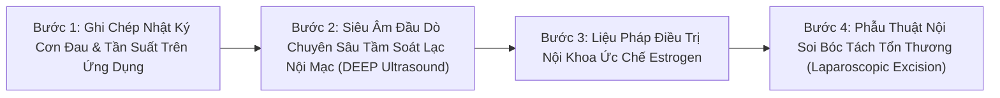

# WH_29 - Lạc Nội Mạc Tử Cung: Nhận Diện Cơn Đau Vùng Chậu Mãn Tính & Lộ Trình Chẩn Đoán Sớm
**Category:** Women's Health 
**Screen:** Menstrual Cycle Screen & Pain Tracking 
**Metric:** Endometriosis Pelvic Pain & Chronic Inflammation (HO-06 / REC-01 / HO-01) 
**Reading Time:** 9 phút đọc / 9 min 
**Hero Image:**  *(Source: [https://images.unsplash.com/photo-1505751172876-fa1923c5c528?auto=format&fit=crop&w=1200&q=85](https://images.unsplash.com/photo-1505751172876-fa1923c5c528?auto=format&fit=crop&w=1200&q=85))* 
**Inline Figure:**  *(Source: [https://commons.wikimedia.org/wiki/File:Blausen_0349_Endometriosis.png](https://commons.wikimedia.org/wiki/File:Blausen_0349_Endometriosis.png))* 
**Clinical Source:** [Nature Reviews Disease Primers (Zondervan et al., 2018) & The Lancet (Taylor et al., 2020)](https://www.thelancet.com/journals/lancet/article/PIIS0140-6736(20)32748-8/fulltext) 

---

## 🇻🇳 Phiên Bản Tiếng Việt (Vietnamese Edition)

# Lạc Nội Mạc Tử Cung: Nhận Diện Cơn Đau Vùng Chậu Mãn Tính & Lộ Trình Chẩn Đoán Sớm

> **Tóm tắt (Sapo):** Đau bụng kinh dữ dội đến mức ngất xỉu, nôn mửa hoặc phải nghỉ làm không bao giờ là chuyện 'bình thường'. Lạc nội mạc tử cung (Endometriosis) là một bệnh lý viêm mãn tính phức tạp hành hạ gần 200 triệu phụ nữ trên toàn cầu, với độ trễ chẩn đoán trung bình từ 7 đến 10 năm. Tìm hiểu cơ chế sinh học, dấu hiệu cảnh báo và lộ trình điều trị y khoa chuẩn mực.

> 💡 **Điểm Cốt Lõi & Hành Động Thực Tế (Key Takeaway):** Nếu cơn đau bụng kinh của bạn không thuyên giảm khi dùng thuốc giảm đau NSAIDs thông thường, hoặc lan ra sau lưng, đau buốt khi đi vệ sinh hay khi quan hệ sâu, đừng chần chừ. Hãy tìm đến bác sĩ chuyên khoa sâu về Lạc nội mạc tử cung để siêu âm chuyên sâu hoặc phẫu thuật nội soi bóc tách tổn thương.

## Bi Kịch Y Khoa: "Độ Trễ Chẩn Đoán 7 Đến 10 Năm"

Trong toàn bộ lịch sử y học hiện đại, hiếm có căn bệnh nào phải chịu đựng sự ngó lơ và bình thường hóa xã hội dai dẳng như **Lạc Nội Mạc Tử Cung (Endometriosis)**:
- Gần **200 triệu phụ nữ và trẻ em gái** trên khắp thế giới đang phải sống chung với căn bệnh này (chiếm khoảng 10% phụ nữ trong độ tuổi sinh sản).
- Đáng kinh ngạc là: Thời gian trung bình từ khi một người phụ nữ bắt đầu xuất hiện triệu chứng đau đớn đầu tiên cho đến khi nhận được chẩn đoán xác định chính xác từ y tế kéo dài từ **7 đến 10 năm**!
- Trong suốt một thập kỷ đó, hầu hết các bệnh nhân đều bị bác sĩ, người thân hoặc bạn bè gạt đi với những lời khuyên thiếu hiểu biết: *"Đau bụng kinh ai chẳng bị, phụ nữ là phải chịu đau, lấy chồng sinh con là hết"*.

Khoa học phụ khoa hiện đại (**Zondervan et al., Nature Reviews Disease Primers 2018** và **Taylor et al., The New England Journal of Medicine 2020**) đã khẳng định: **Lạc nội mạc tử cung là một bệnh lý viêm toàn thân nghiêm trọng, phụ thuộc estrogen, có khả năng xâm lấn các cơ quan vùng chậu tương tự như mô khối u lành tính.**

<figure class="article-inline-diagram">
 
 <figcaption>🏥 <strong>Vị Trí Giải Phẫu Các Ổ Lạc Nội Mạc Tử Cung:</strong> Mô nội mạc tử cung xuất hiện bất thường tại buồng trứng, phúc mạc chậu và dây chằng cùng tử cung; xuất huyết chu kỳ gây phản ứng viêm mạn tính, xơ hóa và đau vùng chậu dai dẳng. <a href="https://commons.wikimedia.org/wiki/File:Blausen_0349_Endometriosis.png" target="_blank" rel="noopener">Nguồn: Blausen Medical Communications / Wikimedia Commons ↗</a></figcaption>
</figure>

---

## Sinh Bệnh Học Phân Tử: Chuyện Gì Đang Xảy Ra Trong Ổ Bụng?

Để hiểu vì sao căn bệnh này gây ra những cơn đau khủng khiếp, hãy nhìn vào cơ chế sinh học:
1. **Hiện Tượng Kinh Nguyệt Trào Ngược (Retrograde Menstruation):** 
 - Thuyết kinh điển của Bác sĩ John Sampson (1927): Trong kỳ kinh, các mảnh niêm mạc tử cung bong ra không chỉ chảy ra ngoài qua âm đạo mà còn trào ngược qua hai vòi trứng chảy vào khoang phúc mạc ổ bụng.
 - Hiện tượng trào ngược này xảy ra ở 90% phụ nữ, nhưng ở phụ nữ khỏe mạnh, hệ thống miễn dịch (đại thực bào, tế bào NK) sẽ nhanh chóng dọn sạch các mảnh vụn này.
2. **Khiếm Khuyết Miễn Dịch & Xâm Lấn Mô:** Ở người mắc Endometriosis, hệ miễn dịch không nhận diện được các tế bào đi lạc. Chúng bám rễ vào bề mặt buồng trứng, phúc mạc, ruột, bàng quang và bắt đầu tăng sinh mạch máu mới.
3. **Chảy Máu Trong Một Khoang Kín:** 
 - Các ổ mô lạc chỗ này chứa các thụ thể nhạy cảm với **Estrogen**. Mỗi tháng, khi estrogen tăng lên, chúng cũng dày lên; khi estrogen tụt dốc, **chúng cũng chảy máu hệt như niêm mạc trong tử cung!**
 - Nhưng máu kinh trong ổ bụng không có lối thoát ra ngoài. Máu bị giam cầm gây viêm vô trùng dữ dội, hình thành các mô sẹo xơ dính (*Fibrotic Adhesions*) kéo dính các cơ quan nội tạng lại với nhau (ví dụ: kéo dính tử cung vào trực tràng tạo thành "vùng chậu đông cứng" - *Frozen Pelvis*).

---

## Bảng Nhận Diện 5 Triệu Chứng Điển Hình (The "5Ds" of Endometriosis)

| Dấu Hiệu Lâm Sàng (The 5 Ds) | Thuật Ngữ Y Khoa | Cơ Chế Bệnh Sinh Trực Tiếp | Mức Độ Nghiêm Trọng |
| :--- | :--- | :--- | :--- |
| **Đau Bụng Kinh Dữ Dội** | **Dysmenorrhea** | Prostaglandin gây viêm cục bộ tại các ổ tổn thương bám trên màng bụng. | Đau quặn thắt khiến ngất xỉu, buồn nôn, thuốc giảm đau NSAIDs vô tác dụng. |
| **Đau Rát Khi Quan Hệ Sâu** | **Dyspareunia** | Tổn thương thâm nhiễm vào dây chằng tử cung - cùng và cùng đồ sau (*Pouch of Douglas*). | Đau buốt nhói thấu xương chậu khi có va chạm cơ học sâu. |
| **Đau Khi Đi Đại Tiện** | **Dyschezia** | Mô lạc nội mạc xâm lấn sâu vào vách ngăn âm đạo - trực tràng (*Rectovaginal Septum*). | Đau buốt như dao cứa khi rặn đại tiện, đặc biệt dữ dội trong những ngày có kinh. |
| **Đau Khi Đi Tiểu Tiện** | **Dysuria** | Tổn thương xâm lấn vào thành bàng quang hoặc niệu quản. | Tiểu buốt, tiểu rắt, cảm giác tức nặng bàng quang liên tục trong kỳ kinh. |
| **Đau Vùng Chậu Mãn Tính** | **Diffuse Pelvic Pain** | Hiện tượng tăng sinh dây thần kinh cảm giác và quá mẫn trung ương (*Central Sensitization*). | Đau âm ỉ lưng dưới, đáy chậu và vùng đùi suốt cả tháng kể cả khi sạch kinh. |

---

## Tín Hiệu Trên Thiết Bị Đeo Khi Cơn Viêm Bùng Phát

Ở những phụ nữ mắc Endometriosis, các đợt bùng phát viêm (*Endo Flares*) để lại dấu vết rất rõ trên các cảm biến sinh trắc học:
- **Biến Thiên Nhịp Tim Sụp Đổ:** Điểm HRV RMSSD rơi tự do xuống đáy sâu trong các đợt đau quặn do hệ thần kinh giao cảm bị kích động liên tục bởi các tín hiệu đau thần kinh.
- **Thân Nhiệt & Nhịp Tim Nghỉ Ngơi Tăng Cao:** Nhịp tim ban đêm RHR có thể tăng thêm 5–10 bpm phản ánh phản ứng viêm toàn thân của các cytokine gây viêm (**IL-1β, TNF-α, IL-6**) tràn ngập trong dịch ổ bụng.

---

## Giao Thức 4 Bước Chẩn Đoán & Kiểm Soát Chuẩn Mực

1. **Số Hóa Dữ Liệu Cơn Đau:** Sử dụng tính năng ghi log triệu chứng (Symptom Log) trên app để ghi lại chính xác: ngày xuất hiện cơn đau, vị trí đau (bụng, lưng, khi đi vệ sinh), mức độ điểm đau (1–10) và loại thuốc giảm đau đã dùng. Đây là bằng chứng vô giá khi gặp bác sĩ.
2. **Tìm Kiếm Chuyên Gia Chẩn Đoán Hình Ảnh Chuyên Sâu:** Siêu âm bụng thông thường thường bỏ sót 80% các tổn thương lạc nội mạc sâu. Hãy tìm đến các trung tâm phụ sản có chuyên gia thực hiện **Siêu âm đầu dò âm đạo chuyên biệt tầm soát lạc nội mạc sâu (Deep Infiltrating Endometriosis - DIE Ultrasound)** hoặc chụp cộng hưởng từ **MRI vùng chậu có chuẩn bị ruột**.
3. **Tiếp Cận Điều Trị Nội Khoa Bậc 1:** Sử dụng các thuốc ức chế rụng trứng và teo mô nội mạc (Progestin đơn thuần liều cao như Dienogest, vòng đặt tử cung chứa Levonorgestrel, hoặc thuốc đối kháng GnRH thế hệ mới).
4. **Phẫu Thuật Nội Soi Bóc Tách Triệt Để (Laparoscopic Excision):** Khi điều trị nội khoa thất bại hoặc tổn thương chèn ép niệu quản, ruột: phẫu thuật nội soi bóc tách tận gốc tổn thương (*Excision Surgery*) do các bác sĩ phẫu thuật chuyên khoa sâu thực hiện là tiêu chuẩn vàng để phục hồi giải phẫu và bảo tồn khả năng sinh sản.

---

## Nguồn Y Khoa Lâm Sàng & Tài Liệu Tham Khảo

1. **Zondervan, K. T., et al. (2018).** Endometriosis. *Nature Reviews Disease Primers*, 4(1), 9. [Tạp chí Nature Reviews Disease Primers: Bệnh Học Toàn Diện Lạc Nội Mạc Tử Cung (PMID: 30026507) ↗](https://www.nature.com/articles/s41572-018-0008-5)
2. **Taylor, H. S., et al. (2020).** Endometriosis is a chronic systemic disease: clinical challenges and novel innovations. *The Lancet*, 397(10276), 839-852. [Tạp chí The Lancet: Lạc Nội Mạc Tử Cung Là Bệnh Viêm Hệ Thống Mãn Tính (PMID: 33640070) ↗](https://www.thelancet.com/journals/lancet/article/PIIS0140-6736(20)32748-8/fulltext)
3. **Becker, C. M., et al. (2022).** ESHRE guideline: endometriosis. *Human Reproduction Open*, 2022(2), hoac009. [Hướng Dẫn Hiệp Hội Sinh Sản Châu Âu ESHRE: Quản Lý & Chẩn Đoán Lạc Nội Mạc (PMID: 35350473) ↗](https://academic.oup.com/hropen/article/2022/2/hoac009/6532454)
4. **WHOOP & Apple HealthKit Pelvic Symptom Algorithms (2025).** Inflammatory Flares & Dysmenorrhea Biomarker Tracking. [WHOOP The Locker: Chronic Pain, Inflammation & Cycle Tracking ↗](https://www.whoop.com/thelocker/menstrual-cycle-coaching/)

---

## 🇬🇧 English Edition

# Endometriosis Uncovered: Retrograde Menstruation, Chronic Inflammation & Care

> **Abstract (Sapo):** Debilitating menstrual agony causing nausea, syncope, or work absenteeism is never 'normal.' Endometriosis is a complex, chronic inflammatory disease affecting nearly 200 million women globally, bearing an alarming diagnostic delay of 7 to 10 years. Discover the underlying cellular pathophysiology, red-flag symptoms, and modern clinical management.

> 💡 **Key Takeaway & Clinical Action:** If menstrual dysmenorrhea is refractory to first-line NSAIDs or radiates to the lumbar spine, accompanied by painful defecation or deep dyspareunia, do not normalize it. Seek consultation with an endometriosis excision specialist for advanced deep-endometriosis ultrasound and diagnostic laparoscopy.

## A Modern Medical Tragedy: The 7 to 10-Year Diagnostic Delay

Throughout modern medical history, few chronic conditions have suffered from such pervasive social dismissal and systemic normalization as **Endometriosis**:
- Nearly **200 million women and girls** worldwide live with this disease (approximately 10% of all reproductive-age females).
- Alarmingly: The average duration spanning a patient's initial onset of symptoms to definitive surgical diagnosis averages **7 to 10 years**!
- Across that grueling decade, patients are routinely gaslit by clinicians, family members, and peers with outdated dismissals: *"Severe period pain is just part of being a woman; take an ibuprofen and it will resolve once you have children."*

Contemporary gynecology (**Zondervan et al., Nature Reviews Disease Primers 2018** and **Taylor et al., The Lancet 2020**) has firmly refuted this myth: **Endometriosis is an aggressive, chronic, estrogen-dependent systemic inflammatory disease, exhibiting semi-invasive characteristics across peritoneal tissue architectures.**

<figure class="article-inline-diagram">
 
 <figcaption>🏥 <strong>Anatomical Distribution of Endometriotic Implants:</strong> Ectopic endometrial glands on ovaries, peritoneal surfaces, and uterosacral ligaments causing cyclical micro-hemorrhage and chronic fibro-inflammatory adhesions. <a href="https://commons.wikimedia.org/wiki/File:Blausen_0349_Endometriosis.png" target="_blank" rel="noopener">Source: Blausen Medical Communications / Wikimedia Commons ↗</a></figcaption>
</figure>

---

## Molecular Pathophysiology: What Occurs Within the Peritoneal Cavity?

Understanding the agony of endometriosis requires examining cellular mechanisms:
1. **The Retrograde Menstruation Paradigm:**
 - Originating with Dr. John Sampson (1927): During menses, desquamated endometrial tissue and erythrocytes reflux through the fallopian tubes into the peritoneal cavity.
 - While retrograde reflux occurs in 90% of women, healthy immune surveillance (macrophages, NK cells) clears this cellular debris promptly.
2. **Immune Evasion & Microvascular Invasion:** In women predisposed to endometriosis, defective peritoneal macrophages fail to clear ectopic fragments. The tissue implants onto peritoneal surfaces, upregulates vascular endothelial growth factor (VEGF), and forms autonomous vascularized lesions.
3. **Internal Bleeding Within a Closed Visceral Space:**
 - These ectopic implants express functional **Estrogen Receptors (ER-β)**. As monthly estrogen rises, they proliferate; as estrogen plunges, **they bleed simultaneously with uterine menses!**
 - Lacking an external exit path, trapped blood induces intense aseptic inflammation, attracting fibroblasts that spin dense bands of scar tissue (*Fibrotic Adhesions*). Over time, these fuse the uterus to the bowel wall, resulting in an immobilized **"Frozen Pelvis."**

---

## Diagnostic Matrix: The "5 Ds" of Endometriosis

| Clinical Presentation (The 5 Ds) | Medical Classification | Biophysical Pathogenesis | Clinical Severity Profile |
| :--- | :--- | :--- | :--- |
| **Severe Menstrual Cramping** | **Dysmenorrhea** | Massive inflammatory prostaglandin release from peritoneal lesions. | Incapacitating contractions causing syncope, vomiting; refractory to standard NSAIDs. |
| **Deep Dyspareunia** | **Painful Intercourse** | Mechanical thrusting impact against tender, fibrotic uterosacral ligaments. | Piercing deep pelvic pain upon deep penetrative intimacy. |
| **Painful Bowel Movements** | **Dyschezia** | Lesion infiltration into the rectovaginal septum and anterior rectal wall. | Lancinating, knife-like rectal spasms during defecation, concentrated during menses. |
| **Painful Urination** | **Dysuria** | Superficial or deep infiltration into the detrusor muscle of the bladder wall. | Cyclic burning, frequency, and suprapubic cramping in the absence of bacterial infection. |
| **Chronic Pelvic Pain** | **Diffuse Pain** | Neuroangiogenesis and spinal **Central Sensitization**. | Persistent, unrelenting pelvic and lower back aching persisting throughout the entire month. |

---

## Biometric Wearable Biomarkers of Inflammatory Flares

During acute endometriosis flares (*Endo Flares*), continuous wearable sensors reflect intense physiological strain:
- **Collapsed Heart Rate Variability (HRV):** Nocturnal RMSSD drops to monthly lows as the sympathetic nervous system fires continuously in response to unremitting visceral nociceptive inputs.
- **Elevated Nocturnal RHR & Skin Temperature:** Resting heart rate elevates 5 to 10 bpm, driven by systemic pro-inflammatory cytokines (**TNF-α, IL-1β, IL-6**) flooding peritoneal fluid.

---

## 4-Step Clinical Evaluation & Excision Pathway

1. **Maintain a Granular Symptom Dossier:** Utilize your wearable symptom logger to capture pain timing, precise anatomical locations, functional impairment scores, and pharmaceutical responses. This quantitative record cuts through clinical dismissal.
2. **Seek Specialized Deep Imaging:** Conventional transabdominal pelvic ultrasounds miss over 80% of deep infiltrating lesions. Seek centers offering **Deep Infiltrating Endometriosis (DIE) high-resolution transvaginal ultrasound** performed by trained sonologists, or pelvic MRI with bowel preparation.
3. **First-Line Medical Down-Regulation:** Implement targeted medical suppressive therapies (high-potency progestins like Dienogest, levonorgestrel-releasing IUDs, or modern oral GnRH receptor antagonists) to induce lesion atrophy.
4. **Gold-Standard Laparoscopic Excision Surgery:** When medical therapy is insufficient or structural damage threatens organ function, **complete laparoscopic excision (cutting lesions out at the roots)** performed by an accredited specialist provides superior long-term pain relief and restores anatomical architecture.

---

## Clinical Citations & Reference Literature

1. **Zondervan, K. T., et al. (2018).** Endometriosis. *Nature Reviews Disease Primers*, 4(1), 9. [Nature Reviews Disease Primers: Endometriosis Pathophysiology (PMID: 30026507) ↗](https://www.nature.com/articles/s41572-018-0008-5)
2. **Taylor, H. S., et al. (2020).** Endometriosis is a chronic systemic disease: clinical challenges and novel innovations. *The Lancet*, 397(10276), 839-852. [The Lancet: Endometriosis as a Chronic Systemic Disease (PMID: 33640070) ↗](https://www.thelancet.com/journals/lancet/article/PIIS0140-6736(20)32748-8/fulltext)
3. **Becker, C. M., et al. (2022).** ESHRE guideline: endometriosis. *Human Reproduction Open*, 2022(2), hoac009. [ESHRE Endometriosis Clinical Guideline (PMID: 35350473) ↗](https://academic.oup.com/hropen/article/2022/2/hoac009/6532454)
4. **WHOOP & Apple HealthKit Pelvic Symptom Algorithms (2025).** Inflammatory Flares & Dysmenorrhea Biomarker Tracking. [WHOOP The Locker: Chronic Pain, Inflammation & Cycle Tracking ↗](https://www.whoop.com/thelocker/menstrual-cycle-coaching/)
