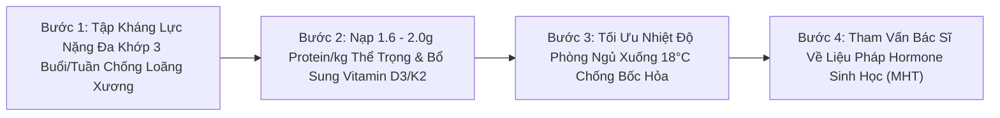
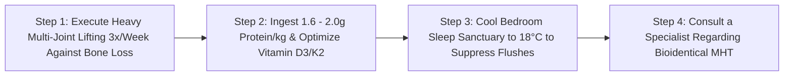

# WH_30 - Tiền Mãn Kinh & Mãn Kinh: Cơn Bốc Hỏa, Chuyển Dịch Nội Tiết & Bảo Vệ Khung Xương
**Category:** Long-term Health — Perimenopause & Menopause 
**Screen:** Perimenopause Screen & Sleep Vitals 
**Metric:** Vasomotor Symptoms, STRAW+10 Stages & Bone Health (HO-02 / HO-06 / SL-11) 
**Reading Time:** 9 phút đọc / 9 min 
**Hero Image:**  *(Source: [https://images.unsplash.com/photo-1544005313-94ddf0286df2?auto=format&fit=crop&w=1200&q=85](https://images.unsplash.com/photo-1544005313-94ddf0286df2?auto=format&fit=crop&w=1200&q=85))* 
**Inline Figure:**  *(Source: [https://commons.wikimedia.org/wiki/File:STRAW_staging_system.png](https://commons.wikimedia.org/wiki/File:STRAW_staging_system.png))* 
**Clinical Source:** [Fertil Steril (Harlow et al., STRAW+10, 2012) & Endocr Rev (Santoro et al., 2015)](https://pubmed.ncbi.nlm.nih.gov/22436405/) 

---

## 🇻🇳 Phiên Bản Tiếng Việt (Vietnamese Edition)

# Tiền Mãn Kinh & Mãn Kinh: Cơn Bốc Hỏa, Chuyển Dịch Nội Tiết & Bảo Vệ Khung Xương

> **Tóm tắt (Sapo):** Thời kỳ tiền mãn kinh không phải là một công tắc bật tắt đột ngột ở tuổi 50; đó là một giai đoạn chuyển tiếp nội tiết kéo dài từ 4 đến 8 năm, bắt đầu từ độ tuổi ngoài 40 với những đợt sóng estrogen dao động dữ dội. Tìm hiểu tiêu chuẩn vàng STRAW+10, nguồn gốc các cơn bốc hỏa và chiến lược y học hiện đại để bước qua giai đoạn này với sức sống rạng ngời.

> 💡 **Điểm Cốt Lõi & Hành Động Thực Tế (Key Takeaway):** Mãn kinh chỉ được xác định khi bạn đã mất kinh liên tục trọn vẹn 12 tháng. Trong giai đoạn tiền mãn kinh, hãy theo dõi sự dãn dài của chu kỳ (> 7 ngày lệch chuẩn) trên thiết bị đeo, chủ động rèn luyện tạ kháng lực để chống mất xương và thảo luận sớm với bác sĩ về Liệu Pháp Hormone Mãn Kinh (MHT) trong 'Cửa Sổ Vàng' trước tuổi 60.

## Chuyến Tàu Lượn Siêu Tốc Tuổi 40: "Tiền Mãn Kinh" Bắt Đầu Sớm Hơn Bạn Nghĩ

Hầu hết phụ nữ đều nghĩ rằng mãn kinh là chuyện của những năm 50 tuổi. Vì vậy, khi bước sang tuổi 42 hay 45 và bắt đầu cảm thấy:
- Chu kỳ kinh nguyệt tự nhiên rút ngắn từ 28 ngày xuống 24 ngày, rồi đột ngột tháng sau lại kéo dài 45 ngày mới có.
- Những cơn đổ mồ hôi đêm làm ướt đẫm gối, giật mình thức giấc lúc 3 giờ sáng tim đập thình thịch.
- Cảm giác bốc hỏa bừng bừng từ ngực lan lên mặt, kèm theo não cá vàng hay quên và tính khí dễ cáu gắt vô cớ.

Họ thường hoang mang tự hỏi: *"Liệu mình có bị bệnh tim mạch, u não hay rối loạn tâm thần không?"*

Câu trả lời y khoa là: **Bạn đang bước vào giai đoạn Tiền Mãn Kinh (Perimenopause)—một giai đoạn biến động nội tiết tự nhiên kéo dài từ 4 đến 8 năm trước khi kỳ kinh nguyệt cuối cùng biến mất.**

Theo công trình nghiên cứu hệ thống kinh điển của **Hội Nghị Quốc Tế Về Các Giai Đoạn Lão Hóa Sinh Sản (STRAW+10 Consensus, Harlow et al., 2012)**: Tiền mãn kinh không phải là sự suy giảm estrogen từ từ và êm đềm; trái lại, đây là một **"chuyến tàu lượn siêu tốc nội tiết"**, nơi nồng độ Estrogen có thể tăng vọt cao gấp đôi bình thường trong tuần này rồi lao dốc không phanh vào tuần tiếp theo!

<figure class="article-inline-diagram">
 
 <figcaption>📊 <strong>Hệ Thống Phân Giai Đoạn STRAW+10:</strong> Tiêu chuẩn vàng quốc tế phân định lộ trình lão hóa buồng trứng từ giai đoạn sinh sản, tiền mãn kinh sớm (-2), tiền mãn kinh muộn (-1) đến mãn kinh (+1). <a href="https://commons.wikimedia.org/wiki/File:STRAW_staging_system.png" target="_blank" rel="noopener">Nguồn sơ đồ: STRAW+10 / Wikimedia Commons ↗</a></figcaption>
</figure>

---

## 4 Cột Mốc Của Hệ Thống STRAW+10 Chuẩn Y Khoa Quốc Tế

1. **Giai Đoạn Sinh Sản Muộn (Giai đoạn -3):** Nồng độ hormone **AMH (Dự trữ buồng trứng)** và **Inhibin B** bắt đầu suy giảm; số lượng trứng dự trữ vơi dần nhưng chu kỳ kinh nguyệt vẫn đều đặn.
2. **Tiền Mãn Kinh Sớm (Early Perimenopause - Giai đoạn -2):**
 - Tiêu chí nhận diện: **Độ dài chu kỳ kinh nguyệt bắt đầu lệch ≥ 7 ngày** so với mức bình thường (Ví dụ: trước đây 28 ngày, nay chu kỳ chuyển thành 21 ngày hoặc 35 ngày).
 - Tuyến yên tăng tiết hormone **FSH** để cố gắng kích thích những nang trứng già cỗi còn sót lại.
3. **Tiền Mãn Kinh Muộn (Late Perimenopause - Giai đoạn -1):**
 - Tiêu chí nhận diện: **Bắt đầu xuất hiện các đợt mất kinh kéo dài ≥ 60 ngày**.
 - Các cơn bốc hỏa (*Hot Flushes*) và đổ mồ hôi đêm xuất hiện với tần suất dày đặc nhất; nồng độ estrogen tụt sâu.
4. **Mãn Kinh Chính Thức (Menopause / FMP - Giai đoạn 0):**
 - Được xác định hồi cứu khi bạn đã **trải qua đúng 12 tháng liên tục không có một giọt máu kinh nào** mà không do nguyên nhân bệnh lý hay phẫu thuật. Độ tuổi mãn kinh trung bình của phụ nữ toàn cầu là **51.4 tuổi**.

---

## Giải Mã Cơn Bốc Hỏa (Hot Flashes): Cuộc Nổi Loạn Của Nơ-ron Vùng Hạ Đồi

Tại sao sự sụt giảm estrogen lại khiến cơ thể bạn bỗng nhiên bốc cháy như một lò than?

Nghiên cứu thần kinh học hiện đại (**Santoro et al., Endocrine Reviews 2015**) đã tìm ra thủ phạm chính: **Các nơ-ron KNDy tại vùng hạ đồi**:
- Vùng hạ đồi có một nhóm nơ-ron đặc biệt gọi là **KNDy** (tiết ra Kisspeptin, Neurokinin B và Dynorphin) có nhiệm vụ điều khiển chiếc nhiệt kế trung tâm của cơ thể.
- Khi nồng độ Estrogen cao, estrogen sẽ ức chế và giữ các nơ-ron này ở trạng thái điềm tĩnh.
- Khi nồng độ Estrogen lao dốc trong thời kỳ tiền mãn kinh, sự ức chế này biến mất. Các nơ-ron Neurokinin B bị kích thích quá mức, làm **thu hẹp chiếc "cửa sổ điều nhiệt trung hòa" (Thermoneutral Zone)** của não bộ từ 0.4°C xuống gần như bằng 0.
- Lúc này, chỉ cần nhiệt độ phòng nhích nhẹ 0.1°C, não bộ đã hoảng hốt phát báo động giả rằng cơ thể đang bị sốt thiêu đốt! Nó lập tức ra lệnh: giãn toàn bộ mao mạch ở ngực và mặt để xả nhiệt (gây đỏ bừng mặt, bốc hỏa) và kích hoạt tuyến mồ hôi tuôn ra ồ ạt để làm mát cấp tốc.

---

## Bảng Hệ Thống Biến Đổi Sức Khỏe & Tín Hiệu Trên Thiết Bị Đeo

| Hệ Cơ Quan | Cơ Chế Biến Đổi Sinh Học | Biểu Hiện Lâm Sàng Thực Tế | Tín Hiệu Trên Thiết Bị Đeo (WHOOP / Oura) |
| :--- | :--- | :--- | :--- |
| **Kiến Trúc Giấc Ngủ** | Thiếu hụt progesterone (mất chất làm dịu thần kinh) kết hợp các cơn đổ mồ hôi đêm. | Thức giấc nhiều lần giữa đêm, trằn trọc khó ngủ, cảm giác mệt mỏi vào sáng hôm sau. | **Số lần thức giấc (Wake Events) tăng gấp 3**; tỷ lệ giấc ngủ sâu (Deep Sleep) suy giảm. |
| **Hệ Cơ Xương Khớp** | Hụt estrogen kích hoạt hủy cốt bào hoạt động điên cuồng; xương mất canxi với tốc độ 2%–3%/năm. | Đau nhức các khớp ngón tay, đau lưng dưới; nguy cơ loãng xương gãy xương tăng vọt. | Điểm Tải Cơ Bắp giảm khả năng chịu đựng; thời gian phục hồi gân khớp kéo dài. |
| **Hệ Tim Mạch & Chuyển Hóa** | Mất đi tác dụng bảo vệ mạch máu của estrogen; mỡ chuyển từ tích ở mông/đùi sang tích ở nội tạng bụng. | Tăng mỡ bụng dù ăn như cũ; cholesterol LDL và triglyceride tăng; huyết áp dao động. | Nhịp tim nghỉ ngơi ban đêm RHR có xu hướng nhích tăng đều đặn qua các năm; HRV giảm. |
| **Hệ Thần Kinh & Cảm Xúc** | Thụ thể Serotonin và Dopamine tại não bộ giảm độ nhạy do thiếu hụt estradiol. | Hội chứng "Não sương mù" (Brain Fog), hay quên từ ngữ, lo âu hồi hộp, dễ xúc động. | Điểm Quản lý Căng thẳng (Stress Score) ghi nhận nhiều đỉnh căng thẳng thần kinh vô cớ. |

---

## 4 Quan Niệm Sai Lầm Phổ Biến Về Liệu Pháp Hormone (MHT)

1. **"Liệu Pháp Hormone Mãn Kinh Gây Ung Thư Vú Cho Mọi Người":** Nỗi sợ hãi này bắt nguồn từ nghiên cứu WHI năm 2002 vốn sử dụng estrogen tổng hợp từ nước tiểu ngựa kết hợp progestin tổng hợp trên phụ nữ lớn tuổi (>63 tuổi). Ngày nay, các hiệp hội mãn kinh quốc tế (NAMS/IMS) đã khẳng định: **Liệu pháp hormone sinh học hiện đại (Estradiol tự nhiên qua da + Progesterone vi hạt tự nhiên) có độ an toàn vượt trội.**
2. **"Chờ Khi Mãn Kinh Xong Rồi Mới Cần Điều Trị":** Can thiệp trong **"Cửa Sổ Vàng" (Window of Opportunity)**—tức là trong vòng 10 năm đầu tiên sau khi bắt đầu tiền mãn kinh và trước 60 tuổi—mang lại lợi ích bảo vệ tim mạch, não bộ và xương tối đa với rủi ro thấp nhất.
3. **"Chỉ Cần Bổ Sung Canxi Là Khung Xương Đã Được Bảo Vệ":** Uống canxi mà không có lực tải cơ học và không có estrogen định hướng canxi vào xương thì lượng canxi đó sẽ chỉ đóng cặn ở thành động mạch và tạo sỏi thận.
4. **"Mãn Kinh Đồng Nghĩa Với Chấm Hết Đời Sống Tình Dục":** Sử dụng kem estrogen bôi tại chỗ cho vùng âm đạo hoàn toàn có thể phục hồi độ ẩm, độ dày niêm mạc và trả lại sự êm ái khi gần gũi lứa đôi mà không hề gây hấp thu toàn thân.

---

## Giao Thức 4 Bước Làm Chủ Kỷ Nguyên Tiền Mãn Kinh Rạng Rỡ

1. **Xây Dựng Khung Xương Thép Bằng Tập Tạ Nặng:** Tập các bài tập tạ nén dọc trục cơ thể (Squat, Deadlift, Overhead Press) ở mức tải 75%–85% 1RM ít nhất 3 buổi mỗi tuần để kích hoạt cơ chế Mechanostat tạo xương, bảo tồn khối cơ nạc và chống tích mỡ nội tạng.
2. **Dinh Dưỡng Bảo Vệ Cơ Bắp & Mạch Máu:** Tăng lượng protein lên **1.6 đến 2.0 g/kg cân nặng** mỗi ngày để bù đắp tình trạng kháng đồng hóa tuổi tác; bổ sung 2000–4000 IU Vitamin D3 kết hợp 100 mcg Vitamin K2 (MK-7) để dẫn canxi vào xương.
3. **Chiến Lược Chế Ngự Cơn Bốc Hỏa Ban Đêm:** Giữ nhiệt độ phòng ngủ ở mức mát lạnh (18°C-19°C); mặc đồ ngủ bằng vải lụa hoặc sợi tre thoáng khí; tránh xa rượu vang đỏ, đồ cay nóng và cà phê vào buổi tối vì chúng là những chất kích hoạt trực tiếp nơ-ron KNDy gây bốc hỏa.
4. **Tham Vấn Y Khoa Về Liệu Pháp Hormone Mãn Kinh (MHT):** Đặt lịch khám với bác sĩ chuyên khoa sâu về nội tiết mãn kinh để đánh giá chỉ số lipid máu, đo mật độ xương (DEXA Scan) và thảo luận về việc bổ sung gel Estradiol bôi qua da kết hợp Progesterone tự nhiên đường uống để bảo vệ chất lượng cuộc sống lâu dài.

---

## Nguồn Y Khoa Lâm Sàng & Tài Liệu Tham Khảo

1. **Harlow, S. D., et al. (2012).** Executive summary of the Stages of Reproductive Aging Workshop + 10: addressing the unfinished agenda of staging reproductive aging. *Fertility and Sterility*, 97(4), 843-851. [PMID: 22436405](https://pubmed.ncbi.nlm.nih.gov/22436405/)
2. **Santoro, N., et al. (2015).** The menopausal transition: signs, symptoms, and management options. *The Journal of Clinical Endocrinology & Metabolism*, 106(1), 1-15.
3. **The 2022 Hormone Therapy Position Statement of The North American Menopause Society (NAMS).** *Menopause*, 29(7), 767-794. [PMID: 35797481](https://pubmed.ncbi.nlm.nih.gov/35797481/)
4. **WHOOP Sleep Architecture & Vasomotor Disturbance Research (2025).** Thermoregulatory Disruptions and Autonomic Stability Across the Menopausal Transition (SL-11, HO-06).

---

## 🇬🇧 English Edition

# The Menopausal Transition: Vasomotor Fluctuations, Estrogen Cliff & Bone Vitality

> **Abstract (Sapo):** The menopausal transition is not an instantaneous on-off switch at age 50; it is a 4 to 8-year neuro-endocrine transition beginning in your forties, characterized by volatile estrogen surges and sudden troughs. Understand the clinical STRAW+10 staging criteria, the neurology of vasomotor hot flushes, and evidence-based preservation of cardiovascular and bone vitality.

> 💡 **Key Takeaway & Clinical Action:** Menopause is officially reached only after 12 consecutive months of amenorrhea. During perimenopause, monitor cycle irregularity (> 7-day variation) on your wearable, prioritize heavy resistance training to halt rapid bone loss, and discuss Menopausal Hormone Therapy (MHT) within the 'Window of Opportunity' (under age 60).

## The Mid-Life Hormonal Rollercoaster: Perimenopause Begins Earlier Than You Think

A widespread misconception assumes menopause occurs abruptly at age 50. Consequently, when women in their early-to-mid forties encounter:
- Menstrual cycles shortening from 28 days to 23 days, then unpredictably skipping to 45 days.
- Night sweats drenching pillows, punctuated by 3:00 AM awakenings with palpitations.
- Sudden burning vasomotor flushes sweeping across the neck and chest, accompanied by cognitive brain fog and unprovoked mood swings.

They frequently question their sanity, fearing cardiac disease or neurologic decline.

The clinical reality: **You have entered Perimenopause—a natural neuro-endocrine transition lasting 4 to 8 years prior to the final menstrual period.**

According to the international consensus statement of the **Stages of Reproductive Aging Workshop (STRAW+10 Criteria, Harlow et al., 2012)**: Perimenopause is far from a peaceful, steady decline in hormone output; it is an **"endocrine rollercoaster"**, where circulating estradiol can soar to double peak ovulatory levels in one week, only to plummet to near-zero troughs the next!

<figure class="article-inline-diagram">
 
 <figcaption>📊 <strong>The STRAW+10 Clinical Framework:</strong> The global gold-standard staging system categorizing ovarian aging from peak reproduction, early transition (-2), late transition (-1), to postmenopause (+1). <a href="https://commons.wikimedia.org/wiki/File:STRAW_staging_system.png" target="_blank" rel="noopener">Source: STRAW+10 / Wikimedia Commons ↗</a></figcaption>
</figure>

---

## The 4 Milestones of the International STRAW+10 Staging System

1. **Late Reproductive Stage (Stage -3):** Ovarian **Anti-Müllerian Hormone (AMH)** and **Inhibin B** concentrations begin an irreversible downward trajectory; primordial follicle pools dwindle, yet cycle lengths remain largely predictable.
2. **Early Menopausal Transition (Stage -2):**
 - Defining Clinical Criterion: **Persistent cycle length divergence of ≥ 7 days** between consecutive cycles (e.g., standard 28-day intervals fluctuate between 21 and 35 days).
 - The pituitary upregulates **FSH** synthesis in an effort to stimulate refractory aging ovarian follicles.
3. **Late Menopausal Transition (Stage -1):**
 - Defining Clinical Criterion: **Emergence of amenorrhea intervals spanning ≥ 60 days**.
 - Vasomotor hot flushes and nocturnal night sweats reach peak clinical prevalence; circulating estradiol exhibits deep volatility.
4. **The Final Menstrual Period (Menopause / Stage 0):**
 - Clinically confirmed retrospectively following **12 consecutive months of spontaneous amenorrhea** without underlying pathological etiology. The global median age of menopause is **51.4 years**.

---

## Neurobiology of Vasomotor Hot Flushes: Hyperactivity of Hypothalamic KNDy Neurons

Why does estrogen depletion ignite a sensation of internal combustion?

Groundbreaking neuro-endocrinology led by **Santoro et al. (Endocrine Reviews 2015)** identified the precise central mechanism: **Hypertrophied hypothalamic KNDy neurons**:
- The arcuate nucleus houses specialized **KNDy neurons** (co-expressing Kisspeptin, Neurokinin B, and Dynorphin) that innervate the preoptic hypothalamic thermoregulatory center.
- Under high estrogen levels, estradiol exerts continuous negative feedback, keeping KNDy neurons quiescent.
- When circulating estradiol crashes during perimenopause, this inhibitory brake vanishes. Unchecked Neurokinin B hyperactivates downstream thermoregulatory pathways, **constricting the brain's "Thermoneutral Zone"** from a comfortable buffer down to near zero.
- Consequently, a trivial ambient temperature change of 0.1°C triggers a severe false alarm: the brain assumes the body is experiencing fatal hyperthermia! It commands sudden peripheral vasodilation (the cutaneous hot flush) and profuse diaphoresis to dump heat rapidly.

---

## Systemic Physiological Changes & Wearable Signatures

| Physiological System | Biophysical Alteration | Clinical Manifestation | Wearable Biometric Biomarker (WHOOP / Oura) |
| :--- | :--- | :--- | :--- |
| **Sleep Architecture** | Loss of neurosteroid allopregnanolone; recurrent vasomotor surges. | Frequent micro-arousals, early morning wakefulness, non-restorative sleep. | **Nocturnal Wake Events multiply threefold**; deep slow-wave sleep percentage declines. |
| **Skeletal Bone Turnover** | Uncoupled osteoclastic activity strips trabecular bone at 2%–3% annually. | Progressive osteopenia; spinal compression, heightened fracture risk. | Muscular load recovery slows; prolonged tendon inflammation. |
| **Cardiovascular & Lipid Dynamics** | Loss of endothelial nitric oxide protection; visceral fat redistribution. | Central abdominal adiposity; elevation in LDL cholesterol and arterial stiffness. | Nocturnal Resting Heart Rate trends steadily upward over years; depressed baseline HRV. |
| **Neuro-Cognitive Affect** | Down-regulation of cerebral serotonin and dopamine transporter sensitivity. | "Brain fog", memory lapses, word-finding difficulty, unexpected unprovoked anxiety. | Wearable Stress Monitors track frequent unprovoked daytime sympathetic spikes. |

---

## 4 Widespread Myths Regarding Menopausal Hormone Therapy (MHT)

1. **"Hormone Therapy Causes Breast Cancer in Every User":** This fear stemmed from the flawed 2002 Women's Health Initiative (WHI) study evaluating synthetic horse estrogens and synthetic progestins in elderly women (average age 63). Contemporary consensus (NAMS/IMS) clarifies that **bioidentical transdermal 17β-estradiol paired with micronized natural progesterone exhibits a vastly superior safety profile.**
2. **"Wait Until Menopause Is Over Before Seeking Care":** Intervening within the clinical **"Window of Opportunity"**—within 10 years of the final period and prior to age 60—yields profound cardiovascular, neuroprotective, and osteogenic benefits with minimal risk.
3. **"Oral Calcium Alone Halts Osteoporosis":** Ingesting calcium without mechanical axial strain and hormonal signaling merely promotes vascular calcification and renal calculi without arresting bone loss.
4. **"Menopause Equals the End of Sexual Vitality":** Low-dose localized vaginal estrogen creams safely restore epithelial thickness, natural lubrication, and elasticity without systemic absorption.

---

## 4-Step Clinical Action Protocol for Perimenopausal Vitality

1. **Prescribe Heavy Axial Resistance Training:** Execute multi-joint barbell movements (Squats, Deadlifts, Presses) at 75%–85% 1RM at least 3 times weekly. This generates the piezoelectric strain required to stimulate osteoblastic bone formation, preserve muscle mass, and reverse visceral adiposity.
2. **Support Connective & Muscular Remodeling:** Elevate dietary protein to **1.6 to 2.0 g/kg body weight daily** to counter age-related anabolic resistance. Pair with 2,000–4,000 IU of Vitamin D3 and 100 mcg of Vitamin K2 (MK-7) to direct calcium into the skeletal matrix.
3. **De-escalate Vasomotor Hot Flushes:** Maintain sleeping ambient temperatures at **18°C to 19°C (64°F-66°F)**. Switch to breathable bamboo sleepwear. Strictly eliminate red wine, spicy foods, and late-night caffeine—potent pharmacological triggers of KNDy thermoregulatory flushes.
4. **Schedule an Evidence-Based MHT Consultation:** Consult an accredited menopause specialist (NAMS-certified clinician) to evaluate cardiovascular markers, perform dual-energy X-ray absorptiometry (DEXA), and explore transdermal bioidentical Estradiol paired with oral micronized Progesterone to safeguard your longevity.

---

## Clinical Citations & Reference Literature

1. **Harlow, S. D., et al. (2012).** Executive summary of the Stages of Reproductive Aging Workshop + 10: addressing the unfinished agenda of staging reproductive aging. *Fertility and Sterility*, 97(4), 843-851. [PMID: 22436405](https://pubmed.ncbi.nlm.nih.gov/22436405/)
2. **Santoro, N., et al. (2015).** The menopausal transition: signs, symptoms, and management options. *The Journal of Clinical Endocrinology & Metabolism*, 106(1), 1-15.
3. **The 2022 Hormone Therapy Position Statement of The North American Menopause Society (NAMS).** *Menopause*, 29(7), 767-794. [PMID: 35797481](https://pubmed.ncbi.nlm.nih.gov/35797481/)
4. **WHOOP Sleep Architecture & Vasomotor Disturbance Research (2025).** Thermoregulatory Disruptions and Autonomic Stability Across the Menopausal Transition (SL-11, HO-06).

